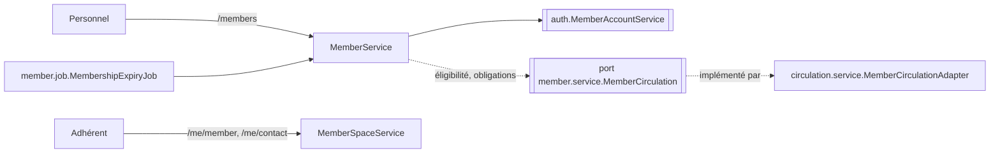

# ARCH — Adhérents et espace adhérent

## 1. Vue d'ensemble
Le module backend est `com.bibliotheque.member` (ADR-001). Côté frontend, la feature est `features/adherents` (ECR-16 → ECR-23). Il y a deux familles d'URL :
- **gestion** : `/api/v1/members/**`, pour LIBRARIAN et ADMIN ;
- **espace adhérent** : `/api/v1/me/**`, pour MEMBER, limité à l'adhérent rattaché au compte de la session (NFR-06).

**Dépendances entre modules (ADR-001)** :
- `member` → `auth` : création du compte `MEMBER` à l'inscription, e-mail porté par le compte (RG-14), désactivation à l'archivage (RG-18). Ces opérations passent par le nouveau service `auth.service.MemberAccountService`.
- `member` ↛ `circulation` : la fiche a besoin de l'éligibilité (RG-23) et des obligations (RG-18). Le module `member` déclare donc le port `member.service.MemberCirculation`, implémenté par `circulation`.
- `circulation` → `member` : le module `circulation` lit les adhérents par `member.service.MemberLookup` (numéro, statut, verrou de ligne, contacts).

**Périmètre** : US-016 → US-024. Les onglets « Emprunts », « Réservations », « Pénalités » et « Historique » d'ECR-18, ainsi que les listes d'ECR-22, sont servis par `circulation` (voir [ARCH-circulation.md](ARCH-circulation.md)).

## 2. Modèle de données
Aucune migration : la table `members` et la séquence `member_number_seq` existent déjà (V1).

**Mapping** :
- **`Member`** : entité JPA sur `members`, avec une version optimiste et l'énumération `MemberStatus` (`ACTIVE`, `EXPIRED`, `SUSPENDED`, `ARCHIVED`).
- **Numéro d'adhérent (RG-13)** : `SELECT NEXT VALUE FOR member_number_seq`, formaté en `A%06d`.
- **E-mail** : il n'est pas dans `members`. Il est porté par le compte `user_accounts` rattaché (`member_id`). Il est lu et écrit par `MemberAccountService`, normalisé en minuscules, et son unicité est garantie par `uk_user_accounts_email` (RG-14).
- **Recherche (US-017)** : requête JPQL paramétrée sur `Member` (nom, prénom) et sous-requête sur l'e-mail des comptes, via `MemberRepository.search`, avec `LIKE` échappé.

  Hypothèse Q-40 : la sous-requête lit `user_accounts` depuis `member`. C'est une lecture autorisée par la dépendance `member` → `auth`, faite par une sous-requête JPQL sur l'entité `UserAccount`.

  Un mot-clé au format `A` + 6 chiffres recherche le numéro exact, archivés compris (AC-017-4). Les autres recherches excluent les archivés.
- **Archivage (RG-18)** : nom, prénom, date de naissance, téléphone, rue, ville et représentant légal sont mis à `NULL`. `birth_year` et `postal_code` sont conservés, `archived_at` est rempli. Côté compte : `email = NULL` et statut `DISABLED`, les sessions sont révoquées. Le tout se fait dans une seule transaction.

## 3. Contrat d'API (extrait de openapi.yaml)
Tous les chemins sont préfixés par `/api/v1`. `{memberNumber}` respecte le motif `^A\d{6}$`.

| Méthode | Chemin | Rôles | Requête (DTO) | Réponse (DTO) | Codes | US |
|---|---|---|---|---|---|---|
| GET | `/members` | LIBRARIAN, ADMIN | `q` (≥ 2), `status`, `page`, `size`, `sort` (`lastName`, `memberNumber`, `expiryDate`) | 200 `PageResponse<MemberSummary>` | 400 | US-017 |
| POST | `/members` | LIBRARIAN, ADMIN | `MemberCreateRequest` | 201 `MemberDetail` + `Location` | 400, 409 `EMAIL_ALREADY_USED`, 409 `DUPLICATE_MEMBER_SUSPECTED` (+`existingMember`), 422 `GUARDIAN_REQUIRED`, 422 `PASSWORD_POLICY_VIOLATION` | US-016 |
| GET | `/members/{memberNumber}` | LIBRARIAN, ADMIN | — | 200 `MemberDetail` | 404 `MEMBER_NOT_FOUND` | US-018 |
| PUT | `/members/{memberNumber}` | LIBRARIAN, ADMIN | `MemberUpdateRequest` (+`version`) | 200 `MemberDetail` | 400, 404, 409 `EMAIL_ALREADY_USED`, 409 `MEMBER_ARCHIVED`, 409 `CONCURRENT_MODIFICATION`, 422 `GUARDIAN_REQUIRED` | US-019 |
| POST | `/members/{memberNumber}/renewal` | LIBRARIAN, ADMIN | — | 200 `MemberDetail` | 404, 409 `RENEWAL_TOO_EARLY` (+`renewableFrom`), 409 `MEMBER_SUSPENDED`, 409 `MEMBER_ARCHIVED` | US-020 |
| POST | `/members/{memberNumber}/suspension` | LIBRARIAN, ADMIN | `SuspendMemberRequest` | 200 `MemberDetail` | 400, 404, 409 `MEMBER_ARCHIVED` | US-021 |
| POST | `/members/{memberNumber}/reactivation` | LIBRARIAN, ADMIN | — | 200 `MemberDetail` | 404, 409 `MEMBER_ARCHIVED` | US-021 |
| GET | `/members/{memberNumber}/archive-check` | LIBRARIAN, ADMIN | — | 200 `ArchiveCheck` | 404 | US-022 |
| POST | `/members/{memberNumber}/archive` | LIBRARIAN, ADMIN | — | 200 `MemberDetail` | 404, 409 `ARCHIVE_BLOCKED` (+`reasons`) | US-022 |
| GET | `/members/to-archive` | LIBRARIAN, ADMIN | `page`, `size` | 200 `PageResponse<MemberToArchive>` | 400 | US-022 (AC-022-2) |
| GET | `/me/member` | MEMBER | — | 200 `MyMember` | — | US-023 |
| PUT | `/me/contact` | MEMBER | `ContactRequest` (+`version`) | 200 `MyMember` | 400, 409 `CONCURRENT_MODIFICATION` | US-024 |

**DTO principaux** (champs JSON) :
- `MemberSummary` : `memberNumber`, `lastName`, `firstName`, `birthDate`, `status`, `expiryDate`. Pour un archivé, les champs d'identité sont `null`.
- `MemberDetail` :
  - champs : `memberNumber`, `lastName`, `firstName`, `birthDate`, `email`, `phone`, `street`, `postalCode`, `city`, `guardian` (`lastName`, `firstName`, `phone` | `null`), `registrationDate`, `expiryDate`, `status`, `suspensionReason`, `accountId`, `accountStatus`, `version`, `activeReservations` ;
  - `eligibility` : `eligible`, `reasons[]`, `activeLoans`, `loanLimit`, `remainingLoans`, `unpaidTotal`, `fineThreshold` (RG-23) ;
  - `renewal` : `allowed`, `newExpiryDate`, `renewableFrom`, `blockedBy` (`RENEWAL_TOO_EARLY`, `MEMBER_SUSPENDED`, `MEMBER_ARCHIVED` ou `null`) (RG-15) ;
  - `expiresSoon` : vrai si l'expiration est dans `MEMBERSHIP_EARLY_RENEWAL_DAYS` jours au plus (AC-018-3).
- `MemberCreateRequest` :
  - champs : `lastName`, `firstName`, `birthDate`, `guardian?`, `email`, `phone?`, `street`, `postalCode`, `city`, `password` ;
  - `confirmDuplicate` (booléen) : à `true`, l'inscription est créée malgré l'avertissement d'homonyme (AC-016-7).
- `MemberUpdateRequest` : mêmes champs, sans `password` ni `confirmDuplicate`, avec `version`. Le numéro et la date d'inscription n'en font pas partie (AC-019-3).
- `SuspendMemberRequest` : `reason`, de 3 à 255 caractères (RG-17).
- `ArchiveCheck` : `archivable`, `reasons[]` (`ACTIVE_LOANS`, `ACTIVE_RESERVATIONS`, `UNPAID_FINES`), `activeLoans`, `activeReservations`, `unpaidTotal`.
- `MemberToArchive` : `memberNumber`, `lastName`, `firstName`, `expiryDate`, plus les champs d'`ArchiveCheck`.
- `MyMember` : `memberNumber`, `lastName`, `firstName`, `birthDate`, `email`, `phone`, `street`, `postalCode`, `city`, `status`, `expiryDate`, `version`.
- `ContactRequest` : `phone?`, `street`, `postalCode`, `city`, `version`. Aucun autre champ n'est accepté (AC-024-2) : une propriété inconnue, comme `lastName`, est refusée en 400 `VALIDATION_FAILED` (`fail-on-unknown-properties`).

**Validations DTO** :
- nom et prénom : 1 à 100 caractères ;
- e-mail : `@Email`, 254 caractères au plus ;
- téléphone (Q-24) : `^(0\d{9}|\+\d{8,15})$` après suppression des espaces ;
- code postal : `^\d{5}$` ;
- rue : 255 caractères au plus ; ville : 100 caractères au plus ;
- date de naissance : strictement passée, vérifiée par le service avec la `Clock`.

## 4. Règles de gestion → application
| RG | Point d'application | Code |
|---|---|---|
| RG-13 | `MemberNumberGenerator` (séquence), aucun DTO ne modifie le numéro | — |
| RG-14 | `MemberAccountService` : normalisation, `existsByEmail`, `uk_user_accounts_email` | `EMAIL_ALREADY_USED` |
| RG-15 | `MembershipPolicy` : expiration = jour + N mois à l'inscription ; renouvellement = max(jour, expiration) + N mois, possible à partir de expiration − `MEMBERSHIP_EARLY_RENEWAL_DAYS` | `RENEWAL_TOO_EARLY` (+`renewableFrom`) |
| RG-16 | `MembershipExpiryJob` (00 h 10) ; lecture : un `ACTIVE` dont l'expiration est passée est présenté `EXPIRED` (ADR-006 §3) | — |
| RG-17 | DTO `@Size(min = 3, max = 255)` ; SQL `ck_members_suspension_reason` | `VALIDATION_FAILED` |
| RG-18 | `MemberCirculation.obligations` puis effacement ; SQL `ck_members_identity`, `ck_members_archived` | `ARCHIVE_BLOCKED` (+`reasons`) |
| RG-19 (D1) | Liste « à archiver » : `EXPIRED` dont l'expiration date de plus de 3 ans | — |
| RG-20 | `MembershipPolicy.requiresGuardian(birthDate, today)` : âge < 15 ans révolus | `GUARDIAN_REQUIRED` |

**Homonyme (AC-016-7)** : à l'inscription, si `confirmDuplicate` vaut `false` et qu'un adhérent non archivé a les mêmes nom, prénom et date de naissance (comparaison sous la collation), l'inscription est refusée avec `DUPLICATE_MEMBER_SUSPECTED` et `existingMember` (`memberNumber`, `lastName`, `firstName`, `status`).

## 5. États et concurrence
| Transition | Condition | Protection |
|---|---|---|
| inscription → `ACTIVE` | RG-14, RG-20 | `uk_user_accounts_email` |
| `ACTIVE` → `EXPIRED` | Lendemain de l'expiration (job) | Mise à jour en masse idempotente |
| `EXPIRED` / `ACTIVE` → `ACTIVE` (renouvellement) | RG-15 | Verrou optimiste `members.version` |
| `ACTIVE` / `EXPIRED` → `SUSPENDED` | Motif RG-17 | idem |
| `SUSPENDED` → `ACTIVE` / `EXPIRED` | Selon l'expiration | idem |
| → `ARCHIVED` | Aucune obligation (RG-18) | Verrou pessimiste de la ligne `members`, partagé avec les opérations de circulation (ARCH-socle §5) |

## 6. Sécurité
- `/api/v1/members/**` : LIBRARIAN, ADMIN.
- `/api/v1/me/**` : MEMBER. L'adhérent est déduit de la session : compte → `member_id`. Aucun identifiant d'adhérent n'est accepté dans l'URL (AC-018-5, AC-023-4).
- **Journal d'audit** : inscription, modification (avant/après sur les champs modifiés), renouvellement, suspension, réactivation, archivage et changement de coordonnées par l'adhérent. Aucune donnée d'identité n'est écrite dans l'objet de référence : l'entrée porte le numéro d'adhérent.

## 7. Plan d'implémentation
1. `auth` :
   - `UserAccount.member(...)`, `changeEmail`, `anonymize` ;
   - `MemberAccountService` : `create`, `changeEmail`, `archive`, `accountsOf`, `memberIdOf`.
2. `member.domain` : `Member`, `MemberStatus`, `Guardian` (embarqué).
3. `member.repository` : `MemberRepository` (recherche, verrou `PESSIMISTIC_WRITE`, à archiver), `MemberNumberGenerator`.
4. `member.service` :
   - `MembershipPolicy`, `MemberService`, `MemberSpaceService` ;
   - `MemberLookup` (pour `circulation`), `MemberCirculation` (port), vues `MemberViews`.
5. `member.job` : `MembershipExpiryJob` (cron `app.jobs.membership-expiry`).
6. `member.web` : `MemberController`, `MemberSpaceController`, `MemberRequests`.
7. Frontend `features/adherents` : ECR-16 → ECR-23 selon UX-adherents §4.

## 8. Stratégie de test
- **Unitaires** : `MembershipPolicyTest` (RG-15, RG-20, bornes AC-016-4 et AC-020-1/2/3), `MemberServiceTest` (inscription, homonyme, e-mail, suspension, réactivation selon l'expiration, archivage bloqué ou réussi), `MemberControllerTest` (droits, validation).
- **QA** : unicité concurrente de l'e-mail, archivage concurrent d'un emprunt (verrou de ligne).

## 9. ADR créés / impactés
Aucun nouvel ADR. ADR-001 est appliqué tel quel : port `MemberCirculation`, dépendance `member` → `auth`.

## 10. Questions ouvertes
| ID | Question | Hypothèse retenue | Impact si faux |
|---|---|---|---|
| Q-40 | La recherche par e-mail lit `user_accounts` depuis le module `member` | Sous-requête JPQL en lecture seule sur `UserAccount`, autorisée par la dépendance `member` → `auth` | Exposer une recherche d'identifiants par e-mail dans `MemberAccountService` |
