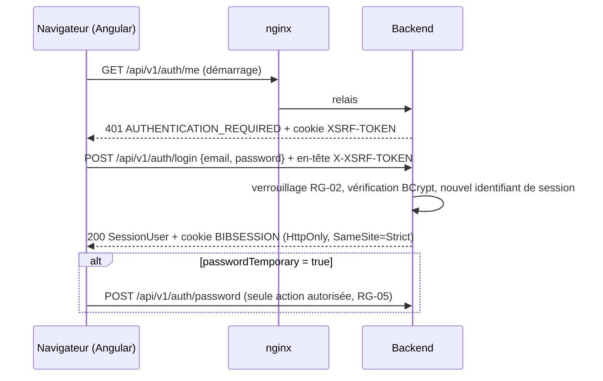

# ARCH — Authentification et comptes utilisateurs

## 1. Vue d'ensemble
Module backend `com.bibliotheque.auth` (ADR-001) et socle `common.security` (ADR-004). Frontend : `core/auth` (session, guards) et `features/authentification` (ECR-03 → ECR-07).

## 2. Modèle de données
Aucune migration nouvelle : tables `user_accounts` et `password_history_entries` créées par `V1__schema_initial.sql` (ARCH-socle §2). Les adhérents n'ont ni nom ni prénom dans `user_accounts` : le module `auth` les obtient du module `member` par l'interface `auth.service.MemberDirectory` (ADR-001 §3), implémentée par `member.repository.MemberDirectoryJdbcAdapter`.

## 3. Contrat d'API (extrait de openapi.yaml)
| Méthode | Chemin | Rôles | Requête (DTO) | Réponse (DTO) | Codes | US |
|---|---|---|---|---|---|---|
| POST | `/auth/login` | public | `LoginRequest` | 200 `SessionUserResponse` | 400 `VALIDATION_FAILED` · 401 `INVALID_CREDENTIALS`, `ACCOUNT_LOCKED`, `ACCOUNT_DISABLED` · 403 `CSRF_TOKEN_INVALID` | US-001 |
| POST | `/auth/logout` | authentifié | — | 204 | 401 | US-002 |
| GET | `/auth/me` | authentifié | — | 200 `SessionUserResponse` | 401 `AUTHENTICATION_REQUIRED` | US-001 (AC-001-7, AC-001-8) |
| POST | `/auth/password` | authentifié | `ChangePasswordRequest` | 204 | 400 · 422 `CURRENT_PASSWORD_INCORRECT`, `PASSWORD_POLICY_VIOLATION`, `PASSWORD_RECENTLY_USED` | US-003 |
| GET | `/staff-accounts` | ADMIN | `q`, `role`, `status`, `page`, `size`, `sort` | 200 `PageResponse<StaffAccountResponse>` | 400 · 403 | US-004, US-005 |
| POST | `/staff-accounts` | ADMIN | `CreateStaffAccountRequest` | 201 `StaffAccountResponse` + `Location` | 400 · 403 · 409 `EMAIL_ALREADY_USED` · 422 `ROLE_NOT_ALLOWED`, `PASSWORD_POLICY_VIOLATION` | US-004 |
| GET | `/staff-accounts/{id}` | ADMIN | — | 200 `StaffAccountResponse` | 403 · 404 `ACCOUNT_NOT_FOUND` | US-004 (cible de l'en-tête `Location`) |
| POST | `/staff-accounts/{id}/deactivation` | ADMIN | — | 200 `StaffAccountResponse` | 403 · 404 `ACCOUNT_NOT_FOUND` · 409 `SELF_DEACTIVATION_FORBIDDEN`, `LAST_ADMIN_REQUIRED` | US-005 |
| POST | `/staff-accounts/{id}/reactivation` | ADMIN | — | 200 `StaffAccountResponse` | 403 · 404 | US-005 |
| POST | `/accounts/{id}/password-reset` | LIBRARIAN, ADMIN | `PasswordResetRequest` | 204 | 400 · 403 `ACCESS_DENIED` · 404 · 409 `ACCOUNT_DISABLED` · 422 `PASSWORD_POLICY_VIOLATION` | US-006 |

Tous les chemins sont préfixés par `/api/v1`. Le contrôle de la politique de mot de passe (RG-01) est fait **par le service** (422 `PASSWORD_POLICY_VIOLATION`, propriété `field`) et non par Bean Validation, conformément à ARCH-socle §4.

### DTO
| DTO (record) | Champ | Type Java | Contraintes Bean Validation |
|---|---|---|---|
| `LoginRequest` | `email` | `String` | `@NotBlank @Email @Size(max = 254)` |
| | `password` | `String` | `@NotBlank @Size(max = 128)` |
| `SessionUserResponse` | `accountId` | `Long` | — |
| | `email` | `String` | — |
| | `role` | `AccountRole` | — |
| | `lastName`, `firstName` | `String` | — (pour un adhérent : nom de la fiche adhérent) |
| | `passwordTemporary` | `boolean` | — |
| | `memberNumber` | `String` | — (`null` sauf `MEMBER`) |
| `ChangePasswordRequest` | `currentPassword` | `String` | `@NotBlank @Size(max = 128)` |
| | `newPassword` | `String` | `@NotBlank @Size(max = 128)` |
| `StaffAccountResponse` | `id` | `Long` | — |
| | `lastName`, `firstName`, `email` | `String` | — |
| | `role` | `AccountRole` | — |
| | `status` | `AccountStatus` | — |
| | `me` | `boolean` | — (compte de l'administrateur connecté) |
| | `version` | `Integer` | — |
| `CreateStaffAccountRequest` | `lastName`, `firstName` | `String` | `@NotBlank @Size(max = 100)` |
| | `email` | `String` | `@NotBlank @Email @Size(max = 254)` |
| | `role` | `AccountRole` | `@NotNull` |
| | `initialPassword` | `String` | `@NotBlank @Size(max = 128)` |
| `PasswordResetRequest` | `newPassword` | `String` | `@NotBlank @Size(max = 128)` |

Propriétés de `ProblemDetail` : `ACCOUNT_LOCKED` → `lockedUntil` (instant ISO 8601) ; `PASSWORD_POLICY_VIOLATION` → `field` (`newPassword`, `initialPassword`) ; `VALIDATION_FAILED` → `fieldErrors`.

**Filtres et tri de `/staff-accounts`** : `q` (≥ 2 caractères, sur nom, prénom, e-mail ; caractères `%` et `_` neutralisés), `role` ∈ {`LIBRARIAN`, `ADMIN`}, `status` ∈ {`ACTIVE`, `LOCKED`, `DISABLED`} ; tri autorisé `lastName` (défaut, croissant), `role`, `status` ; taille 20 par défaut, 100 au maximum.

**Codes transverses ajoutés au catalogue** (`openapi.yaml`) : `CSRF_TOKEN_INVALID` (403, jeton CSRF absent ou invalide : le frontend recharge `/auth/me` puis rejoue la requête une fois), `ROUTE_NOT_FOUND` (404, chemin inconnu **à l'intérieur d'une famille d'URL autorisée**, ex. `/api/v1/auth/inconnu`), `REQUEST_NOT_SUPPORTED` (405/406/415). Un chemin hors des familles déclarées dans la chaîne de sécurité reçoit 401 `AUTHENTICATION_REQUIRED` (anonyme) ou 403 `ACCESS_DENIED` (connecté) : refus par défaut, pour qu'un endpoint oublié dans la configuration ne soit jamais exposé.

## 4. Règles de gestion → application
| RG | Point d'application | Code d'erreur | HTTP |
|---|---|---|---|
| RG-01 | `auth.service.PasswordPolicy` (≥ 12 caractères, 1 majuscule, 1 minuscule, 1 chiffre) ; `PasswordService` compare aux 3 dernières empreintes (`password_history_entries`, les plus anciennes sont supprimées) | `PASSWORD_POLICY_VIOLATION` ; `PASSWORD_RECENTLY_USED` | 422 |
| RG-02 | `AuthenticationService.login` : 5 échecs consécutifs → `LOCKED` pendant 15 min (`app.security.login.*`) ; un verrou échu est levé à la tentative suivante (compteur remis à 0) ; e-mail inconnu : calcul BCrypt factice (temps constant) | `INVALID_CREDENTIALS` ; `ACCOUNT_LOCKED` ; `ACCOUNT_DISABLED` (seulement si le mot de passe est correct) | 401 |
| RG-03 | `server.servlet.session.timeout=30m` | `AUTHENTICATION_REQUIRED` | 401 |
| RG-04 | `StaffAccountService.create` refuse `MEMBER` ; SQL `ck_user_accounts_member_link` | `ROLE_NOT_ALLOWED` | 422 |
| RG-05 | `common.security.PasswordChangeRequiredFilter` ; création et réinitialisation posent `password_temporary = true`, le changement le remet à `false` et met à jour la session | `PASSWORD_CHANGE_REQUIRED` | 403 |
| RG-06 | Règle d'URL `/staff-accounts/**` = ADMIN ; `StaffAccountService.deactivate` : soi-même interdit, comptes ADMIN non désactivés lus `FOR UPDATE` puis comptés ; `AccountPasswordResetService` : un LIBRARIAN ne réinitialise qu'un compte `MEMBER` | `SELF_DEACTIVATION_FORBIDDEN` ; `LAST_ADMIN_REQUIRED` ; `ACCESS_DENIED` | 409 ; 403 |
| RG-14 | E-mail normalisé (`trim`, minuscules) ; SQL `uk_user_accounts_email` ; violation concurrente traduite en `EMAIL_ALREADY_USED` | `EMAIL_ALREADY_USED` | 409 |

## 5. États et concurrence
| Entité | Transition | Condition | Endpoint | Protection concurrence |
|---|---|---|---|---|
| Compte | `ACTIVE` → `LOCKED` | 5ᵉ échec consécutif | `POST /auth/login` | Verrou optimiste `version` (les échecs simultanés perdants sont rejoués une fois) |
| Compte | `LOCKED` → `ACTIVE` | Verrou échu (à la tentative suivante) ou réinitialisation | `POST /auth/login`, `POST /accounts/{id}/password-reset` | Verrou optimiste |
| Compte | `ACTIVE`/`LOCKED` → `DISABLED` | RG-06 | `POST /staff-accounts/{id}/deactivation` | `SELECT … FOR UPDATE` des comptes ADMIN ; **suppression de toutes les sessions du compte** (AC-005-1) |
| Compte | `DISABLED` → `ACTIVE` | — | `POST /staff-accounts/{id}/reactivation` | Verrou optimiste ; compteur d'échecs remis à 0 (AC-005-2) |

## 6. Sécurité
| Endpoint | Rôles | Règle d'appartenance | Données sensibles |
|---|---|---|---|
| `POST /auth/login` | public | — | Mot de passe jamais journalisé ; l'e-mail d'une tentative échouée sur un compte inconnu n'est pas journalisé |
| `/auth/me`, `/auth/logout`, `/auth/password` | authentifié (y compris mot de passe temporaire) | Soi-même | — |
| `/staff-accounts/**` | ADMIN | — | — |
| `/accounts/{id}/password-reset` | LIBRARIAN, ADMIN | LIBRARIAN : compte `MEMBER` uniquement | Nouveau mot de passe jamais journalisé ; sessions du compte supprimées |

Journal d'audit (NFR-08) : `LOGIN_SUCCESS`, `LOGIN_FAILURE`, `LOGOUT`, `STATE_CHANGE` (verrouillage, désactivation, réactivation), `CREATE` (compte), `UPDATE` (changement ou réinitialisation de mot de passe, détail `{"field":"password"}` sans valeur).

## 7. Plan d'implémentation
### Backend (chemins exacts, sous `backend/src/main/java/com/bibliotheque/`)
- `common/config/` : `ClockConfig`, `AppProperties`, `SchedulingConfig`, `JacksonConfig`
- `common/exception/` : `ErrorCode`, `BusinessException`, `GlobalExceptionHandler`, `ProblemDetails`
- `common/web/` : `PageResponse`, `PageRequests`, `LikePatterns`
- `common/security/` : `SecurityConfig`, `AccountPrincipal`, `CurrentUser`, `CsrfCookieFilter`, `SpaCsrfTokenRequestHandler`, `PasswordChangeRequiredFilter`, `ProblemDetailAuthenticationEntryPoint`, `ProblemDetailAccessDeniedHandler`, `SessionRevoker`, `SecuritySessionManager`
- `common/audit/` : `AuditAction`, `AuditObjectType`, `AuditEntry`, `AuditEntryRepository`, `AuditService`, `AuditPurgeJob`
- `common/settings/` : `SettingCode`, `Setting`, `SettingRepository`, `SettingsService`
- `auth/domain/` : `AccountRole`, `AccountStatus`, `UserAccount`, `PasswordHistoryEntry`
- `auth/repository/` : `UserAccountRepository`, `PasswordHistoryEntryRepository`
- `auth/service/` : `MemberDirectory`, `PasswordPolicy`, `PasswordService`, `AuthenticationService`, `SessionUserService`, `StaffAccountService`, `AccountPasswordResetService`, `BootstrapAdminInitializer`, `AccountLabels`
- `auth/web/` : `AuthController`, `StaffAccountController`, `AccountController`, DTO (`LoginRequest`, `SessionUserResponse`, `ChangePasswordRequest`, `StaffAccountResponse`, `CreateStaffAccountRequest`, `PasswordResetRequest`)
- `member/repository/MemberDirectoryJdbcAdapter`

### Frontend (chemins exacts, sous `frontend/src/app/`)
- `core/auth/` : `auth.service.ts`, `session-idle.service.ts`, `auth.guard.ts`, `role.guard.ts`, `password-change.guard.ts`, `guest.guard.ts`, `session-user.model.ts`
- `core/http/` : `api-error.ts`, `problem-detail.interceptor.ts`, `session-activity.interceptor.ts`
- `core/layout/` : `public-layout`, `member-layout`, `staff-layout`, `app-header`, `app-staff-sidebar`, `app-user-menu`, `session-expiry-dialog`
- `core/errors/` : `not-found.page.ts` (ECR-01), `forbidden.page.ts` (ECR-02)
- `core/notifications/toast.service.ts`
- `shared/ui/` : composants de UX-socle §5.3 utilisés par ces écrans
- `shared/validators/password-policy.validator.ts`, `shared/pipes/`, `shared/models/statuses.ts`
- `features/authentification/` : pages ECR-03, ECR-04, ECR-05 ; composants `login-form`, `password-form`, `password-policy-checklist`, `staff-account-table`, `staff-account-form-dialog` (ECR-06), `reset-password-dialog` (ECR-07) ; `data-access/auth-api.service.ts`, `staff-account.service.ts`, `account.models.ts`, `auth-messages.ts`

### Build / Docker / Config
- Aucune nouvelle dépendance backend.
- Frontend : Angular 22, Tailwind CSS 3.4, Cypress (devDependency, ADR-005). `frontend/Dockerfile` : `CYPRESS_INSTALL_BINARY=0` à l'étape de construction (le binaire Cypress est inutile dans l'image).

## 8. Stratégie de test recommandée
| Niveau | Cible | Outil |
|---|---|---|
| Unitaire | `PasswordPolicy`, `PasswordService`, `AuthenticationService` (verrouillage avec `Clock` fixe), `StaffAccountService` (soi-même, dernier admin), `AccountPasswordResetService` | JUnit 5, Mockito, AssertJ |
| Contrôleur | Codes HTTP, `code` des ProblemDetail, rôles, CSRF, filtre RG-05 | `@WebMvcTest` + spring-security-test |
| Intégration | Connexion réelle, session en base, révocation des sessions à la désactivation | Testcontainers (QA) |
| E2E | ECR-03 → ECR-07 | Cypress (QA) |

## 9. ADR créés / impactés
Aucun nouvel ADR. Applique ADR-001 (port `MemberDirectory`), ADR-003, ADR-004.

## 10. Questions ouvertes
| ID | Question | Hypothèse retenue | Impact |
|---|---|---|---|
| Q-31 | RG-06 exige « au moins 1 ADMIN ACTIVE » : un ADMIN temporairement `LOCKED` compte-t-il ? | Oui : on compte les ADMIN non `DISABLED` (le verrou est temporaire, RG-02) | Si non : un ADMIN verrouillé ne protège plus la règle |
