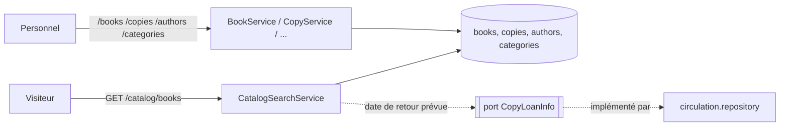

# ARCH — Catalogue et exemplaires

## 1. Vue d'ensemble
Module backend `com.bibliotheque.catalog` (ADR-001), frontend `features/catalogue` (ECR-08 → ECR-15). Deux familles d'URL :
- **publique** `/api/v1/catalog/**` (lecture seule, visiteurs compris, RG-11, jamais de donnée d'emprunteur) ;
- **gestion** `/api/v1/books/**`, `/authors/**`, `/categories/**`, `/copies/**` (LIBRARIAN, ADMIN).

Le catalogue devient l'accueil public de l'application (`/` → `/catalogue`), ce qui lève en partie Q-33.

**Périmètre de cette itération** : US-007 → US-014. Reportés, avec leur feature :
| Élément | Reporté vers | Raison |
|---|---|---|
| US-015 (pré-remplissage ISBN, COULD) | itération ultérieure du catalogue | Source externe non choisie (Q-04) |
| ECR-09 : bouton « Réserver », position dans la file | feature reservations | Dépend de l'API de réservation |
| ECR-12 : « Déclarer retrouvé » (ECR-28), « Historique » (ECR-29), « Réserver pour un adhérent » (ECR-31), file d'attente (ECR-32) | features emprunts, reservations | Dépendent de la circulation |
| AC-012-2 (exemplaire ajouté mis de côté pour une réservation) | feature reservations | Aucune réservation ne peut exister avant cette feature : tout exemplaire ajouté est `AVAILABLE` |

## 2. Modèle de données
Aucune migration : tables `books`, `book_authors`, `book_categories`, `authors`, `categories`, `copies`, `languages` et séquence `copy_number_seq` créées par V1/V2 (ARCH-socle §2).

**Mapping JPA** :
- `Book.authors` : `@ManyToMany List<Author>` sur `book_authors`, `@OrderColumn(name = "author_order") @ListIndexBase(1)`. Lors d'une modification, la liste est vidée et écrite (`flush`) avant d'être recréée, pour ne jamais violer `uk_book_authors_book_order` pendant un réordonnancement.
- `Book.categories` : `@ManyToMany Set<Category>` sur `book_categories`.
- `Book.language` : `@ManyToOne Language` (`language_code`).
- Colonnes `CHAR(n)` (`isbn`, `copy_number`, `languages.code`) : `columnDefinition = "char(n)"` (validation Hibernate).
- `hibernate.default_batch_fetch_size = 50` : auteurs et catégories d'une page chargés en une requête par collection (pas de N+1).
- Numéro d'exemplaire : `SELECT NEXT VALUE FOR copy_number_seq` formaté sur 8 chiffres (RG-09).

**Recherche (RG-11)** : `Specification` JPA (critères paramétrés, aucune concaténation SQL). Le mot-clé est découpé en mots (5 au maximum) : **chaque mot** doit apparaître dans le titre, le sous-titre, le nom ou le prénom d'un auteur (`LIKE` échappé, collation insensible à la casse et aux accents). Ainsi « monte cristo » trouve « Monte-Cristo » (AC-007-1) et « emile zola » trouve « Émile Zola » (AC-007-2). Si le mot-clé, sans tirets ni espaces, est un ISBN-10 ou un ISBN-13 valide, la notice d'ISBN correspondant (normalisé en ISBN-13) est aussi trouvée (AC-007-3). Tri par pertinence (titre commençant par le premier mot, puis titre) si un mot-clé est saisi, sinon par titre.

**Compteurs** : disponibles = exemplaires `AVAILABLE` ; total = exemplaires hors `WITHDRAWN` et `LOST` (RG-11) ; calculés pour toute une page en une seule requête groupée.

**Date de retour prévue** (AC-008-1) : le catalogue la lit à travers le port `catalog.service.CopyLoanInfo` (« date de retour prévue de l'emprunt en cours de ces exemplaires »), implémenté par `circulation.repository.CopyLoanInfoJdbcAdapter` sur la table `loans` (ADR-001 §3, `circulation` → `catalog` autorisé).

## 3. Contrat d'API (extrait de openapi.yaml)
Tous les chemins sont préfixés par `/api/v1`.
| Méthode | Chemin | Rôles | Requête (DTO) | Réponse (DTO) | Codes | US |
|---|---|---|---|---|---|---|
| GET | `/catalog/books` | public | `q`, `categoryId`, `language`, `available`, `page`, `size`, `sort` | 200 `PageResponse<BookSearchItem>` | 400 | US-007 |
| GET | `/catalog/books/{id}` | public | — | 200 `BookPublicDetail` | 404 `BOOK_NOT_FOUND` | US-008 |
| GET | `/catalog/categories` | public | — | 200 `CategoryOption[]` | — | US-007 |
| GET | `/catalog/languages` | public | — | 200 `LanguageOption[]` | — | US-007, US-009 |
| GET | `/books` | LIBRARIAN, ADMIN | `q`, `categoryId`, `includeWithdrawn`, `page`, `size`, `sort` | 200 `PageResponse<BookAdminItem>` | 400 | US-007 (AC-007-7), US-009 |
| GET | `/books/{id}` | LIBRARIAN, ADMIN | — | 200 `BookAdminDetail` | 404 | US-008 (AC-008-2), US-010 |
| POST | `/books` | LIBRARIAN, ADMIN | `BookRequest` | 201 `BookAdminDetail` + `Location` | 400 · 404 `AUTHOR_NOT_FOUND`, `CATEGORY_NOT_FOUND` · 409 `ISBN_ALREADY_EXISTS` · 422 `ISBN_INVALID` | US-009 |
| PUT | `/books/{id}` | LIBRARIAN, ADMIN | `BookRequest` (avec `version`) | 200 `BookAdminDetail` | idem + 404 `BOOK_NOT_FOUND` · 409 `CONCURRENT_MODIFICATION` | US-010 |
| DELETE | `/books/{id}` | LIBRARIAN, ADMIN | — | 204 | 404 · 409 `BOOK_HAS_COPIES` | US-011 |
| GET | `/authors` | LIBRARIAN, ADMIN | `q` (≥ 2) | 200 `AuthorResponse[]` (10 au plus) | 400 | US-009 |
| POST | `/authors` | LIBRARIAN, ADMIN | `AuthorRequest` | 201 `AuthorResponse` | 400 | US-009 (AC-009-2) |
| POST | `/books/{id}/copies` | LIBRARIAN, ADMIN | `AddCopiesRequest` | 201 `CopyResponse[]` | 400 · 404 | US-012 |
| PUT | `/copies/{copyNumber}` | LIBRARIAN, ADMIN | `UpdateCopyRequest` | 200 `CopyResponse` | 400 · 404 `COPY_NOT_FOUND` · 409 `COPY_WITHDRAWN`, `CONCURRENT_MODIFICATION` | US-013 |
| POST | `/copies/{copyNumber}/withdrawal` | LIBRARIAN, ADMIN | `WithdrawCopyRequest` | 200 `CopyResponse` | 400 · 404 · 409 `COPY_IN_CIRCULATION`, `COPY_WITHDRAWN` | US-013 |
| GET | `/categories` | LIBRARIAN, ADMIN | `page`, `size`, `sort` | 200 `PageResponse<CategoryResponse>` | 400 | US-014 |
| POST | `/categories` | LIBRARIAN, ADMIN | `CategoryRequest` | 201 `CategoryResponse` | 400 · 409 `CATEGORY_ALREADY_EXISTS` | US-014 |
| PUT | `/categories/{id}` | LIBRARIAN, ADMIN | `CategoryRequest` (avec `version`) | 200 `CategoryResponse` | 400 · 404 · 409 `CATEGORY_ALREADY_EXISTS`, `CONCURRENT_MODIFICATION` | US-014 |
| DELETE | `/categories/{id}` | LIBRARIAN, ADMIN | — | 204 | 404 · 409 `CATEGORY_IN_USE` (+`bookCount`) | US-014 |

**Paramètres** : `q` 2-100 caractères ; `sort` public ∈ {`title,asc`, `publicationYear,desc`} (absent = pertinence) ; `sort` gestion ∈ {`title,asc|desc`, `publicationYear,asc|desc`} ; `sort` catégories ∈ {`label,asc|desc`} ; pagination ADR-003 §5.

### DTO
| DTO (record) | Champ | Type Java | Contraintes Bean Validation |
|---|---|---|---|
| `BookRequest` | `isbn` | `String` | `@Size(max = 20)` (format vérifié par le service, RG-07) |
| | `title` | `String` | `@NotBlank @Size(max = 255)` |
| | `subtitle` | `String` | `@Size(max = 255)` |
| | `authorIds` | `List<Long>` | `@NotEmpty` (ordre = ordre d'affichage) |
| | `categoryIds` | `Set<Long>` | `@NotEmpty` |
| | `publisher` | `String` | `@Size(max = 150)` |
| | `publicationYear` | `Integer` | `@Min(1450)` ; ≤ année en cours vérifié par le service |
| | `languageCode` | `String` | `@NotBlank @Size(min = 3, max = 3)` |
| | `pageCount` | `Integer` | `@Positive` |
| | `summary` | `String` | `@Size(max = 4000)` |
| | `version` | `Integer` | requis en modification |
| `AuthorRequest` | `lastName` / `firstName` | `String` | `@NotBlank @Size(max = 100)` / `@Size(max = 100)` |
| `AddCopiesRequest` | `quantity` | `int` | `@Min(1) @Max(20)` (Q-23) |
| | `shelfMark` | `String` | `@NotBlank @Size(max = 30)` |
| | `physicalCondition` | `PhysicalCondition` | `@NotNull` |
| | `acquisitionDate` | `LocalDate` | `@NotNull` ; ≤ date du jour vérifié par le service |
| `UpdateCopyRequest` | `shelfMark`, `physicalCondition`, `version` | | `@NotBlank @Size(max = 30)`, `@NotNull`, `@NotNull` |
| `WithdrawCopyRequest` | `reason` | `WithdrawalReason` | `@NotNull` |
| `CategoryRequest` | `label` | `String` | `@NotBlank` ; 2-50 caractères après `trim` vérifié par le service (RG-12) |
| | `version` | `Integer` | requis en modification |
| `BookSearchItem` | `id`, `title`, `subtitle`, `authors[]`, `publicationYear`, `categories[]`, `availableCount`, `totalCount` | | — |
| `BookPublicDetail` | champs de la notice, `language {code,label}`, `copies[] {shelfMark, status, dueDate}`, `availableCount`, `totalCount` | | exemplaires hors `WITHDRAWN`, aucun numéro d'exemplaire ni emprunteur |
| `BookAdminItem` | `id`, `title`, `authors[]`, `isbn`, `publicationYear`, `availableCount`, `totalCount`, `copyCount`, `withdrawn` | | `withdrawn` = au moins 1 exemplaire et tous retirés |
| `BookAdminDetail` | notice complète + `version` + `copies[] (CopyResponse)` | | — |
| `CopyResponse` | `id`, `copyNumber`, `shelfMark`, `physicalCondition`, `acquisitionDate`, `status`, `withdrawalReason`, `dueDate`, `version` | | — |
| `CategoryResponse` | `id`, `label`, `bookCount`, `version` | | — |

## 4. Règles de gestion → application
| RG | Point d'application | Code d'erreur | HTTP |
|---|---|---|---|
| RG-07 | `catalog.service.Isbn` (clé ISBN-10/13, conversion en ISBN-13, tirets et espaces ignorés) ; SQL `ck_books_isbn`, `uk_books_isbn` ; contrainte traduite par le gestionnaire d'exceptions | `ISBN_INVALID` (`field`) ; `ISBN_ALREADY_EXISTS` (+`existingBook {id, title}`) | 422 ; 409 |
| RG-08 | DTO ; service : année ≤ année en cours (`BusinessTime`), auteurs et catégories existants, langue existante ; SQL `ck_books_*` | `VALIDATION_FAILED` (+`fieldErrors`) ; `AUTHOR_NOT_FOUND` ; `CATEGORY_NOT_FOUND` | 400 ; 404 |
| RG-09 | `CopyNumberGenerator` (séquence) ; aucun DTO ne modifie le numéro ; SQL `uk_copies_copy_number`, `ck_copies_copy_number` | — | — |
| RG-10 | `BookService.delete` (aucun exemplaire, quel que soit son statut) ; `Copy.withdraw` (depuis `AVAILABLE` ou `LOST`, motif obligatoire) ; un exemplaire retiré n'est plus modifiable ; SQL `fk_copies_book` (RESTRICT), `ck_copies_withdrawal` | `BOOK_HAS_COPIES` ; `COPY_IN_CIRCULATION` ; `COPY_WITHDRAWN` | 409 |
| RG-11 | `BookSpecifications` (§2) ; visibilité publique : au moins 1 exemplaire hors `WITHDRAWN` (sinon 404 sur la fiche) | `VALIDATION_FAILED` (`q` < 2) ; `BOOK_NOT_FOUND` | 400 ; 404 |
| RG-12 | `CategoryService` : `trim`, 2-50 caractères, unicité par la collation (`existsByLabel…`), suppression refusée si utilisée ; SQL `uk_categories_label`, `ck_categories_label`, `fk_book_categories_category` | `VALIDATION_FAILED` ; `CATEGORY_ALREADY_EXISTS` ; `CATEGORY_IN_USE` (+`bookCount`) | 400 ; 409 |

Ajouts au gestionnaire d'exceptions (contraintes uniques) : `uk_books_isbn` → `ISBN_ALREADY_EXISTS`, `uk_categories_label` → `CATEGORY_ALREADY_EXISTS`.

## 5. États et concurrence
| Entité | Transition | Condition | Endpoint | Protection concurrence |
|---|---|---|---|---|
| Exemplaire | création → `AVAILABLE` | — | `POST /books/{id}/copies` | Séquence (numéros uniques) |
| Exemplaire | `AVAILABLE`/`LOST` → `WITHDRAWN` | Motif (RG-10) | `POST /copies/{n}/withdrawal` | Verrou optimiste `copies.version` (un emprunt simultané ne peut pas passer) |
| Notice | modification | — | `PUT /books/{id}` | `version` envoyée par le client → 409 `CONCURRENT_MODIFICATION` (AC-010-3) |
| Catégorie | renommage | — | `PUT /categories/{id}` | `version` |

## 6. Sécurité
| Endpoint | Rôles | Règle d'appartenance | Données sensibles |
|---|---|---|---|
| `GET /catalog/**` | public | — | Jamais de numéro d'exemplaire, d'emprunteur ni d'exemplaire retiré (AC-008-1) |
| `/books/**`, `/authors/**`, `/categories/**`, `/copies/**` | LIBRARIAN, ADMIN | — | — |

Journal d'audit (NFR-08) : `CREATE`/`UPDATE`/`DELETE` de notice, auteur, catégorie ; `CREATE`/`UPDATE` d'exemplaire ; `STATE_CHANGE` au retrait. L'auteur est résolu par `common.audit.ActorLabelResolver`, implémenté par le module `auth` (le catalogue ne dépend pas de `auth`, ADR-001).

## 7. Plan d'implémentation
### Backend (`backend/src/main/java/com/bibliotheque/`)
- `common/audit/ActorLabelResolver.java` (port) ; `AuditService.recordAs(...)` ; `auth/service/AccountActorLabelResolver.java` (implémentation)
- `catalog/domain/` : `Book`, `Author`, `Category`, `Copy`, `Language`, `CopyStatus`, `PhysicalCondition`, `WithdrawalReason`
- `catalog/repository/` : `BookRepository` (+ `JpaSpecificationExecutor`), `BookSpecifications`, `AuthorRepository`, `CategoryRepository`, `CopyRepository` (compteurs groupés), `LanguageRepository`, `CopyNumberGenerator`
- `catalog/service/` : `Isbn`, `CatalogSearchService`, `BookService`, `AuthorService`, `CategoryService`, `CopyService`, `CopyLoanInfo` (port), vues (records)
- `catalog/web/` : `CatalogController` (public), `BookController`, `AuthorController`, `CategoryController`, `CopyController`, DTO
- `circulation/repository/CopyLoanInfoJdbcAdapter.java`
- `common/exception/GlobalExceptionHandler` : 2 contraintes uniques ajoutées ; `common/security/SecurityConfig` : 2 familles d'URL ; `application.yml` : `default_batch_fetch_size`
### Frontend (`frontend/src/app/`)
- `features/catalogue/data-access/` : `catalog-search.service.ts`, `book.service.ts`, `author.service.ts`, `category.service.ts`, `copy.service.ts`, `catalog.models.ts`, `catalog-messages.ts`
- `features/catalogue/pages/` : ECR-08 `catalog-search.page.ts`, ECR-09 `book-public-detail.page.ts`, ECR-10 `catalog-admin.page.ts`, ECR-11 `book-form.page.ts`, ECR-12 `book-admin-detail.page.ts`, ECR-15 `categories.page.ts`
- `features/catalogue/components/` : `availability-badge`, `book-result-card`, `book-summary`, `public-copy-list`, `book-admin-table`, `book-form`, `author-picker`, `category-picker`, `copy-admin-table`, `add-copies-dialog` (ECR-13), `copy-edit-dialog` (ECR-14), `category-table`
- `shared/validators/isbn.validator.ts`, `shared/pipes/date-fr.pipe.ts`, statuts d'exemplaire dans `shared/models/statuses.ts`
- Routes : `/` → `/catalogue` ; menu du personnel : « Catalogue », « Catégories » ; la déconnexion mène au catalogue (Q-33)
### Build / Docker / Config
Aucun changement.

## 8. Stratégie de test recommandée
| Niveau | Cible | Outil |
|---|---|---|
| Unitaire | `Isbn` (clés, conversion), services (RG-08, RG-10, RG-12, audit), recherche (découpage en mots) | JUnit 5, Mockito |
| Contrôleur | Public sans session, gestion refusée à un MEMBER, codes d'erreur | `@WebMvcTest` |
| Intégration | Recherche réelle (accents, tirets, ISBN, visibilité), contraintes, verrou optimiste | Testcontainers (QA) |
| E2E | ECR-08 → ECR-15 | Cypress (QA) |

## 9. ADR créés / impactés
Aucun nouvel ADR. Applique ADR-001 (ports `CopyLoanInfo` et `ActorLabelResolver`), ADR-002 §9 (recherche par `LIKE` en collation insensible), ADR-003.

## 10. Questions ouvertes
| ID | Question | Hypothèse retenue | Impact |
|---|---|---|---|
| Q-37 | UX ECR-10 propose aussi le tri par nombre d'exemplaires | Tri par titre et par année seulement dans cette itération (le tri par agrégat demande une requête dédiée) | Ajout ultérieur sans changement de contrat (nouvelle valeur de `sort`) |
| Q-38 | Fonctions de circulation et de réservation présentes dans ECR-09 et ECR-12 | Reportées avec les features emprunts et reservations (§1) | Écrans complétés plus tard |
