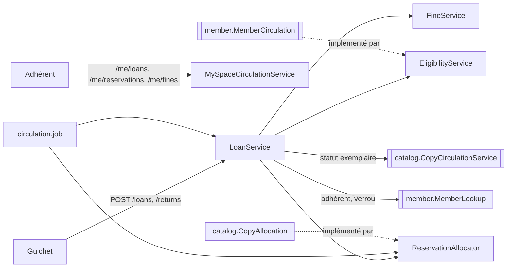

# ARCH — Circulation : emprunts, réservations et pénalités

## 1. Vue d'ensemble
Ce document couvre les features `emprunts`, `reservations` et `penalites`, conçues ensemble comme le recommande INDEX §2 : un retour crée une pénalité (RG-26, RG-36) et libère un exemplaire au profit de la file d'attente (RG-32).

- **Backend** : un seul module, `com.bibliotheque.circulation` (ADR-001), organisé par sous-domaines (`Loan*`, `Reservation*`, `Fine*`, `Payment*`, `Eligibility*`).
- **Frontend** : trois features, `features/emprunts` (ECR-24 → ECR-29), `features/reservations` (ECR-30 → ECR-33) et `features/penalites` (ECR-34 → ECR-36).

**Dépendances** :
- `circulation` → `catalog` passe par `catalog.service.CopyCirculationService` : lecture et verrou d'un exemplaire, changement de statut de circulation, description titre/cote d'une liste d'exemplaires, comptage des exemplaires d'une notice par statut.
- `circulation` → `member` passe par `member.service.MemberLookup`.
- `circulation` ↛ `auth` : l'agent n'est connu que par l'identifiant de compte de la session.
- **Ports implémentés** :
  - `member.service.MemberCirculation` (éligibilité et obligations, ARCH-adherents) ;
  - `catalog.service.CopyAllocation` : un exemplaire ajouté est attribué à la première réservation en attente (AC-012-2, reporté par ARCH-catalogue §1).

**Périmètre** :
- inclus : US-025 → US-035 et US-037 → US-040 ;
- reporté : US-036 (COULD, e-mail « réservation prête »). Aucun service d'envoi n'est configuré dans le socle (Q-41). La colonne `notification_status` reste `NULL` et l'adhérent voit le statut « prête » dans son espace.

## 2. Modèle de données
Aucune migration : les tables `loans`, `reservations`, `fines` et `payments` existent déjà (V1).

**Entités** :
- `Loan` : `copyId`, `memberId`, dates, `renewalCount`, statut, `loanedBy`, `returnedBy`, `memberUnlinkedAt`, version ;
- `Reservation` : `bookId`, `memberId`, `reservedAt`, statut, `copyId`, `readyAt`, `pickupDeadline`, `closedAt`, `createdBy`, `closedBy`, version ;
- `Fine` : `memberId`, `loanId`, motif, `lateDays`, montant, statut, `paymentId`, `settledAt`, `settledBy`, `waiverReason`, version ;
- `Payment` : `memberId`, montant, mode, `collectedBy`, `collectedAt`.

Les colonnes générées `active_copy_id`, `active_member_id` et `ready_copy_id` ne sont pas mappées : elles sont calculées par MariaDB. Les liens vers d'autres modules ne passent que par identifiant (ADR-001 §4).

**Garanties d'unicité** (NFR-10) :
- `uk_loans_active_copy` : un seul emprunt en cours par exemplaire ;
- `uk_reservations_active_member_book` : RG-31 ;
- `uk_reservations_ready_copy` : RG-32 ;
- `uk_fines_loan_reason` : une seule pénalité de chaque type par emprunt.

Les deux premières violations sont traduites respectivement en `COPY_NOT_AVAILABLE` et `RESERVATION_ALREADY_EXISTS` (gestionnaire d'exceptions).

**Statut effectif** (ADR-006 §3) : un emprunt `ACTIVE` dont `due_date` est passée est présenté et traité comme `OVERDUE`, et une réservation `READY` dont `pickup_deadline` est passée est traitée comme expirée lors d'un emprunt. Les lectures ne dépendent donc pas des traitements de minuit.

## 3. Contrat d'API (extrait de openapi.yaml)
Préfixe `/api/v1`.

**Emprunts**
| Méthode | Chemin | Rôles | Requête | Réponse | Codes | US |
|---|---|---|---|---|---|---|
| POST | `/loans` | LIBRARIAN, ADMIN | `LoanRequest` (`memberNumber`, `copyNumber`) | 201 `LoanResult` | 404 `MEMBER_NOT_FOUND`, 404 `COPY_NOT_FOUND`, 409 `MEMBER_NOT_ELIGIBLE` (+`reasons`), 409 `COPY_NOT_AVAILABLE` (+`copyStatus`), 409 `COPY_RESERVED_FOR_ANOTHER_MEMBER` | US-025 |
| POST | `/returns` | LIBRARIAN, ADMIN | `ReturnRequest` (`copyNumber`) | 200 `ReturnResult` | 404 `COPY_NOT_FOUND`, 409 `NO_ACTIVE_LOAN_FOR_COPY` | US-026, US-037 |
| POST | `/loans/{id}/renewal` | LIBRARIAN, ADMIN | — | 200 `MemberLoan` | 404 `LOAN_NOT_FOUND`, 409 `RENEWAL_LIMIT_REACHED`, `RENEWAL_BLOCKED_BY_RESERVATION`, `LOAN_OVERDUE`, `MEMBER_NOT_ELIGIBLE`, `LOAN_NOT_ACTIVE` | US-027 (AC-027-7) |
| GET | `/loans/overdue` | LIBRARIAN, ADMIN | `minDays`, `page`, `size`, `sort` (`overdueDays`, `dueDate`, `memberName`) | 200 `PageResponse<OverdueLoan>` | 400 | US-028 |
| GET | `/loans/{id}/loss-preview` | LIBRARIAN, ADMIN | — | 200 `LossAmounts` | 404, 409 `LOAN_NOT_ACTIVE` | US-029 |
| POST | `/loans/{id}/loss` | LIBRARIAN, ADMIN | — | 200 `LossAmounts` | 404, 409 `LOAN_NOT_ACTIVE` | US-029, US-037 |
| POST | `/copies/{copyNumber}/found` | LIBRARIAN, ADMIN | — | 200 `CopyRelease` | 404, 409 `COPY_NOT_LOST` | US-030 |
| GET | `/copies/{copyNumber}/loans` | LIBRARIAN, ADMIN | `page`, `size` | 200 `PageResponse<CopyLoanHistoryItem>` | 404 | US-031 |

**Situation d'un adhérent (ECR-18)**
| Méthode | Chemin | Rôles | Réponse | US |
|---|---|---|---|---|
| GET | `/members/{memberNumber}/loans` | LIBRARIAN, ADMIN | `MemberLoan[]` (en cours) | US-018 |
| GET | `/members/{memberNumber}/reservations` | LIBRARIAN, ADMIN | `MemberReservation[]` (actives) | US-018 |
| GET | `/members/{memberNumber}/fines` | LIBRARIAN, ADMIN | `MemberFines` (impayées + total) | US-018, US-038 |
| GET | `/members/{memberNumber}/history` | LIBRARIAN, ADMIN | `PageResponse<HistoryLoan>` (rendus ≤ 4 mois) | US-018 |

**Espace adhérent (MEMBER, adhérent de la session uniquement)**
| Méthode | Chemin | Réponse | Codes | US |
|---|---|---|---|---|
| GET | `/me/loans` | `MemberLoan[]` | — | US-023 |
| GET | `/me/reservations` | `MemberReservation[]` | — | US-023 |
| GET | `/me/fines` | `MemberFines` | — | US-023 |
| GET | `/me/history` | `PageResponse<HistoryLoan>` | — | US-023 (AC-023-2) |
| POST | `/me/loans/{id}/renewal` | `MemberLoan` | 404 `LOAN_NOT_FOUND` (emprunt d'un autre adhérent, AC-027-6), 409 comme ci-dessus | US-027 |
| GET | `/me/books/{bookId}/reservation` | `MyBookReservation` | 404 `BOOK_NOT_FOUND` | US-032, AC-034-3 |
| POST | `/me/reservations` | 201 `ReservationCreated` | 404, 409 (motifs ci-dessous) | US-032 |
| POST | `/me/reservations/{id}/cancellation` | `ReservationCancelled` | 404 (réservation d'un autre adhérent), 409 `RESERVATION_CLOSED` | US-033 |

**Réservations (personnel)**
| Méthode | Chemin | Rôles | Requête | Réponse | Codes | US |
|---|---|---|---|---|---|---|
| GET | `/reservations/preview` | LIBRARIAN, ADMIN | `bookId`, `memberNumber` | 200 `ReservationPreview` | 404 | US-032 (AC-032-8) |
| POST | `/reservations` | LIBRARIAN, ADMIN | `StaffReservationRequest` (`bookId`, `memberNumber`) | 201 `ReservationCreated` | 404, 409 `COPY_AVAILABLE_ON_SHELF`, `NO_COPY_IN_CIRCULATION`, `RESERVATION_LIMIT_REACHED` (+`limit`), `RESERVATION_ALREADY_EXISTS`, `BOOK_ALREADY_BORROWED`, `MEMBER_NOT_ELIGIBLE` (+`reasons`) | US-032 |
| POST | `/reservations/{id}/cancellation` | LIBRARIAN, ADMIN | — | 200 `ReservationCancelled` | 404, 409 `RESERVATION_CLOSED` | US-033 |
| GET | `/books/{id}/reservations` | LIBRARIAN, ADMIN | — | 200 `QueueEntry[]` | 404 | US-034 |
| GET | `/reservations/ready` | LIBRARIAN, ADMIN | `page`, `size` | 200 `PageResponse<ReadyReservation>` | 400 | US-035 |
| GET | `/reservations/released` | LIBRARIAN, ADMIN | `page`, `size` | 200 `PageResponse<ReleasedCopy>` | 400 | US-035 (Q-26) |

**Pénalités**
| Méthode | Chemin | Rôles | Requête | Réponse | Codes | US |
|---|---|---|---|---|---|---|
| POST | `/payments` | LIBRARIAN, ADMIN | `PaymentRequest` (`memberNumber`, `fineIds[]`, `method`, `amount`) | 201 `PaymentResult` | 400, 404, 409 `FINE_ALREADY_SETTLED`, 422 `PARTIAL_PAYMENT_NOT_ALLOWED`, 422 `PAYMENT_AMOUNT_MISMATCH` | US-038 |
| POST | `/fines/{id}/waiver` | ADMIN | `WaiverRequest` (`reason`, 3-255) | 200 `WaiverResult` | 400, 403, 404, 409 `FINE_ALREADY_SETTLED` | US-039 |
| GET | `/fines/debtors` | LIBRARIAN, ADMIN | `page`, `size`, `sort` (`total`, `name`, `count`) | 200 `DebtorList` | 400 | US-040 |

**DTO principaux** :
- `Eligibility` (partagé avec `MemberDetail`) : `eligible`, `reasons[]`, `activeLoans`, `loanLimit`, `remainingLoans`, `unpaidTotal`, `fineThreshold`.
- `MemberLoan` :
  - champs : `id`, `copyNumber`, `bookId`, `title`, `loanDate`, `dueDate`, `status` (statut effectif), `renewalCount`, `overdueDays`, `provisionalFine` ;
  - `renewal` : `allowed`, `blockedBy` (`RENEWAL_LIMIT_REACHED`, `RENEWAL_BLOCKED_BY_RESERVATION`, `LOAN_OVERDUE`, `MEMBER_NOT_ELIGIBLE` ou `null`), `memberReasons[]`, `newDueDate`.
- `LoanResult` : `loanId`, `copyNumber`, `title`, `dueDate`, `reservationFulfilled`, `eligibility` (après l'emprunt).
- `ReturnResult` : `copyNumber`, `title`, `shelfMark`, `member` (`memberNumber`, `lastName`, `firstName` | `null`), `lateDays`, `fine` (`id`, `amount` | `null`), `destination` (`SHELF` | `HOLD`), `hold` (`memberNumber`, `lastName`, `firstName`, `pickupDeadline` | `null`).
- `OverdueLoan` : `loanId`, `copyNumber`, `title`, `member` (`memberNumber`, `lastName`, `firstName`, `phone`, `email`), `dueDate`, `overdueDays`, `provisionalFine`.
- `LossAmounts` : `lateDays`, `lateFine`, `lostItemFine`, `total`.
- `CopyRelease` : `copyNumber`, `shelfMark`, `destination`, `hold`.
- `CopyLoanHistoryItem` : `loanDate`, `dueDate`, `returnDate`, `status`, `borrower` (`memberNumber`, `lastName`, `firstName` | `null` si anonymisé).
- `HistoryLoan` : `id`, `copyNumber`, `title`, `loanDate`, `dueDate`, `returnDate`.
- `MemberReservation` : `id`, `bookId`, `title`, `status`, `position`, `queueLength`, `reservedAt`, `pickupDeadline`, `copyNumber`.
- `ReservationPreview` : `reservable`, `reasons[]` (codes de refus ci-dessus), `memberReasons[]` (motifs RG-23), `position`, `activeReservations`, `limit`, `pickupDays`, `member` (`memberNumber`, `lastName`, `firstName`, `status` ; personnel seulement).
- `MyBookReservation` : `current` (`id`, `status`, `position`, `queueLength`, `pickupDeadline` | `null`), `preview` (`ReservationPreview`).
- `ReservationCreated` : `id`, `status`, `position`, `queueLength`.
- `ReservationCancelled` : `id`, `status`, `release` (`CopyRelease` | `null`).
- `QueueEntry` : `id`, `status`, `position`, `member`, `reservedAt`, `pickupDeadline`, `copyNumber`.
- `ReadyReservation` : `id`, `title`, `copyNumber`, `shelfMark`, `member` (+`phone`), `pickupDeadline`, `lastDay`, `notificationFailed`.
- `ReleasedCopy` : `reservationId`, `title`, `copyNumber`, `shelfMark`, `previousMember`, `closedOn`, `closedStatus`, `destination`, `hold`.
- `MemberFines` : `fines[]` (`id`, `reason`, `lateDays`, `title`, `copyNumber`, `createdOn`, `amount`, `version`), `total`.
- `PaymentResult` : `paymentId`, `amount`, `method`, `paidFineIds[]`, `unpaidTotal`, `eligible`.
- `WaiverResult` : `fineId`, `status`, `unpaidTotal`, `eligible`.
- `DebtorList` : `memberCount`, `totalAmount`, `threshold`, `page` (`PageResponse<Debtor>` : `memberNumber`, `lastName`, `firstName`, `phone`, `email`, `fineCount`, `total`, `blocked`).

## 4. Règles de gestion → application
| RG | Point d'application |
|---|---|
| RG-21 | `LOAN_DURATION_DAYS` lu à chaque emprunt (non rétroactif) |
| RG-22, RG-23 | `EligibilityService.evaluate(member, forLoan)` : tous les motifs ensemble. L'emprunt en retard est déterminé par `status = 'OVERDUE' OR (status = 'ACTIVE' AND due_date < :today)`. Le seuil de pénalités est strictement supérieur. Le quota n'est compté que pour un emprunt |
| RG-24 | `LoanService.borrow` : exemplaire `AVAILABLE`, ou `RESERVED` pour une réservation `READY` non échue du même adhérent (elle passe alors `FULFILLED`) |
| RG-25 | `LoanRenewalPolicy` : plafond `LOAN_MAX_RENEWALS`, réservation `PENDING` sur la notice, emprunt en retard, éligibilité hors quota |
| RG-26 | `LoanService.giveBack` : une seule transaction (retour + `ReservationAllocator` + pénalité) |
| RG-27 | `OverdueLoansJob` (00 h 00) + statut effectif en lecture |
| RG-28 | `LoanService.declareLost` / `markFound` |
| RG-29 → RG-31 | `ReservationService.preview` / `create` |
| RG-32 | `ReservationAllocator.allocate(copy)` : première `PENDING` par (`reserved_at`, `id`), lue `FOR UPDATE` |
| RG-33 | `ReservationExpiryJob` (00 h 05) : `READY` échues → `EXPIRED` + réattribution |
| RG-34 | `ReservationService.cancel` |
| RG-35 → RG-37 | `FineCalculator` (`BigDecimal`, échelle 2) : retard = min(jours × tarif, plafond) ; aucune pénalité si le montant est nul |
| RG-38 | `PaymentService` : somme exacte, verrou optimiste des pénalités, aucun encaissement partiel de la sélection |
| RG-39 | `@PreAuthorize("hasRole('ADMIN')")` + `FineService.waive` |
| RG-19 (D2) | `LoanAnonymizationJob` (02 h 00) : emprunts `RETURNED` depuis plus de 4 mois sans pénalité `UNPAID` liée → `member_id = NULL` |

## 5. États et concurrence
| Opération | Verrous (toujours dans cet ordre) |
|---|---|
| Emprunt | Ligne `members` (`FOR UPDATE`, quota RG-22), puis ligne `copies` (`FOR UPDATE`) ; second filet `uk_loans_active_copy` |
| Retour, perte, retrouvé | Ligne `copies` (`FOR UPDATE`) ; première réservation `PENDING` (`FOR UPDATE`) |
| Réservation | Ligne `members` (`FOR UPDATE`, quota RG-30) ; filet `uk_reservations_active_member_book` |
| Annulation, expiration | Réservation (version) ; exemplaire (`FOR UPDATE`) si elle était `READY` |
| Encaissement, remise | Version de chaque pénalité → `FINE_ALREADY_SETTLED` (AC-038-5) |

## 6. Sécurité
- `/api/v1/loans/**`, `/returns`, `/reservations/**`, `/payments`, `/fines/**` : LIBRARIAN, ADMIN, sauf `/api/v1/fines/*/waiver`, réservé à ADMIN.
- `/api/v1/members/*/loans|reservations|fines|history` : famille `/members/**` (personnel).
- `/api/v1/me/**` : MEMBER ; toute ressource est filtrée sur l'adhérent de la session (un emprunt ou une réservation d'un autre adhérent → 404, sans fuite d'existence).
- Les réponses à l'adhérent ne contiennent jamais l'identité des autres adhérents (AC-034-3).
- **Journal d'audit** : emprunt, retour, prolongation (`details.event = "RENEWAL"`, utilisé par les statistiques), perte, retrouvé, réservation (création, mise à disposition, annulation, expiration), pénalité (création, encaissement, remise), paiement. Auteur : agent, adhérent ou « Système ».

## 7. Plan d'implémentation
1. `catalog` :
   - `Copy.changeCirculationStatus` ;
   - `CopyRepository.lockByCopyNumber` / `lockById` ;
   - `CopyCirculationService` ;
   - port `CopyAllocation`, appelé par `CopyService.add`.
2. `member` : `MemberLookup` (ARCH-adherents).
3. `circulation.domain` : `Loan`, `LoanStatus`, `Reservation`, `ReservationStatus`, `Fine`, `FineReason`, `FineStatus`, `Payment`, `PaymentMethod`.
4. `circulation.repository` : repositories JPA ; requêtes de liste (retards, débiteurs, prêtes, libérées) paginées.
5. `circulation.service` :
   - éligibilité et règles : `EligibilityService`, `FineCalculator`, `LoanRenewalPolicy` ;
   - opérations : `LoanService`, `ReservationAllocator`, `ReservationService`, `FineService`, `PaymentService` ;
   - lectures : `MemberCirculationAdapter`, `CirculationReadService` ;
   - vues : `CirculationViews`.
6. `circulation.job` : `OverdueLoansJob`, `ReservationExpiryJob`, `LoanAnonymizationJob`.
7. `circulation.web` : `LoanController`, `ReservationController`, `FineController`, `MemberCirculationController`, `MySpaceCirculationController`.
8. Frontend : `features/emprunts`, `features/reservations`, `features/penalites`, et les intégrations dans ECR-09, ECR-12, ECR-18 et ECR-22.

## 8. Stratégie de test
- **Unitaires** :
  - `FineCalculatorTest` : AC-037-1 → AC-037-3 ;
  - `EligibilityServiceTest` : motifs multiples, seuil exact, quota exact ;
  - `LoanServiceTest` : emprunt, réservation honorée, réservé pour un autre, retour avec ou sans file, retard, perte, retrouvé ;
  - `ReservationServiceTest` : motifs de refus, position, annulation d'une réservation `READY` ;
  - `PaymentServiceTest` : partiel, montant différent, déjà réglée ;
  - contrôleurs `@WebMvcTest` : droits, dont la remise réservée à ADMIN.
- **QA** (Testcontainers) : emprunts simultanés du même exemplaire (AC-025-10), double encaissement (AC-038-5), traitements planifiés avec `Clock` fixe.

## 9. ADR créés / impactés
Aucun nouvel ADR. ADR-001 : ports `MemberCirculation` et `CopyAllocation`. ADR-006 : cron `app.jobs.*` existants.

## 10. Questions ouvertes
| ID | Question | Hypothèse retenue | Impact si faux |
|---|---|---|---|
| Q-41 | Service d'envoi d'e-mails pour US-036 (COULD) | Non configuré dans cette version : US-036 reportée, `notification_status` reste `NULL` | Ajout de Spring Mail, d'un modèle de message et du marqueur `ready-email-failed` |
| Q-42 | « Exemplaires à remettre en rayon » (Q-26) : comment connaître la destination actuelle de l'exemplaire libéré ? | Destination lue sur l'état actuel de l'exemplaire : `RESERVED` pour une réservation `READY` → mise de côté, sinon rayon | Historiser la destination au moment de la libération |
