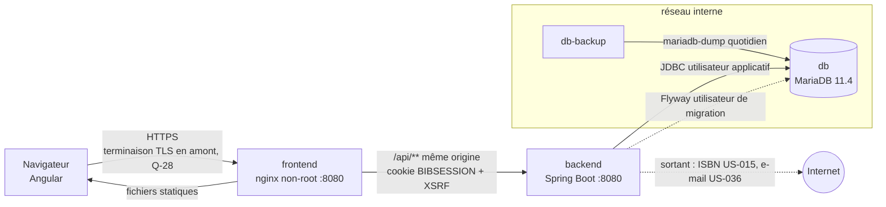
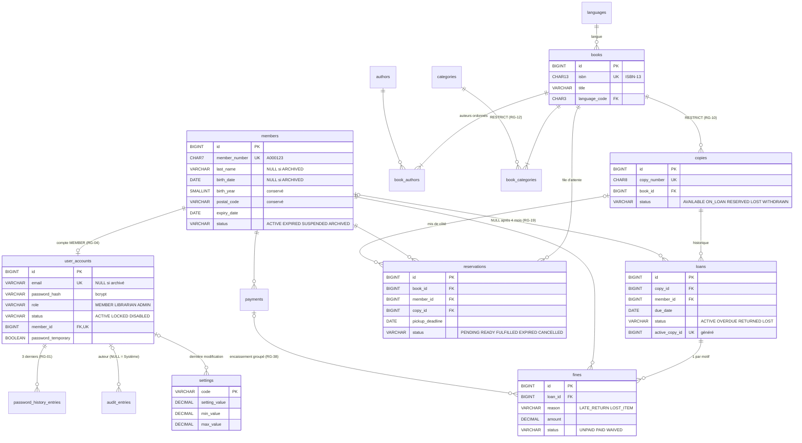

# ARCH — Socle technique : base de données, projet Spring Boot, déploiement

> Ce document couvre ce qui est **commun à toutes les features** : modèle de données complet, structure du projet, sécurité, build et déploiement. Les **contrats d'API détaillés** sont produits feature par feature (`ARCH-<slug>.md` + `openapi.yaml`), en commençant par `authentification` (voir §9).

## 1. Vue d'ensemble


**Correspondance features (SPEC/UX) ↔ modules backend (ADR-001)**
| Feature (slug) | Module backend | Dossier frontend |
|---|---|---|
| authentification | `com.bibliotheque.auth` | `features/authentification` |
| catalogue | `com.bibliotheque.catalog` | `features/catalogue` |
| adherents | `com.bibliotheque.member` | `features/adherents` |
| emprunts, reservations, penalites | `com.bibliotheque.circulation` | `features/emprunts`, `features/reservations`, `features/penalites` |
| pilotage | `com.bibliotheque.reporting` + `common.settings` + `common.audit` | `features/pilotage` |

## 2. Modèle de données


### Migrations Flyway (source de vérité du DDL)
| Fichier | Contenu |
|---|---|
| [`V1__schema_initial.sql`](../../backend/src/main/resources/db/migration/V1__schema_initial.sql) | 2 séquences, 18 tables (dont les 2 tables Spring Session), toutes les contraintes `CHECK`/`UNIQUE`/`FK` et index nommés |
| [`V2__donnees_de_reference.sql`](../../backend/src/main/resources/db/migration/V2__donnees_de_reference.sql) | 9 langues (Q-22), 12 paramètres avec valeurs par défaut et bornes (RG-40) |

Le DDL complet n'est pas recopié ici pour éviter deux sources divergentes. **Vérifié le 17/10/2026** sur MariaDB 11.4 : migrations appliquées par l'application, puis 35 tests de contraintes (31 refus attendus, 4 cas valides) tous conformes.

### Tables
| Table | Rôle | Points d'intégrité en base |
|---|---|---|
| `languages` | Référentiel des langues | Code ISO 639-2 en minuscules |
| `members` | Adhérents | Numéro `A` + 6 chiffres ; identité obligatoire sauf `ARCHIVED` ; motif de suspension ; représentant légal complet ou absent ; `birth_year` cohérent |
| `user_accounts` | Comptes (tous rôles) | E-mail unique insensible à la casse ; `MEMBER` ⇔ adhérent rattaché ; nom/prénom obligatoires pour le personnel ; e-mail `NULL` seulement si compte adhérent désactivé |
| `password_history_entries` | Empreintes précédentes | Suppression en cascade avec le compte |
| `authors`, `categories` | Référentiels du catalogue | Libellé de catégorie unique (casse, accents) et 2-50 caractères |
| `books`, `book_authors`, `book_categories` | Notices | ISBN-13 (`978`/`979`) unique ; année ≥ 1450 ; ordre des auteurs unique par notice |
| `copies` | Exemplaires | Numéro 8 chiffres ; `WITHDRAWN` ⇔ motif + date ; jamais supprimés (FK) |
| `loans` | Emprunts | Un seul emprunt en cours par exemplaire (`active_copy_id`) ; cohérence statut/dates/agents ; adhérent effaçable uniquement si `RETURNED` |
| `reservations` | Réservations | Une active par adhérent et notice ; un exemplaire pour une seule `READY` ; cohérence statut/exemplaire/dates |
| `fines` | Pénalités | Une par emprunt et par motif ; montant > 0 ; `PAID` ⇔ encaissement ; `WAIVED` ⇔ motif |
| `payments` | Encaissements | Montant > 0 ; mode `CASH`/`CARD`/`CHECK` |
| `settings` | Paramètres RG-40 | Valeur dans les bornes ; entière pour les paramètres entiers |
| `audit_entries` | Journal (NFR-08) | Détail JSON valide ; listes fermées d'actions et de types d'objets ; ni `updated_at` ni `version` (immuable) |
| `SPRING_SESSION`, `SPRING_SESSION_ATTRIBUTES` | Sessions HTTP (ADR-004) | Schéma imposé par Spring Session (noms en majuscules) |

### Règles de mapping JPA
- Entités : un champ `@Version Integer version` sur chaque table qui en a une ; `created_at`/`updated_at` gérés par la base (colonnes `insertable = false, updatable = false`) ou par l'audit JPA ; pas les deux.
- Les colonnes générées `active_copy_id`, `active_member_id`, `ready_copy_id` **ne sont pas mappées**.
- `audit_entries.details` : type `JSON` MariaDB (alias de `LONGTEXT` + `CHECK JSON_VALID`) → champ `String` avec `@JdbcTypeCode(SqlTypes.JSON)` ; vérifier que `ddl-auto=validate` l'accepte, sinon `columnDefinition = "json"`.
- Numéros fonctionnels : `SELECT NEXT VALUE FOR member_number_seq` (formaté `A%06d`) et `copy_number_seq` (`%08d`) par requête native dans le service.
- Énumérations : `@Enumerated(EnumType.STRING)` ; les valeurs Java sont exactement celles des `CHECK`.

## 3. Contrat d'API
Conventions communes : ADR-003 (préfixe, codes HTTP, `ProblemDetail`, pagination) et ADR-004 (session, CSRF). Squelette commun : [`openapi.yaml`](openapi.yaml) (schémas `ProblemDetail`, `PageResponse`, catalogue `ErrorCode`, schéma de sécurité). **Aucun chemin n'y est encore défini** : ils seront ajoutés par `ARCH-<slug>.md` (§9).

## 4. Règles de gestion → application
Légende : **SQL** = contrainte en base (filet de sécurité, testée) · **DTO** = Bean Validation · **SVC** = service.

| RG | Point d'application | Code d'erreur | HTTP |
|---|---|---|---|
| RG-01 | DTO `@StrongPassword` (12 car., maj., min., chiffre) ; SVC historique de 3 (`password_history_entries`) | `PASSWORD_POLICY_VIOLATION` ; `PASSWORD_RECENTLY_USED` ; `CURRENT_PASSWORD_INCORRECT` | 422 |
| RG-02 | SVC compteur `failed_login_count`, `locked_until`, statut `LOCKED` (SQL `ck_user_accounts_locked`) | `INVALID_CREDENTIALS` ; `ACCOUNT_LOCKED` (+`lockedUntil`) ; `ACCOUNT_DISABLED` | 401 |
| RG-03 | Configuration `server.servlet.session.timeout=30m` | `AUTHENTICATION_REQUIRED` | 401 |
| RG-04 | SQL `ck_user_accounts_member_link`, `uk_user_accounts_member_id` ; SVC rôle autorisé | `ROLE_NOT_ALLOWED` | 422 |
| RG-05 | Colonne `password_temporary` ; filtre de sécurité (ADR-004 §7) | `PASSWORD_CHANGE_REQUIRED` | 403 |
| RG-06 | `@PreAuthorize("hasRole('ADMIN')")` ; SVC soi-même + dernier admin (verrou sur les comptes ADMIN actifs) | `SELF_DEACTIVATION_FORBIDDEN` ; `LAST_ADMIN_REQUIRED` ; `ACCESS_DENIED` | 409 ; 403 |
| RG-07 | DTO `@Isbn` (clé ISBN-10/13, normalisation) ; SQL `ck_books_isbn`, `uk_books_isbn` | `ISBN_INVALID` ; `ISBN_ALREADY_EXISTS` (+`existingBook`) | 422 ; 409 |
| RG-08 | DTO `@NotBlank` titre, `@NotEmpty` auteurs/catégories, `@Min(1450)` ; SVC année ≤ année en cours ; SQL `ck_books_*` | `VALIDATION_FAILED` (+`fieldErrors`) | 400 |
| RG-09 | Séquence `copy_number_seq` ; SQL `ck_copies_copy_number`, `uk_copies_copy_number` ; aucun DTO ne permet de le modifier | — | — |
| RG-10 | SQL `fk_copies_book` (RESTRICT), `ck_copies_withdrawal` ; SVC statut avant retrait ; aucun point de suppression d'exemplaire | `BOOK_HAS_COPIES` ; `COPY_IN_CIRCULATION` ; `COPY_WITHDRAWN` | 409 |
| RG-11 | DTO `@Size(min = 2)` sur `q` ; requêtes : notices avec ≥ 1 exemplaire hors `WITHDRAWN`, `LIKE` insensible aux accents (ADR-002 §9) | `VALIDATION_FAILED` | 400 |
| RG-12 | SQL `uk_categories_label` (collation), `ck_categories_label`, `fk_book_categories_category` | `CATEGORY_ALREADY_EXISTS` ; `CATEGORY_IN_USE` (+`bookCount`) | 409 |
| RG-13 | Séquence `member_number_seq` ; SQL `ck_members_member_number`, `uk_members_member_number` | — | — |
| RG-14 | SQL `uk_user_accounts_email` (collation insensible à la casse) ; SVC normalisation en minuscules | `EMAIL_ALREADY_USED` | 409 |
| RG-15 | Paramètres `MEMBERSHIP_DURATION_MONTHS`, `MEMBERSHIP_EARLY_RENEWAL_DAYS` ; SVC calcul de l'échéance ; SQL `ck_members_dates` | `RENEWAL_TOO_EARLY` (+`renewableFrom`) ; `MEMBER_SUSPENDED` ; `MEMBER_ARCHIVED` | 409 |
| RG-16 | Traitement `member.job` (ADR-006) ; SVC éligibilité | `MEMBER_NOT_ELIGIBLE` (+`reasons`) | 409 |
| RG-17 | DTO `@Size(min = 3, max = 255)` ; SQL `ck_members_suspension_reason` | `VALIDATION_FAILED` | 400 |
| RG-18 | SVC vérification via `MemberObligations` (ADR-001) puis effacement ; SQL `ck_members_identity`, `ck_members_archived`, `ck_user_accounts_email` | `ARCHIVE_BLOCKED` (+`reasons`) | 409 |
| RG-19 | Traitement `circulation.job` ; SQL `ck_loans_member`, `ck_loans_unlinked` ; requête « à archiver » (`idx_members_status_expiry_date`) | — | — |
| RG-20 | SVC âge calculé avec la `Clock` (heure de Paris) | `GUARDIAN_REQUIRED` | 422 |
| RG-21 | Paramètre `LOAN_DURATION_DAYS` ; SQL `ck_loans_due_date` | — | — |
| RG-22 | Paramètre `LOAN_MAX_ACTIVE` ; SVC comptage sous verrou de la ligne `members` | `MEMBER_NOT_ELIGIBLE` (motif `LOAN_LIMIT_REACHED`) | 409 |
| RG-23 | SVC `EligibilityService` (tous les motifs renvoyés ensemble) | `MEMBER_NOT_ELIGIBLE` (+`reasons`) | 409 |
| RG-24 | SVC statut de l'exemplaire + réservation `READY` du même adhérent ; SQL `uk_loans_active_copy` | `COPY_NOT_FOUND` ; `COPY_NOT_AVAILABLE` (+`copyStatus`) ; `COPY_RESERVED_FOR_ANOTHER_MEMBER` | 404 ; 409 |
| RG-25 | Paramètres `LOAN_MAX_RENEWALS`, `LOAN_RENEWAL_DAYS` ; SQL `ck_loans_renewal_count` | `RENEWAL_LIMIT_REACHED` ; `RENEWAL_BLOCKED_BY_RESERVATION` ; `LOAN_OVERDUE` ; `MEMBER_NOT_ELIGIBLE` | 409 |
| RG-26 | SVC retour + attribution à la file (RG-32) + pénalité (RG-36) dans **une seule transaction** | `NO_ACTIVE_LOAN_FOR_COPY` | 409 |
| RG-27 | Traitement `circulation.job` ; lectures fondées sur `due_date` (ADR-006 §3) | — | — |
| RG-28 | SVC perte et « retrouvé » ; SQL `ck_loans_lost` | `LOAN_NOT_ACTIVE` ; `COPY_NOT_LOST` | 409 |
| RG-29 | SVC disponibilité + éligibilité hors quota | `COPY_AVAILABLE_ON_SHELF` ; `NO_COPY_IN_CIRCULATION` ; `MEMBER_NOT_ELIGIBLE` | 409 |
| RG-30 | Paramètre `RESERVATION_MAX_ACTIVE` ; SVC comptage sous verrou de la ligne `members` | `RESERVATION_LIMIT_REACHED` (+`limit`) | 409 |
| RG-31 | SQL `uk_reservations_active_member_book` ; SVC emprunt en cours sur la notice | `RESERVATION_ALREADY_EXISTS` ; `BOOK_ALREADY_BORROWED` | 409 |
| RG-32 | SVC `ReservationAllocationService` : première `PENDING` par `reserved_at, id` lue `FOR UPDATE` ; SQL `uk_reservations_ready_copy`, `ck_reservations_ready` | — | — |
| RG-33 | Paramètre `RESERVATION_PICKUP_DAYS` ; traitement `circulation.job` | — | — |
| RG-34 | SVC annulation + appartenance (`/me`) | `RESERVATION_CLOSED` | 409 |
| RG-35 | Paramètre `FINE_BLOCKING_THRESHOLD` ; SVC éligibilité (strictement supérieur) | motif `UNPAID_FINES_ABOVE_THRESHOLD` | 409 |
| RG-36 | Paramètres `FINE_DAILY_RATE`, `FINE_LATE_CAP` ; calcul en `BigDecimal` ; aucune pénalité si montant nul ; SQL `uk_fines_loan_reason`, `ck_fines_amount` | — | — |
| RG-37 | Paramètre `FINE_LOST_ITEM_AMOUNT` | — | — |
| RG-38 | SVC somme exacte des pénalités sélectionnées ; verrou optimiste des pénalités ; SQL `ck_fines_paid`, `ck_payments_*` | `PARTIAL_PAYMENT_NOT_ALLOWED` ; `PAYMENT_AMOUNT_MISMATCH` ; `FINE_ALREADY_SETTLED` | 422 ; 409 |
| RG-39 | `@PreAuthorize("hasRole('ADMIN')")` ; SQL `ck_fines_waived`, `ck_fines_settled` | `FINE_ALREADY_SETTLED` ; `ACCESS_DENIED` | 409 ; 403 |
| RG-40 | SQL `ck_settings_range`, `ck_settings_integer` ; non-rétroactivité par construction (échéance, montant, date limite, expiration figés à la création) | `SETTING_OUT_OF_RANGE` (+`min`, `max`) | 422 |
| RG-41 | SVC `reporting` (mois civil, données anonymisées comprises) | `MONTH_IN_FUTURE` | 422 |

**Codes transverses** : `VALIDATION_FAILED` (400), `AUTHENTICATION_REQUIRED` (401), `ACCESS_DENIED` (403), `<RESSOURCE>_NOT_FOUND` (404 : `ACCOUNT_`, `MEMBER_`, `BOOK_`, `AUTHOR_`, `CATEGORY_`, `COPY_`, `LOAN_`, `RESERVATION_`, `FINE_`), `CONCURRENT_MODIFICATION` (409), `DUPLICATE_MEMBER_SUSPECTED` (409, AC-016-7, +`existingMember`), `ISBN_LOOKUP_NOT_FOUND` (404) et `ISBN_LOOKUP_UNAVAILABLE` (503) pour US-015, `INTERNAL_ERROR` (500).

**Motifs d'inéligibilité** (`reasons`, RG-23) : `MEMBERSHIP_EXPIRED`, `MEMBER_SUSPENDED`, `MEMBER_ARCHIVED`, `OVERDUE_LOAN`, `UNPAID_FINES_ABOVE_THRESHOLD`, `LOAN_LIMIT_REACHED`. **Motifs de blocage d'archivage** (RG-18) : `ACTIVE_LOANS`, `ACTIVE_RESERVATIONS`, `UNPAID_FINES`.

## 5. États et concurrence
| Entité | Transition | Condition | Protection concurrence |
|---|---|---|---|
| Exemplaire | `AVAILABLE` → `ON_LOAN` | Éligibilité RG-23, RG-24 | Verrou optimiste `copies.version` + `uk_loans_active_copy` (AC-025-10) |
| Exemplaire | `ON_LOAN` → `AVAILABLE`/`RESERVED` | Retour RG-26 | Même transaction que l'attribution RG-32 ; `uk_reservations_ready_copy` |
| Emprunt / réservation (quotas) | Création | Quotas RG-22, RG-30 | `SELECT … FOR UPDATE` sur la ligne `members` de l'adhérent : sérialise les opérations d'un même adhérent |
| Réservation | `PENDING` → `READY` | Exemplaire libéré | Lecture de la première `PENDING` `FOR UPDATE` ; contrainte `uk_reservations_ready_copy` |
| Pénalité | `UNPAID` → `PAID`/`WAIVED` | RG-38, RG-39 | Verrou optimiste `fines.version` → `FINE_ALREADY_SETTLED` (AC-038-5) |
| Notice, adhérent, paramètre | Modification | — | Verrou optimiste `version` → `CONCURRENT_MODIFICATION` (AC-010-3) |
| Compte ADMIN | `ACTIVE` → `DISABLED` | RG-06 | Verrou des comptes `ADMIN` actifs avant comptage |

Toute violation de contrainte unique ou optimiste est traduite par le gestionnaire d'exceptions en code métier 409 (jamais en 500).

## 6. Sécurité
| Famille d'URL | Rôles | Règle d'appartenance | Données sensibles |
|---|---|---|---|
| `POST /api/v1/auth/login` | public | — | Mot de passe (jamais journalisé) |
| `GET /api/v1/auth/me`, `POST /api/v1/auth/password`, `POST /api/v1/auth/logout` | authentifié | Soi-même | — |
| `GET /api/v1/catalog/**`, `GET /api/v1/categories`, `GET /api/v1/languages` | public | Aucune donnée d'emprunteur (AC-008-1) | — |
| `/api/v1/me/**` | `MEMBER` | Adhérent de la session uniquement | Identité, emprunts, pénalités |
| `/api/v1/books/**`, `/authors/**`, `/categories/**` (écriture), `/copies/**` | `LIBRARIAN`, `ADMIN` | — | — |
| `/api/v1/members/**` | `LIBRARIAN`, `ADMIN` | — | Identité, coordonnées (RGPD) |
| `/api/v1/loans/**`, `/reservations/**`, `/fines/**`, `/payments/**`, `/dashboard` | `LIBRARIAN`, `ADMIN` | — | — |
| `/api/v1/fines/{id}/waiver` | `ADMIN` | — | — |
| `/api/v1/staff-accounts/**`, `/statistics/**`, `/settings/**`, `/audit-entries/**` | `ADMIN` | — | Journal d'audit |
| `/actuator/health/**`, `/actuator/info` | réseau interne uniquement (non relayés par nginx) | — | — |
| Tout le reste | refusé | — | — |

Exigences transverses : CSRF actif pour toute méthode non sûre ; en-têtes de sécurité posés par nginx (CSP, `nosniff`, `frame-ancestors 'none'`) ; aucune donnée personnelle ni jeton dans les journaux ; erreurs sans trace d'exécution (`include-stacktrace: never`).

## 7. Plan d'implémentation
### 7.1 Backend — déjà créé (vérifié : `gradlew build` OK)
- `backend/settings.gradle`, `backend/build.gradle`, `backend/gradle/libs.versions.toml`, wrapper Gradle 8.14.3 (`gradlew`, `gradlew.bat`, `gradle/wrapper/*`)
- `backend/src/main/java/com/bibliotheque/BibliothequeApplication.java`
- 33 `package-info.java` documentant les packages : `common.{config,security,exception,web,audit,settings}`, `auth|catalog|member.{web,service,domain,repository}`, `member.job`, `circulation.{web,service,domain,repository,job}`, `reporting.{web,service,repository}`
- `backend/src/main/resources/application.yml`, `application-dev.yml`, `application-prod.yml`
- `backend/src/main/resources/db/migration/V1__schema_initial.sql`, `V2__donnees_de_reference.sql`
- `backend/Dockerfile`, `backend/.dockerignore`

### 7.2 Backend — socle à implémenter par le Développeur (avant toute feature)
| Fichier | Rôle |
|---|---|
| `common/config/ClockConfig.java` | Bean `Clock` (UTC) + `ZoneId` métier `app.time-zone` |
| `common/config/AppProperties.java` | `@ConfigurationProperties("app")` : `bootstrapAdmin`, `security`, `privacy`, `audit`, `jobs` |
| `common/config/SchedulingConfig.java` | `@EnableScheduling` |
| `common/exception/ErrorCode.java` | Énumération des codes du §4 avec statut HTTP associé |
| `common/exception/BusinessException.java` | Exception métier portant `ErrorCode`, `reasons`, propriétés |
| `common/exception/GlobalExceptionHandler.java` | `@RestControllerAdvice` → `ProblemDetail` ; validation → `fieldErrors` ; contraintes uniques/optimistes → 409 |
| `common/web/PageResponse.java`, `common/web/PageRequests.java` | Réponse paginée ; taille max 100 ; liste blanche de tri |
| `common/security/SecurityConfig.java` | Chaîne de filtres (§6), CSRF SPA, session, gestion 401/403 en `ProblemDetail` |
| `common/security/AccountUserDetailsService.java`, `CurrentUser.java` | Chargement du compte par e-mail ; principal = identifiant du compte |
| `common/security/PasswordChangeRequiredFilter.java` | RG-05 |
| `common/security/SessionRevoker.java` | Suppression des sessions d'un compte (AC-005-1) |
| `common/audit/AuditEntry.java`, `AuditEntryRepository.java`, `AuditService.java`, `AuditPurgeJob.java` | NFR-08, ADR-006 |
| `common/settings/Setting.java`, `SettingRepository.java`, `SettingsService.java`, `SettingCode.java` | Lecture typée (`int`, `BigDecimal`) des 12 paramètres |
| `auth/service/BootstrapAdminInitializer.java` | Création de l'administrateur initial (ADR-004 §10) |
| `backend/src/test/java/com/bibliotheque/ArchitectureTest.java` | Règles ArchUnit d'ADR-001 |

### 7.3 Frontend
Projet à créer par le Développeur : `ng new bibliotheque-frontend --standalone --routing --style=css` dans `frontend/`, puis Tailwind CSS 3 et Cypress, avec l'arborescence de [UX-socle §4](../design/UX-socle.md). Déjà fournis : `frontend/Dockerfile`, `frontend/.dockerignore`, `frontend/nginx/default.conf`, `frontend/nginx/security-headers.conf` (`nginx -t` OK). Développement : `proxy.conf.json` relayant `/api` vers `http://localhost:8081`.

### 7.4 Build / Docker / configuration (déjà créés)
| Fichier | Rôle |
|---|---|
| `docker-compose.yml` | db, backend, frontend, db-backup ; réseaux, sondes, limites (ADR-005) |
| `docker-compose.dev.yml` | Ports locaux de la base (3306) et du backend (8081) |
| `.env.example` | Variables à renseigner (aucun secret réel) |
| `db/init/01-create-app-user.sh` | Utilisateur applicatif aux droits DML |
| `db/backup/backup.sh` | Sauvegarde quotidienne (NFR-12) |
| `.gitignore`, `.gitattributes` | `.env` exclu ; fins de ligne LF pour les scripts |

**Variables d'environnement**
| Variable | Service | Obligatoire | Rôle |
|---|---|---|---|
| `MARIADB_ROOT_PASSWORD` | db | Oui | Compte root MariaDB |
| `DB_NAME` | tous | Non (`bibliotheque`) | Nom de la base |
| `DB_MIGRATION_USER` / `DB_MIGRATION_PASSWORD` | db, backend, db-backup | Oui | Propriétaire du schéma |
| `DB_APP_USER` / `DB_APP_PASSWORD` | db, backend | Oui | Utilisateur applicatif |
| `APP_BOOTSTRAP_ADMIN_EMAIL` / `APP_BOOTSTRAP_ADMIN_PASSWORD` | backend | Oui | Administrateur initial (mot de passe temporaire conforme à RG-01) |
| `FRONTEND_PORT` | frontend | Non (8080) | Port publié |
| `APP_VERSION` | backend, frontend | Non (0.1.0) | Étiquette des images |
| `BACKUP_RETENTION_DAYS` / `BACKUP_INTERVAL_SECONDS` | db-backup | Non (14 / 86400) | Sauvegardes |
| `SESSION_COOKIE_SECURE` | backend (hors prod) | Non | Forcé à `true` en profil `prod` |

**Commandes**
```bash
cp .env.example .env              # puis remplacer les valeurs « a-changer »
docker compose up -d --build      # production locale (frontend sur http://localhost:8080)
docker compose -f docker-compose.yml -f docker-compose.dev.yml up -d db   # base seule pour le développement
cd backend && ./gradlew bootRun --args='--spring.profiles.active=dev'      # backend sur :8081 (variables DB_* exportées)
```

## 8. Stratégie de test recommandée
| Niveau | Cible | Outil |
|---|---|---|
| Unitaire | Services (calculs d'échéances, pénalités, éligibilité) avec `Clock` fixe | JUnit 5, Mockito, AssertJ |
| Architecture | Dépendances entre modules et couches (ADR-001) | ArchUnit |
| Intégration | Migrations, contraintes, requêtes, transactions, concurrence (deux emprunts simultanés) | `@SpringBootTest` + Testcontainers `mariadb:11.4` |
| API | Codes HTTP, `code` des `ProblemDetail`, rôles, IDOR, CSRF | MockMvc + spring-security-test |
| E2E | Parcours UX (guichet, espace adhérent) sur la pile Compose | Cypress |
| Contraintes SQL | Les 35 cas vérifiés le 17/10/2026, à reprendre en tests `*IT` par le QA | Testcontainers |

## 9. ADR créés / impactés
| ADR | Titre | Statut |
|---|---|---|
| [ADR-001](adr/ADR-001-architecture-backend-modulaire.md) | Architecture backend modulaire par domaine | Accepté |
| [ADR-002](adr/ADR-002-donnees-mariadb-flyway.md) | Données : MariaDB 11.4, Flyway, intégrité en base | Accepté |
| [ADR-003](adr/ADR-003-api-rest-problem-detail.md) | API REST, ProblemDetail, pagination | Accepté |
| [ADR-004](adr/ADR-004-securite-session-serveur.md) | Session serveur plutôt que JWT | Accepté (dérogation au socle) |
| [ADR-005](adr/ADR-005-build-et-deploiement.md) | Build Gradle et déploiement Docker Compose | Accepté (dérogations) |
| [ADR-006](adr/ADR-006-traitements-planifies.md) | Traitements planifiés | Accepté |

**Reste à produire par l'Architecte** (contrats d'API) : `ARCH-authentification.md`, puis `ARCH-catalogue.md`, `ARCH-adherents.md`, `ARCH-circulation.md` (emprunts + réservations + pénalités), `ARCH-pilotage.md`, chacun complétant `openapi.yaml`.

## 10. Questions ouvertes
| ID | Question | Hypothèse retenue | Impact |
|---|---|---|---|
| Q-27 | Le socle de l'agent prévoyait `build.gradle.kts` (Kotlin DSL) ; la demande nomme `build.gradle`. | Groovy DSL (`build.gradle`), demande explicite (ADR-005) | Conversion mécanique en Kotlin DSL si souhaité |
| Q-28 | Où se fait la terminaison HTTPS en production ? Le cookie de session est `Secure`. | Reverse proxy ou répartiteur en amont du conteneur frontend, qui transmet `X-Forwarded-Proto` | Sans HTTPS, la connexion est impossible en profil `prod` ; sinon ajouter un certificat dans nginx |
| Q-29 | Spring Boot 3.5 est la dernière ligne 3.x (Spring Boot 4 est publié) ; la date de fin de son support communautaire est à confirmer sur le calendrier officiel de Spring. La stack impose « Spring Boot 3 ». | 3.5.16 (dernière version publiée, vérifiée sur Maven Central) ; migration vers Spring Boot 4 à planifier si le support est terminé | Correctifs de sécurité futurs à surveiller ; nouvel ADR lors de la migration |
| Q-30 | Les sauvegardes restent sur l'hôte Docker (volume `db-backups`). | Une copie externe est organisée par l'exploitation (hors périmètre applicatif) | NFR-12 non garanti en cas de perte de l'hôte |
