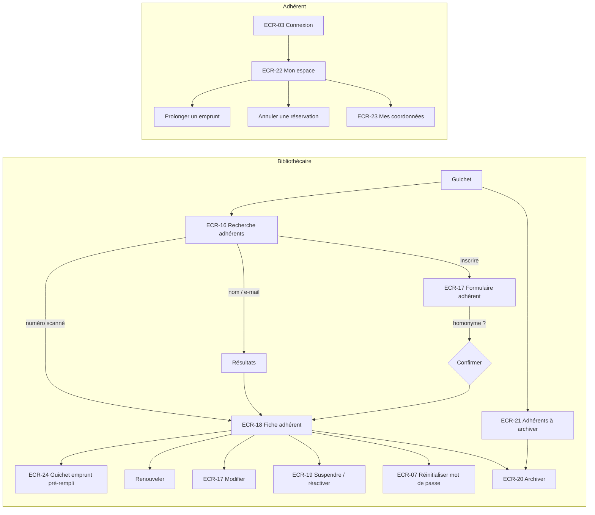

# UX — Adhérents et espace adhérent

> Réutilise le socle [UX-socle.md](UX-socle.md). Les actions de circulation et de paiement intégrées aux fiches (prolonger, déclarer perdu, annuler une réservation, encaisser, remise) sont spécifiées dans [UX-emprunts.md](UX-emprunts.md), [UX-reservations.md](UX-reservations.md) et [UX-penalites.md](UX-penalites.md).

## 1. Parcours utilisateurs


## 2. Plan de navigation
| ECR | Route Angular | Rôles | Guard | US couvertes |
|---|---|---|---|---|
| ECR-16 | `/gestion/adherents` (`q`, `statut`, `page`, `taille`, `tri`) | LIBRARIAN, ADMIN | `authGuard`, `passwordChangeGuard`, `roleGuard` | US-017 |
| ECR-17 | `/gestion/adherents/nouveau` · `/gestion/adherents/:memberNumber/modifier` | LIBRARIAN, ADMIN | idem | US-016, US-019 |
| ECR-18 | `/gestion/adherents/:memberNumber` | LIBRARIAN, ADMIN | idem | US-018, US-020 ; accès US-006, US-021, US-022, US-025, US-027, US-029, US-033, US-038, US-039 |
| ECR-19 | dialogue dans ECR-18 | LIBRARIAN, ADMIN | — | US-021 |
| ECR-20 | dialogue dans ECR-18 et ECR-21 | LIBRARIAN, ADMIN | — | US-022 |
| ECR-21 | `/gestion/adherents/a-archiver` | LIBRARIAN, ADMIN | idem | US-022 (AC-022-2) |
| ECR-22 | `/mon-espace` | MEMBER | `authGuard`, `passwordChangeGuard`, `roleGuard(['MEMBER'])` | US-023 ; accès US-027, US-033 |
| ECR-23 | `/mon-espace/coordonnees` | MEMBER | idem | US-024 |

L'identifiant de route est le **numéro d'adhérent** (`A000123`) : c'est l'identifiant affiché et scanné au guichet [RG-13].

## 3. Écrans

### ECR-16 — Recherche d'adhérents
- **Route** : `/gestion/adherents` · **Rôles** : LIBRARIAN, ADMIN · **US/AC** : US-017 (AC-017-1 → AC-017-5)
- **Wireframe** :
```
┌──────────────────────── Gabarit personnel ───────────────────────┐
│ Adhérents                 [Adhérents à archiver] [+ Inscrire]      │
│ Numéro, nom ou e-mail [A000123__________] [Rechercher]             │
│ Statut [Tous sauf archivés ▾]                                      │
│ ┌─────────┬────────────────┬────────────┬──────────┬────────────┐ │
│ │ Numéro  │ Nom ▲          │ Naissance  │ Statut   │ Expire le  │ │
│ ├─────────┼────────────────┼────────────┼──────────┼────────────┤ │
│ │ A000123 │ MARTIN Jean    │ 12/03/1990 │ [Actif]  │ 17/10/2027 │ │
│ │ A000456 │ MARTINEZ Ana   │ 02/07/2001 │ [Expiré] │ 01/09/2026 │ │
│ └─────────┴────────────────┴────────────┴──────────┴────────────┘ │
│ Page 1 sur 1                                     ◀  ▶  20 ▾        │
└────────────────────────────────────────────────────────────────────┘
```
- **Composants** : `app-member-search-page` (smart) → `app-member-table` (presentational) ; `app-scan-input` (accepte saisie et lecteur), `app-data-table`, `app-pagination`, `app-status-badge`.
- **Données lues** : adhérents paginés (numéro, nom, prénom, date de naissance, statut, date d'expiration). **Données écrites** : aucune.
- **Comportement de recherche** : si la saisie correspond exactement au format d'un numéro d'adhérent (`A` + 6 chiffres [RG-13]), ouverture directe d'ECR-18 (AC-017-1) ; sinon recherche partielle sur nom, prénom, e-mail (≥ 2 caractères). Les adhérents `ARCHIVED` ne sont trouvés que par numéro exact et s'affichent sans données personnelles (AC-017-4).
- **États** : initial (aucune saisie) : liste paginée des adhérents non archivés, tri nom · chargement squelette · vide : « Aucun adhérent ne correspond à votre recherche. » (AC-017-3) · numéro inexistant : « Aucun adhérent ne porte le numéro A000999. » · erreur standard · succès.
- **Actions** : Inscrire → ECR-17 ; Adhérents à archiver → ECR-21 ; clic ligne → ECR-18 ; filtre statut (Tous sauf archivés [défaut], Actif, Expiré, Suspendu) ; tri nom, numéro, expiration.
- **Formulaire** : champ de recherche ≥ 2 caractères, message « Saisissez au moins 2 caractères. »
- **data-testid** : `member-search-input`, `member-search-submit`, `member-search-error`, `member-status-filter`, `member-new-button`, `member-to-archive-link`, `member-row` (+ `data-row-id` = numéro), `member-not-found`, `member-search-loading`, `member-search-empty`, `member-search-error-state`, `member-search-error-retry`

### ECR-17 — Formulaire adhérent (inscription / modification)
- **Route** : `/gestion/adherents/nouveau` · `/gestion/adherents/:memberNumber/modifier` · **Rôles** : LIBRARIAN, ADMIN · **US/AC** : US-016 (AC-016-1 → AC-016-8), US-019 (AC-019-1 → AC-019-5)
- **Wireframe** :
```
┌──────────────────────── Gabarit personnel ───────────────────────┐
│ Inscrire un adhérent                                               │
│ ┌ Identité ────────────────────────────────────────────────────┐  │
│ │ Nom * [__________]  Prénom * [__________]                     │  │
│ │ Date de naissance * [JJ/MM/AAAA]   → 10 ans                   │  │
│ └───────────────────────────────────────────────────────────────┘  │
│ ┌ Représentant légal (obligatoire : moins de 15 ans) ───────────┐  │ (affiché si âge < 15)
│ │ Nom * [______] Prénom * [______] Téléphone * [__________]     │  │
│ └───────────────────────────────────────────────────────────────┘  │
│ ┌ Coordonnées ─────────────────────────────────────────────────┐  │
│ │ E-mail * [__________________]  Téléphone [______________]     │  │
│ │ Adresse * [_____________________________]                     │  │
│ │ Code postal * [_____]  Ville * [______________]               │  │
│ └───────────────────────────────────────────────────────────────┘  │
│ ┌ Compte de l'adhérent (inscription uniquement) ────────────────┐  │
│ │ Mot de passe initial * [________] (règles RG-01)              │  │
│ │ Confirmer * [________]                                        │  │
│ │ [i] À communiquer à l'adhérent ; il devra le changer à sa     │  │
│ │     première connexion.                                       │  │
│ └───────────────────────────────────────────────────────────────┘  │
│                                   [ Annuler ] [ Inscrire ]         │
└────────────────────────────────────────────────────────────────────┘
```
- **Composants** : `app-member-form-page` (smart, création/modification) → `app-member-form` (presentational, sections `fieldset`), `app-guardian-fields` (presentational), `app-password-policy-checklist` (feature authentification) ; `app-confirm-dialog` (homonyme).
- **Données lues** : (modification) adhérent + version. **Données écrites** : identité, représentant légal, coordonnées, mot de passe initial (inscription), confirmation d'homonyme.
- **Mode modification** : numéro d'adhérent et date d'inscription affichés en lecture seule (AC-019-3) ; section « Compte » masquée ; un adhérent `ARCHIVED` redirige vers ECR-18 avec le message « Un adhérent archivé ne peut plus être modifié. » (AC-019-4).
- **Âge et représentant légal** : l'âge est calculé à la saisie de la date de naissance et affiché (« → 10 ans ») ; la section représentant légal apparaît (annonce `aria-live`) si l'âge est strictement inférieur à 15 ans [RG-20] ; le jour anniversaire des 15 ans, elle n'est pas exigée (AC-016-4).
- **Homonyme (AC-016-7)** : si le serveur signale un adhérent existant de mêmes nom, prénom et date de naissance, `app-confirm-dialog` : « Un adhérent existe déjà avec ces nom, prénom et date de naissance : A000123 — MARTIN Jean (Actif). Voulez-vous vraiment créer une nouvelle inscription ? » boutons « Voir l'adhérent existant » / « Inscrire quand même ».
- **États** : chargement (modification) squelette · erreur de lecture standard · formulaire : pristine → invalide → envoi → erreur serveur → succès : toast « Adhérent A000124 inscrit. Adhésion valable jusqu'au 17/10/2027. » (inscription) ou « Modifications enregistrées. » puis ECR-18.
- **Formulaire** :
| Champ | Type | Obligatoire | Validation [RG] | Message d'erreur exact |
|---|---|---|---|---|
| Nom | texte | Oui | 1-100 | « Ce champ est obligatoire. » / « 100 caractères maximum. » |
| Prénom | texte | Oui | 1-100 | idem |
| Date de naissance | date | Oui | < date du jour | « La date de naissance doit être antérieure à aujourd'hui. » |
| Représentant légal — nom, prénom | texte | Si âge < 15 [RG-20] | 1-100 | « Représentant légal obligatoire pour un adhérent de moins de 15 ans. » (sur le premier champ vide) |
| Représentant légal — téléphone | tél. | Si âge < 15 [RG-20] | Format téléphone | « Saisissez un numéro de téléphone valide. » |
| E-mail | email | Oui | Format ; unicité [RG-14] serveur | « Saisissez une adresse e-mail valide. » / serveur : « Cette adresse e-mail est déjà utilisée. » |
| Téléphone | tél. | Non | Français (10 chiffres commençant par 0) ou international (`+` puis 8 à 15 chiffres) | « Saisissez un numéro de téléphone valide. » |
| Adresse (rue) | texte | Oui | 1-255 | « Ce champ est obligatoire. » |
| Code postal | texte | Oui | 5 chiffres | « Le code postal doit contenir 5 chiffres. » |
| Ville | texte | Oui | 1-100 | « Ce champ est obligatoire. » |
| Mot de passe initial | password | Oui (inscription) | [RG-01] | « Le mot de passe doit contenir au moins 12 caractères, dont une majuscule, une minuscule et un chiffre. » |
| Confirmation | password | Oui (inscription) | Identique | « Les mots de passe ne correspondent pas. » |
- **data-testid** : `member-form-lastname-input`, `member-form-lastname-error`, `member-form-firstname-input`, `member-form-firstname-error`, `member-form-birthdate-input`, `member-form-birthdate-error`, `member-form-age`, `member-form-guardian-section`, `member-form-guardian-lastname-input`, `member-form-guardian-firstname-input`, `member-form-guardian-phone-input`, `member-form-guardian-error`, `member-form-email-input`, `member-form-email-error`, `member-form-phone-input`, `member-form-phone-error`, `member-form-street-input`, `member-form-postcode-input`, `member-form-postcode-error`, `member-form-city-input`, `member-form-password-input`, `member-form-password-error`, `member-form-confirm-input`, `member-form-confirm-error`, `member-form-number-readonly`, `member-form-submit`, `member-form-cancel`, `member-form-server-error`, `member-duplicate-dialog`, `member-duplicate-view-existing`, `member-duplicate-confirm`

### ECR-18 — Fiche adhérent
- **Route** : `/gestion/adherents/:memberNumber` · **Rôles** : LIBRARIAN, ADMIN · **US/AC** : US-018 (AC-018-1 → AC-018-5), US-020 (AC-020-1 → AC-020-5) ; points d'entrée US-006, US-021, US-022, US-025, US-027, US-029, US-033, US-038, US-039
- **Wireframe** (`lg`) :
```
┌──────────────────────── Gabarit personnel ───────────────────────┐
│ Adhérents › A000123                                                │
│ MARTIN Jean   A000123  [Actif]  Adhésion jusqu'au 01/11/2026       │
│ [ Nouvel emprunt ] [ Renouveler ] [ Modifier ] [ Plus ▾ ]          │
│                    Plus : Suspendre | Réactiver | Réinitialiser le │
│                           mot de passe | Archiver                  │
│ ┌──────────────────────────────────────────────────────────────┐  │
│ │ [!] L'adhésion expire le 01/11/2026. [ Renouveler ]           │  │ (≤ 30 j, RG-15)
│ └──────────────────────────────────────────────────────────────┘  │
│ ┌──────────────────────────────────────────────────────────────┐  │
│ │ ✗ Emprunt impossible :                                        │  │ (danger)
│ │   • Emprunt en retard                                         │  │
│ │   • Pénalités impayées supérieures à 5,00 €                   │  │
│ │ ── ou ──  ✓ Peut emprunter 3 document(s)                      │  │ (success)
│ └──────────────────────────────────────────────────────────────┘  │
│ [Emprunts (2)] [Réservations (1)] [Pénalités (1,40 €)] [Historique] [Coordonnées]
│ ┌─────────────────┬─────────┬───────────┬────────────┬────────┬──┐ │
│ │ Titre           │ N° ex.  │ Emprunté  │ Retour     │ Statut │  │ │
│ ├─────────────────┼─────────┼───────────┼────────────┼────────┼──┤ │
│ │ L'Étranger      │00001235 │ 10/10/2026│ 31/10/2026 │[En cours]│⋮│ │
│ │ Germinal        │00000877 │ 01/09/2026│ 22/09/2026 │[En retard│⋮│ │
│ │                 │         │           │ 25 j · 5,00 € provisoire│ │
│ └─────────────────┴─────────┴───────────┴────────────┴────────┴──┘ │
└────────────────────────────────────────────────────────────────────┘
Menu ⋮ (emprunt) : Prolonger | Déclarer perdu
```
- **Composants** : `app-member-detail-page` (smart) → `app-member-header`, `app-eligibility-panel`, `app-member-loans-table`, `app-member-reservations-table`, `app-member-fines-panel`, `app-member-history-table`, `app-member-contact-card` (presentational) ; `app-tabs`, `app-alert`, `app-status-badge` ; dialogues ECR-07, ECR-19, ECR-20, ECR-27, ECR-34, ECR-36 ; actions `app-renew-loan-action` (emprunts) et `app-cancel-reservation-action` (réservations).
- **Données lues** : identité, coordonnées, représentant légal, statut, motif de suspension, dates d'inscription/expiration ; éligibilité (peut emprunter oui/non, nombre restant [RG-22], liste des motifs de refus [RG-23]) ; possibilité de renouveler et date à partir de laquelle [RG-15] ; emprunts en cours (titre, numéro d'exemplaire, dates, statut, nb prolongations, prolongeable + motif, jours de retard, montant provisoire [RG-36]) ; réservations actives (titre, statut, position/total, date limite) ; pénalités `UNPAID` (motif, emprunt, montant, date) + total ; historique ≤ 4 mois [RG-19] ; statut du compte adhérent.
- **Onglets** : chacun a ses propres états ; l'onglet par défaut est « Emprunts ». Libellés d'onglet avec compteurs.
- **États** : chargement squelette `detail` · 404 : « Aucun adhérent ne porte le numéro A000999. » (AC-018-4) · erreur standard · succès. Vides : Emprunts « Aucun emprunt en cours. » ; Réservations « Aucune réservation active. » ; Pénalités « Aucune pénalité impayée. » ; Historique « Aucun emprunt rendu au cours des 4 derniers mois. ».
- **Adhérent archivé** : seuls le numéro, le statut `Archivé` et le texte « Les données personnelles de cet adhérent ont été effacées. » sont affichés ; aucune action.
- **Actions** :
| Action | Déclencheur | Résultat | Feedback |
|---|---|---|---|
| Nouvel emprunt | Bouton (désactivé si non éligible, avec renvoi au panneau d'éligibilité) | ECR-24 avec l'adhérent déjà identifié | — |
| Renouveler | Bouton (visible si `ACTIVE`/`EXPIRED` ; désactivé avant la date possible avec le texte « Renouvellement possible à partir du JJ/MM/AAAA. ») → `app-confirm-dialog` « Renouveler l'adhésion de Jean MARTIN jusqu'au 01/11/2027 ? » (date calculée côté serveur, prévisualisée) | Nouvelle date d'expiration, statut `ACTIVE` | Toast « Adhésion renouvelée jusqu'au 01/11/2027. » |
| Modifier | Bouton | ECR-17 | — |
| Suspendre / Réactiver | Menu « Plus » | ECR-19 | — |
| Réinitialiser le mot de passe | Menu « Plus » (compte non `DISABLED`) | ECR-07 | — |
| Archiver | Menu « Plus » | ECR-20 | — |
| Prolonger / Déclarer perdu | Menu ⋮ d'un emprunt | `app-renew-loan-action` / ECR-27 | voir UX-emprunts |
| Annuler une réservation | Ligne de réservation | `app-cancel-reservation-action` | voir UX-reservations |
| Encaisser | Onglet Pénalités | ECR-34 | voir UX-penalites |
| Accorder une remise | Ligne de pénalité (ADMIN uniquement) | ECR-36 | voir UX-penalites |
- **Messages serveur (renouvellement)** : trop tôt (AC-020-3) → « Renouvellement possible à partir du JJ/MM/AAAA. » ; suspendu (AC-020-4) → « Un adhérent suspendu doit d'abord être réactivé. » ; archivé → « Un adhérent archivé ne peut pas être renouvelé. »
- **Libellés des motifs d'inéligibilité** [RG-23] (réutilisés par ECR-24, ECR-30, ECR-31) :
| Motif | Libellé exact |
|---|---|
| Statut `EXPIRED` | « Adhésion expirée » |
| Statut `SUSPENDED` | « Adhérent suspendu » |
| Emprunt en retard | « Emprunt en retard » |
| Pénalités > seuil [RG-35] | « Pénalités impayées supérieures à 5,00 € » (montant du seuil fourni par le serveur) |
| Quota atteint [RG-22] | « Nombre maximal d'emprunts atteint » |
- **data-testid** : `member-detail-name`, `member-detail-number`, `member-detail-status`, `member-detail-expiry`, `member-detail-renew-alert`, `member-eligibility-panel` (+ `data-eligible`), `member-eligibility-reason` (+ `data-reason`), `member-eligibility-remaining`, `member-detail-new-loan-button`, `member-detail-renew-button`, `member-detail-renew-blocked`, `member-renew-dialog`, `member-renew-confirm`, `member-detail-edit-button`, `member-detail-more-menu`, `member-detail-suspend-action`, `member-detail-reactivate-action`, `member-detail-reset-password-action`, `member-detail-archive-action`, `member-tab-loans`, `member-tab-reservations`, `member-tab-fines`, `member-tab-history`, `member-tab-contact`, `member-loan-row` (+ `data-row-id` = numéro d'exemplaire), `member-loan-overdue-days`, `member-loan-provisional-fine`, `member-loan-menu`, `member-reservation-row`, `member-fines-total`, `member-fine-row`, `member-history-row`, `member-archived-notice`, `member-detail-loading`, `member-detail-not-found`, `member-detail-error`, `member-detail-error-retry`, `member-loans-empty`, `member-reservations-empty`, `member-fines-empty`, `member-history-empty`

### ECR-19 — Dialogue « Suspendre / réactiver »
- **Route** : dialogue dans ECR-18 · **Rôles** : LIBRARIAN, ADMIN · **US/AC** : US-021 (AC-021-1 → AC-021-5)
- **Wireframe** :
```
┌──── Suspendre Jean MARTIN (A000123) ────┐      ┌──── Réactiver Jean MARTIN ─────────┐
│ Motif * [______________________]         │      │ Le statut deviendra : Actif         │
│ [i] L'adhérent ne pourra plus emprunter, │      │ (ou « Expiré » si l'adhésion est    │
│ prolonger ni réserver. Ses réservations  │      │  échue — RG-16)                     │
│ en cours sont conservées.                │      │          [ Annuler ] [ Réactiver ]  │
│          [ Annuler ] [ Suspendre ]       │      └─────────────────────────────────────┘
└──────────────────────────────────────────┘
```
- **Composants** : `app-suspend-member-dialog` (presentational, deux modes).
- **Données écrites** : suspension (motif) ou réactivation. **Données lues en retour** : nouveau statut.
- **États** : formulaire ; succès : toast « Adhérent suspendu. » / « Adhérent réactivé (statut : Actif). » ou « Adhérent réactivé (statut : Expiré). »
- **Formulaire** :
| Champ | Type | Obligatoire | Validation [RG] | Message d'erreur exact |
|---|---|---|---|---|
| Motif de suspension | zone de texte | Oui | 3-255 caractères [RG-17] | « Le motif doit contenir entre 3 et 255 caractères. » |
- **data-testid** : `suspend-dialog`, `suspend-reason-input`, `suspend-reason-error`, `suspend-dialog-confirm`, `suspend-dialog-cancel`, `reactivate-dialog`, `reactivate-target-status`, `reactivate-dialog-confirm`

### ECR-20 — Dialogue « Archiver l'adhérent »
- **Route** : dialogue dans ECR-18 et ECR-21 · **Rôles** : LIBRARIAN, ADMIN · **US/AC** : US-022 (AC-022-1, AC-022-3, AC-022-4)
- **Wireframe** :
```
┌──────── Archiver Jean MARTIN (A000123) ────────┐
│ (archivable)                                     │
│ [!] Action irréversible. Le nom, la date de      │
│ naissance, les coordonnées et le représentant    │
│ légal seront effacés définitivement. Le compte   │
│ sera désactivé.                                  │
│ Pour confirmer, saisissez ARCHIVER : [________]  │
│                    [ Annuler ] [ Archiver ]      │
│ (non archivable)                                 │
│ ✗ Archivage impossible :                         │
│   • 1 emprunt en cours                           │
│   • Pénalités impayées (1,40 €)                  │
│                               [ Fermer ]         │
└──────────────────────────────────────────────────┘
```
- **Composants** : `app-archive-member-dialog` (presentational) basé sur `app-confirm-dialog` (`requireTyping="ARCHIVER"`).
- **Données lues** : archivabilité + motifs bloquants [RG-18]. **Données écrites** : archivage.
- **États** : chargement (vérification) spinner dans le dialogue · erreur standard · succès : toast « Adhérent archivé. Ses données personnelles ont été effacées. » puis ECR-18 en mode archivé.
- **Libellés des motifs bloquants** [RG-18] : « N emprunt(s) en cours » ; « N réservation(s) active(s) » ; « Pénalités impayées (X,XX €) ».
- **Formulaire** : mot de confirmation (exactement « ARCHIVER ») ; bouton « Archiver » désactivé tant que la saisie ne correspond pas.
- **data-testid** : `archive-dialog`, `archive-blocking-reason` (+ `data-reason`), `archive-confirm-input`, `archive-dialog-confirm`, `archive-dialog-cancel`, `archive-dialog-loading`

### ECR-21 — Adhérents à archiver
- **Route** : `/gestion/adherents/a-archiver` · **Rôles** : LIBRARIAN, ADMIN · **US/AC** : US-022 (AC-022-2)
- **Wireframe** :
```
┌──────────────────────── Gabarit personnel ───────────────────────┐
│ Adhérents à archiver                                               │
│ Adhérents dont l'adhésion a expiré depuis plus de 3 ans.           │
│ ┌─────────┬───────────────┬────────────┬───────────────────┬─────┐ │
│ │ Numéro  │ Nom           │ Expiré le  │ Archivable        │     │ │
│ ├─────────┼───────────────┼────────────┼───────────────────┼─────┤ │
│ │ A000045 │ DURAND Paul   │ 03/02/2023 │ Oui               │[Arch.]│
│ │ A000078 │ PETIT Léa     │ 15/06/2022 │ Non : pénalités   │     │ │
│ │         │               │            │ impayées (2,00 €) │     │ │
│ └─────────┴───────────────┴────────────┴───────────────────┴─────┘ │
│ Page 1 sur 1                                                       │
└────────────────────────────────────────────────────────────────────┘
```
- **Composants** : `app-members-to-archive-page` (smart) → `app-members-to-archive-table` (presentational) ; ouvre ECR-20.
- **Données lues** : adhérents `EXPIRED` depuis plus de 3 ans [RG-19] avec archivabilité et motifs [RG-18]. **Données écrites** : via ECR-20.
- **États** : chargement · vide : « Aucun adhérent à archiver. » · erreur standard · succès. Tri par date d'expiration croissante.
- **data-testid** : `to-archive-row` (+ `data-row-id`), `to-archive-archivable` (+ `data-archivable`), `to-archive-reason`, `to-archive-action`, `to-archive-loading`, `to-archive-empty`, `to-archive-error`, `to-archive-error-retry`

### ECR-22 — Mon espace (adhérent)
- **Route** : `/mon-espace` · **Rôles** : MEMBER · **US/AC** : US-023 (AC-023-1 → AC-023-5) ; actions US-027, US-033
- **Wireframe** (mobile `sm`, une colonne ; en `lg` deux colonnes) :
```
┌─────────────── Gabarit adhérent ───────────────┐
│ Bonjour Jean                                    │
│ Adhésion valable jusqu'au 17/10/2027            │
│ ┌─────────────────────────────────────────────┐ │
│ │ [!] Votre adhésion a expiré. Renouvelez-la  │ │ (si EXPIRED)
│ │ à l'accueil de la bibliothèque.              │ │
│ └─────────────────────────────────────────────┘ │
│ Mes emprunts (2)                                 │
│ ┌─────────────────────────────────────────────┐ │
│ │ L'Étranger                                   │ │
│ │ Emprunté le 10/10/2026                       │ │
│ │ À rendre le 31/10/2026 · dans 14 jours       │ │
│ │                          [ Prolonger ]       │ │
│ ├─────────────────────────────────────────────┤ │
│ │ Germinal                [En retard]          │ │
│ │ À rendre le 22/09/2026 · 25 jours de retard  │ │
│ │ Pénalité provisoire : 5,00 €                 │ │
│ │ Prolongation impossible : emprunt en retard  │ │
│ └─────────────────────────────────────────────┘ │
│ Mes réservations (1)                             │
│ │ Bel-Ami  [En attente] Position 2 sur 3 [Annuler]│
│ │ Nana     [Prête] À retirer avant le 20/10/2026 │
│ Mes pénalités · Total à régler : 1,40 €          │
│ │ Retard (5 j) · L'Étranger · 1,00 €  [Impayée]  │
│ │ À régler à l'accueil de la bibliothèque.       │
│ Historique (4 derniers mois)  ▸                  │
└─────────────────────────────────────────────────┘
```
- **Composants** : `app-member-space-page` (smart) → `app-my-loans-list`, `app-my-loan-card`, `app-my-reservations-list`, `app-my-fines-list`, `app-my-history-list` (presentational, `app-my-history-list` repliable) ; `app-renew-loan-action` (emprunts), `app-cancel-reservation-action` (réservations).
- **Données lues** : uniquement celles de l'adhérent connecté (jamais d'identifiant d'un autre adhérent dans l'URL, AC-023-4) : identité, statut, date d'expiration ; emprunts en cours (titre, dates, jours restants/retard, montant provisoire, prolongeable + motif) ; réservations actives (titre, statut, position/total, date limite) ; pénalités `UNPAID` + total ; historique ≤ 4 mois [RG-19].
- **États** : chargement : squelettes par section · vide global (aucun emprunt, réservation ni pénalité) : « Vous n'avez aucun document en cours. » + lien « Rechercher un livre » (AC-023-3) ; vides par section : « Aucun emprunt en cours. », « Aucune réservation. », « Aucune pénalité. », « Aucun emprunt rendu au cours des 4 derniers mois. » · erreur : `app-error-state` par section · succès.
- **Libellés d'échéance** : « dans N jours » (N ≥ 2), « demain », « aujourd'hui » (`warning` si ≤ 3 jours), « N jour(s) de retard » (`danger`).
- **Actions** :
| Action | Déclencheur | Résultat | Feedback |
|---|---|---|---|
| Prolonger | Bouton (si prolongeable ; sinon motif affiché à la place) | voir UX-emprunts `app-renew-loan-action` | Nouvelle date affichée |
| Annuler une réservation | Bouton | voir UX-reservations | Liste mise à jour |
| Mes coordonnées | Onglet du gabarit | ECR-23 | — |
- **data-testid** : `my-space-greeting`, `my-space-expiry`, `my-space-expired-alert`, `my-loans-section`, `my-loan-card` (+ `data-row-id` = numéro d'exemplaire), `my-loan-due-date`, `my-loan-due-label`, `my-loan-provisional-fine`, `my-loan-renew-button`, `my-loan-renew-blocked-reason`, `my-reservations-section`, `my-reservation-row`, `my-reservation-position`, `my-reservation-deadline`, `my-fines-section`, `my-fines-total`, `my-fine-row`, `my-history-toggle`, `my-history-row`, `my-space-empty`, `my-space-loading`, `my-space-error`, `my-space-error-retry`

### ECR-23 — Mes coordonnées (adhérent)
- **Route** : `/mon-espace/coordonnees` · **Rôles** : MEMBER · **US/AC** : US-024 (AC-024-1 → AC-024-3)
- **Wireframe** :
```
┌─────────────── Gabarit adhérent ───────────────┐
│ Mes coordonnées                                  │
│ Nom : MARTIN Jean · Né le 12/03/1990             │
│ E-mail : jean.martin@exemple.fr                  │
│ Pour modifier ces informations, adressez-vous    │
│ à l'accueil de la bibliothèque.                  │
│ Téléphone   [06 12 34 56 78]                     │
│ Adresse *   [12 rue des Lilas________]           │
│ Code postal*[75011]  Ville * [Paris_____]        │
│                [ Annuler ] [ Enregistrer ]       │
└─────────────────────────────────────────────────┘
```
- **Composants** : `app-my-contact-page` (smart) → `app-my-contact-form` (presentational).
- **Données lues** : nom, prénom, date de naissance, e-mail (lecture seule), téléphone, adresse. **Données écrites** : téléphone, adresse, code postal, ville.
- **États** : chargement squelette · erreur standard · formulaire : pristine → invalide → envoi → erreur serveur → succès : toast « Vos coordonnées ont été mises à jour. »
- **Formulaire** : mêmes règles que ECR-17 pour Téléphone, Adresse, Code postal (« Le code postal doit contenir 5 chiffres. », AC-024-3), Ville. Les champs nom, date de naissance, e-mail ne sont pas éditables (AC-024-2).
- **data-testid** : `my-contact-readonly`, `my-contact-phone-input`, `my-contact-phone-error`, `my-contact-street-input`, `my-contact-postcode-input`, `my-contact-postcode-error`, `my-contact-city-input`, `my-contact-submit`, `my-contact-cancel`, `my-contact-server-error`, `my-contact-loading`, `my-contact-error`

## 4. Arborescence de composants
```
features/adherents/
  adherents.admin.routes.ts            (/gestion/adherents/**)
  adherents.member.routes.ts           (/mon-espace/**)
  pages/
    member-search.page.ts              app-member-search-page        (ECR-16)
    member-form.page.ts                app-member-form-page          (ECR-17)
    member-detail.page.ts              app-member-detail-page        (ECR-18)
    members-to-archive.page.ts         app-members-to-archive-page   (ECR-21)
    member-space.page.ts               app-member-space-page         (ECR-22)
    my-contact.page.ts                 app-my-contact-page           (ECR-23)
  components/
    member-table.component.ts          app-member-table
    member-form.component.ts           app-member-form
    guardian-fields.component.ts       app-guardian-fields
    member-header.component.ts         app-member-header
    eligibility-panel.component.ts     app-eligibility-panel         (réutilisé par ECR-24)
    member-loans-table.component.ts    app-member-loans-table
    member-reservations-table.component.ts app-member-reservations-table
    member-fines-panel.component.ts    app-member-fines-panel
    member-history-table.component.ts  app-member-history-table
    member-contact-card.component.ts   app-member-contact-card
    suspend-member-dialog.component.ts app-suspend-member-dialog     (ECR-19)
    archive-member-dialog.component.ts app-archive-member-dialog     (ECR-20)
    members-to-archive-table.component.ts app-members-to-archive-table
    my-loans-list.component.ts         app-my-loans-list
    my-loan-card.component.ts          app-my-loan-card
    my-reservations-list.component.ts  app-my-reservations-list
    my-fines-list.component.ts         app-my-fines-list
    my-history-list.component.ts       app-my-history-list
    my-contact-form.component.ts       app-my-contact-form
  data-access/
    member.service.ts                  (recherche, lecture, inscription, modification, renouvellement, suspension, réactivation, archivage, à archiver)
    member-space.service.ts            (situation de l'adhérent connecté, coordonnées)
    member.models.ts                   (interfaces miroir des données §7)
    member-messages.ts                 (codes de refus et motifs d'inéligibilité → libellés exacts)
shared/validators/postal-code.validator.ts, phone.validator.ts, date-not-future.validator.ts
```

## 5. Design tokens & composants partagés
| Token / Composant | Valeur / Rôle | Nouveau ou existant |
|---|---|---|
| Tokens | [UX-socle §5.1](UX-socle.md) | Existant |
| `app-eligibility-panel` | Panneau `success` (« Peut emprunter N document(s) ») ou `danger` (« Emprunt impossible : » + liste des motifs) ; réutilisé par le guichet d'emprunt | Nouveau (feature, exporté) |
| `app-confirm-dialog` avec `requireTyping` | Archivage irréversible | Existant (socle) |
| Libellés d'échéance | `warning` ≤ 3 jours, `danger` en retard | Nouveau (règle d'affichage) |

## 6. Accessibilité
| Écran | Point de contrôle WCAG | Mise en œuvre |
|---|---|---|
| ECR-17 | 1.3.1 | Sections en `fieldset`/`legend` (Identité, Représentant légal, Coordonnées, Compte) |
| ECR-17 | 4.1.3 | Apparition de la section représentant légal annoncée en `aria-live` |
| ECR-17, ECR-23 | 1.3.5 | `autocomplete` : `family-name`, `given-name`, `bday`, `email`, `tel`, `street-address`, `postal-code`, `address-level2` |
| ECR-18 | 1.4.1 | Éligibilité : icône + titre texte + liste des motifs, pas seulement la couleur |
| ECR-18 | 2.4.6 | Onglets libellés avec compteurs (« Pénalités (1,40 €) ») |
| ECR-20 | 3.3.4 | Saisie du mot « ARCHIVER » avant une action irréversible |
| ECR-22 | 1.4.10 | Une colonne à 320 px ; cartes au lieu de tableaux |

## 7. Besoins de données pour l'Architecte
| ECR | Opération | Données entrée | Données sortie | Pagination/Tri/Filtres |
|---|---|---|---|---|
| ECR-16 | Rechercher des adhérents | texte (numéro exact, ou nom/prénom/e-mail partiel ≥ 2), statut | numéro, nom, prénom, date de naissance, statut, date d'expiration (archivés : numéro + statut seulement, et uniquement sur numéro exact) | Paginé 20 ; tri nom / numéro / expiration ; filtre statut |
| ECR-17 | Inscrire un adhérent | identité, représentant légal, coordonnées, mot de passe initial, confirmation d'homonyme (booléen) | numéro attribué, date d'expiration ; refus : e-mail utilisé, représentant légal manquant, champs invalides, homonyme probable (numéro, nom, statut de l'existant) | — |
| ECR-17 | Lire / modifier un adhérent | numéro ; champs modifiables + version | adhérent + version ; refus : e-mail utilisé, archivé, conflit | — |
| ECR-18 | Lire la situation d'un adhérent | numéro | §3 ECR-18 « Données lues » (une seule lecture pour l'en-tête + éligibilité ; onglets chargés séparément) | Emprunts/réservations en cours : liste complète (≤ quota) ; pénalités impayées : liste complète ; historique : paginé 20, tri date de retour décroissante |
| ECR-18 | Renouveler l'adhésion | numéro | nouvelle date d'expiration, statut ; refus : trop tôt (date possible), suspendu, archivé | — |
| ECR-18 | Prévisualiser le renouvellement | numéro | date d'expiration qui résulterait du renouvellement, date à partir de laquelle il est possible | — |
| ECR-19 | Suspendre / réactiver | numéro, motif (suspension) | statut résultant | — |
| ECR-20 | Vérifier l'archivabilité | numéro | archivable (oui/non), motifs (nb emprunts en cours, nb réservations actives, montant impayé) | — |
| ECR-20 | Archiver | numéro | statut `ARCHIVED` ; refus : motifs bloquants | — |
| ECR-21 | Lister les adhérents à archiver | — | numéro, nom, prénom, date d'expiration, archivable, motifs | Paginé 20 ; tri expiration croissante |
| ECR-22 | Lire ma situation | (session) | identité, statut, expiration, emprunts en cours, réservations actives, pénalités impayées + total, sans aucun identifiant d'autre adhérent | Historique paginé 20 |
| ECR-23 | Lire / modifier mes coordonnées | téléphone, adresse, code postal, ville | coordonnées ; refus : champs invalides, champ non modifiable | — |

## 8. Questions ouvertes
| ID | Question | Hypothèse retenue | Impact |
|---|---|---|---|
| Q-24 | Format du numéro de téléphone (SPEC : « français ou international valide ») ? | Français : 10 chiffres commençant par 0 (espaces tolérés) ; international : `+` suivi de 8 à 15 chiffres | Ajustement du validateur |
