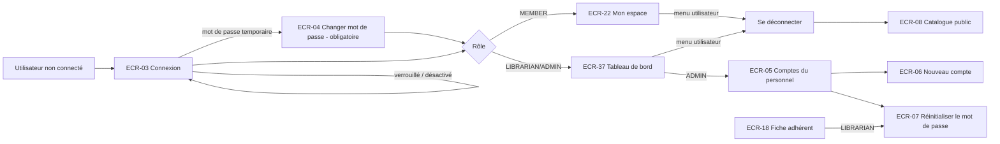

# UX — Authentification et comptes utilisateurs

> Réutilise le socle [UX-socle.md](UX-socle.md) : gabarits, guards, tokens, composants partagés, messages transverses.

## 1. Parcours utilisateurs


## 2. Plan de navigation
| ECR | Route Angular | Rôles | Guard | US couvertes |
|---|---|---|---|---|
| ECR-03 | `/connexion` | aucun (visiteur) | `guestGuard` | US-001 |
| ECR-04 | `/compte/mot-de-passe` (`?obligatoire=1`) | MEMBER, LIBRARIAN, ADMIN | `authGuard` | US-003, AC-001-7 |
| ECR-05 | `/gestion/comptes` | ADMIN | `authGuard`, `passwordChangeGuard`, `roleGuard(['ADMIN'])` | US-004, US-005, US-006 |
| ECR-06 | dialogue dans ECR-05 | ADMIN | — | US-004 |
| ECR-07 | dialogue dans ECR-05 (ADMIN) et ECR-18 (LIBRARIAN, ADMIN) | LIBRARIAN, ADMIN | — | US-006 |
| — | Menu utilisateur « Se déconnecter » (`app-user-menu`, socle) | tous connectés | — | US-002 |

## 3. Écrans

### ECR-03 — Connexion
- **Route** : `/connexion` · **Rôles** : visiteur · **US/AC** : US-001 (AC-001-1 → AC-001-8), US-002 (AC-002-2)
- **Wireframe** :
```
┌───────────────────────── Gabarit public ─────────────────────────┐
│                    Se connecter                                    │
│  ┌──────────────────────────────────────────────┐                 │
│  │ [!] Votre session a expiré. Veuillez vous     │ (si ?expire=1)  │
│  │     reconnecter.                              │                 │
│  └──────────────────────────────────────────────┘                 │
│  Adresse e-mail *        [______________________]                  │
│  Mot de passe *          [______________________] [Afficher]       │
│  ┌──────────────────────────────────────────────┐                 │
│  │ [x] Identifiants incorrects.                  │ (erreur serveur)│
│  └──────────────────────────────────────────────┘                 │
│                          [ Se connecter ]                          │
│  Mot de passe oublié ? Adressez-vous à l'accueil de la             │
│  bibliothèque.                                                     │
└────────────────────────────────────────────────────────────────────┘
```
- **Composants** : `app-login-page` (smart) → `app-login-form` (presentational) ; `app-form-field`, `app-button`, `app-alert` (shared).
- **Données lues** : aucune. **Données écrites** : e-mail + mot de passe → session (identité, rôle, mot de passe temporaire).
- **États** : chargement N/A (pas de lecture) · vide N/A · erreur : `app-alert danger` au-dessus du bouton, mot de passe vidé, focus sur le champ mot de passe · succès : redirection selon §2.3 du socle (ECR-04 si mot de passe temporaire).
- **Actions** :
| Action | Déclencheur | Résultat | Feedback |
|---|---|---|---|
| Se connecter | Bouton ou `Entrée` | Session ouverte, redirection | Bouton `loading` pendant l'appel |
| Afficher/masquer le mot de passe | Bouton bascule (`aria-pressed`) | Champ en clair/masqué | Libellé « Afficher » / « Masquer » |
- **Formulaire** :
| Champ | Type | Obligatoire | Validation [RG] | Message d'erreur exact |
|---|---|---|---|---|
| Adresse e-mail | email, `autocomplete=username` | Oui | Format e-mail | « Saisissez une adresse e-mail valide. » |
| Mot de passe | password, `autocomplete=current-password` | Oui | Non vide (aucune règle de complexité affichée à la connexion) | « Ce champ est obligatoire. » |
- **Messages serveur** :
| Refus | Message exact |
|---|---|
| Identifiants incorrects (AC-001-3) — ne révèle jamais si l'e-mail existe | « Identifiants incorrects. » |
| Compte verrouillé (AC-001-4) [RG-02] | « Votre compte est temporairement verrouillé suite à plusieurs tentatives infructueuses. Réessayez à partir de HH:MM. » (heure fournie par le serveur) |
| Compte désactivé (AC-001-5) | « Compte désactivé, contactez la bibliothèque. » |
| Session expirée (AC-001-8), via `?expire=1` | « Votre session a expiré. Veuillez vous reconnecter. » |
- **data-testid** : `login-email-input`, `login-email-error`, `login-password-input`, `login-password-error`, `login-password-toggle`, `login-submit`, `login-server-error`, `login-session-expired`

### ECR-04 — Changer mon mot de passe
- **Route** : `/compte/mot-de-passe` · **Rôles** : MEMBER, LIBRARIAN, ADMIN · **US/AC** : US-003 (AC-003-1 → AC-003-5), AC-001-7
- **Wireframe** :
```
┌──────────────── Gabarit adhérent ou personnel ────────────────┐
│ Changer mon mot de passe                                        │
│ ┌────────────────────────────────────────────────────────────┐ │
│ │ [i] Pour des raisons de sécurité, vous devez choisir un    │ │ (mode obligatoire)
│ │     nouveau mot de passe avant de continuer.               │ │
│ └────────────────────────────────────────────────────────────┘ │
│ Mot de passe actuel *           [__________________]            │
│ Nouveau mot de passe *          [__________________]            │
│   ✓ Au moins 12 caractères      ✗ Une majuscule                 │ (liste vivante)
│   ✓ Une minuscule               ✗ Un chiffre                    │
│ Confirmer le nouveau mot de passe * [__________________]        │
│                       [ Annuler ] [ Enregistrer ]               │
└─────────────────────────────────────────────────────────────────┘
```
- **Composants** : `app-change-password-page` (smart) → `app-password-form` (presentational) → `app-password-policy-checklist` (presentational, réutilisé par ECR-06, ECR-07, ECR-17).
- **Données lues** : indicateur « mot de passe temporaire » (session). **Données écrites** : mot de passe actuel, nouveau mot de passe.
- **États** : chargement N/A · vide N/A · erreur : `app-alert danger` + champ concerné marqué · succès : toast « Votre mot de passe a été modifié. » puis, en mode obligatoire, redirection vers l'accueil du rôle ; sinon retour à la page précédente.
- **Mode obligatoire** (`?obligatoire=1`, AC-001-7) : bandeau `app-alert info` ci-dessus, bouton « Annuler » remplacé par « Se déconnecter », navigation du gabarit désactivée (`passwordChangeGuard`).
- **Actions** :
| Action | Déclencheur | Résultat | Feedback |
|---|---|---|---|
| Enregistrer | Bouton / `Entrée` | Mot de passe changé, n'est plus temporaire | Toast succès |
| Annuler | Bouton | Retour page précédente | — |
- **Formulaire** :
| Champ | Type | Obligatoire | Validation [RG] | Message d'erreur exact |
|---|---|---|---|---|
| Mot de passe actuel | password, `autocomplete=current-password` | Oui | Non vide | « Ce champ est obligatoire. » |
| Nouveau mot de passe | password, `autocomplete=new-password` | Oui | [RG-01] ≥ 12 caractères, 1 majuscule, 1 minuscule, 1 chiffre | « Le mot de passe doit contenir au moins 12 caractères, dont une majuscule, une minuscule et un chiffre. » |
| Confirmation | password | Oui | Identique au nouveau | « Les mots de passe ne correspondent pas. » |
- **Messages serveur** : mot de passe actuel incorrect (AC-003-2) → « Mot de passe actuel incorrect. » ; réutilisation (AC-003-4) [RG-01] → « Mot de passe déjà utilisé récemment. Choisissez-en un autre. »
- **data-testid** : `password-form-current-input`, `password-form-current-error`, `password-form-new-input`, `password-form-new-error`, `password-form-confirm-input`, `password-form-confirm-error`, `password-policy-item` (+ `data-rule`, `data-valid`), `password-form-submit`, `password-form-cancel`, `password-form-server-error`, `password-forced-banner`

### ECR-05 — Comptes du personnel
- **Route** : `/gestion/comptes` · **Rôles** : ADMIN · **US/AC** : US-004, US-005 (AC-005-1 → AC-005-5), US-006 (AC-006-3)
- **Wireframe** :
```
┌──────────────────────── Gabarit personnel ────────────────────────┐
│ Comptes du personnel                         [ + Nouveau compte ]   │
│ Rechercher [nom ou e-mail____] Rôle [Tous ▾] Statut [Tous ▾]        │
│ ┌──────────────┬──────────────────┬───────────────┬─────────┬─────┐│
│ │ Nom ▲        │ E-mail           │ Rôle          │ Statut  │     ││
│ ├──────────────┼──────────────────┼───────────────┼─────────┼─────┤│
│ │ DUPONT Marie │ m.dupont@…       │ Bibliothécaire│ [Actif] │ ⋮   ││
│ │ (vous) LEROY │ a.leroy@…        │ Administrateur│ [Actif] │ ⋮   ││
│ └──────────────┴──────────────────┴───────────────┴─────────┴─────┘│
│ Page 1 sur 1                                     ◀  ▶   20 ▾        │
└─────────────────────────────────────────────────────────────────────┘
Menu ⋮ : Désactiver | Réactiver | Réinitialiser le mot de passe
```
- **Composants** : `app-staff-accounts-page` (smart) → `app-staff-account-table` (presentational) ; `app-data-table`, `app-pagination`, `app-search-input`, `app-status-badge`, `app-confirm-dialog` ; ouvre ECR-06, ECR-07.
- **Données lues** : liste paginée des comptes `LIBRARIAN`/`ADMIN` (nom, prénom, e-mail, rôle, statut). **Données écrites** : changement de statut.
- **États** : chargement : squelette 5 lignes · vide : « Aucun compte ne correspond à votre recherche. » · erreur : `app-error-state` · succès : tableau.
- **Actions** :
| Action | Déclencheur | Résultat | Feedback |
|---|---|---|---|
| Nouveau compte | Bouton | Ouvre ECR-06 | — |
| Désactiver | Menu ⋮ (compte `ACTIVE`/`LOCKED`) → `app-confirm-dialog` « Désactiver le compte de Marie DUPONT ? L'agent perdra immédiatement tout accès. » | Statut `DISABLED` | Toast « Compte désactivé. » |
| Réactiver | Menu ⋮ (compte `DISABLED`) | Statut `ACTIVE` | Toast « Compte réactivé. » |
| Réinitialiser le mot de passe | Menu ⋮ | Ouvre ECR-07 | — |
- **Règles d'affichage** : sur la ligne de l'administrateur connecté, « Désactiver » est désactivé avec l'explication « Vous ne pouvez pas désactiver votre propre compte. » (AC-005-3, [RG-06]).
- **Messages serveur** : dernier administrateur actif (AC-005-4) → « Au moins un administrateur actif est requis. » ; auto-désactivation → « Vous ne pouvez pas désactiver votre propre compte. »
- **Filtres/tri** : recherche nom/e-mail (≥ 2 caractères), rôle, statut ; tri par nom (défaut), rôle, statut.
- **data-testid** : `staff-accounts-new-button`, `staff-accounts-search-input`, `staff-accounts-role-filter`, `staff-accounts-status-filter`, `staff-accounts-row` (+ `data-row-id` = e-mail), `staff-accounts-row-menu`, `staff-accounts-disable-action`, `staff-accounts-enable-action`, `staff-accounts-reset-password-action`, `staff-accounts-loading`, `staff-accounts-empty`, `staff-accounts-error`, `staff-accounts-error-retry`

### ECR-06 — Dialogue « Nouveau compte du personnel »
- **Route** : dialogue dans ECR-05 · **Rôles** : ADMIN · **US/AC** : US-004 (AC-004-1 → AC-004-4)
- **Wireframe** :
```
┌──────── Nouveau compte du personnel ────────┐
│ Nom *            [____________]              │
│ Prénom *         [____________]              │
│ Adresse e-mail * [____________]              │
│ Rôle *  (•) Bibliothécaire  ( ) Administrateur│
│ Mot de passe initial *  [____________]       │
│   (liste de règles RG-01)                    │
│ Confirmer *      [____________]              │
│ [i] L'agent devra changer ce mot de passe    │
│     à sa première connexion.                 │
│               [ Annuler ] [ Créer le compte ]│
└──────────────────────────────────────────────┘
```
- **Composants** : `app-staff-account-form-dialog` (presentational, émet la saisie) ; `app-dialog`, `app-form-field`, `app-password-policy-checklist`.
- **Données écrites** : nom, prénom, e-mail, rôle (`LIBRARIAN` ou `ADMIN` uniquement — `MEMBER` n'est pas proposé, AC-004-3), mot de passe initial.
- **États** : formulaire uniquement (pristine → invalide → envoi → erreur serveur → succès : fermeture + toast « Compte créé. Communiquez le mot de passe initial à l'agent. » + rafraîchissement de ECR-05).
- **Formulaire** :
| Champ | Type | Obligatoire | Validation [RG] | Message d'erreur exact |
|---|---|---|---|---|
| Nom | texte, ≤ 100 | Oui | 1-100 caractères | « Ce champ est obligatoire. » / « 100 caractères maximum. » |
| Prénom | texte, ≤ 100 | Oui | idem | idem |
| Adresse e-mail | email | Oui | Format ; unicité [RG-14] côté serveur | « Saisissez une adresse e-mail valide. » / serveur : « Cette adresse e-mail est déjà utilisée. » |
| Rôle | radio | Oui | `LIBRARIAN` ou `ADMIN` [RG-04] | « Sélectionnez un rôle. » |
| Mot de passe initial | password | Oui | [RG-01] | « Le mot de passe doit contenir au moins 12 caractères, dont une majuscule, une minuscule et un chiffre. » |
| Confirmation | password | Oui | Identique | « Les mots de passe ne correspondent pas. » |
- **data-testid** : `staff-account-dialog`, `staff-account-lastname-input`, `staff-account-firstname-input`, `staff-account-email-input`, `staff-account-email-error`, `staff-account-role-librarian`, `staff-account-role-admin`, `staff-account-password-input`, `staff-account-password-error`, `staff-account-confirm-input`, `staff-account-confirm-error`, `staff-account-dialog-confirm`, `staff-account-dialog-cancel`, `staff-account-server-error`

### ECR-07 — Dialogue « Réinitialiser le mot de passe »
- **Route** : dialogue dans ECR-05 (ADMIN, comptes du personnel) et ECR-18 (LIBRARIAN/ADMIN, compte de l'adhérent) · **US/AC** : US-006 (AC-006-1 → AC-006-3)
- **Wireframe** :
```
┌──── Réinitialiser le mot de passe ────┐
│ Compte : Jean MARTIN (A000123)         │
│ Nouveau mot de passe temporaire *      │
│ [______________]  (règles RG-01)       │
│ Confirmer * [______________]           │
│ [i] Le compte sera débloqué. Le        │
│ mot de passe devra être changé à la    │
│ prochaine connexion.                   │
│          [ Annuler ] [ Réinitialiser ] │
└────────────────────────────────────────┘
```
- **Composants** : `app-reset-password-dialog` (composant smart de la feature `authentification`, exporté et réutilisé par `adherents`) ; `app-password-policy-checklist`.
- **Données lues** : identité du compte ciblé (nom, prénom, numéro d'adhérent ou rôle). **Données écrites** : nouveau mot de passe temporaire.
- **Règles d'affichage** : l'action n'est pas proposée pour un compte `DISABLED` (AC-006-2) ; pour un `LIBRARIAN`, elle n'est proposée que sur les comptes adhérents (AC-006-3).
- **États** : formulaire ; succès : fermeture + toast « Mot de passe réinitialisé. Le compte est débloqué. »
- **Formulaire** : identique aux champs « Mot de passe initial » et « Confirmation » de ECR-06 [RG-01].
- **Messages serveur** : compte désactivé → « Ce compte est désactivé. » ; droits (AC-006-3) → message 403 du socle.
- **data-testid** : `reset-password-dialog`, `reset-password-account-label`, `reset-password-input`, `reset-password-error`, `reset-password-confirm-input`, `reset-password-confirm-error`, `reset-password-dialog-confirm`, `reset-password-dialog-cancel`, `reset-password-server-error`

## 4. Arborescence de composants
```
features/authentification/
  authentification.routes.ts
  pages/
    login.page.ts                       app-login-page              (ECR-03)
    change-password.page.ts             app-change-password-page    (ECR-04)
    staff-accounts.page.ts              app-staff-accounts-page     (ECR-05)
  components/
    login-form.component.ts             app-login-form
    password-form.component.ts          app-password-form
    password-policy-checklist.component.ts app-password-policy-checklist (réutilisé par adherents)
    staff-account-table.component.ts    app-staff-account-table
    staff-account-form-dialog.component.ts app-staff-account-form-dialog (ECR-06)
    reset-password-dialog.component.ts  app-reset-password-dialog   (ECR-07, smart, exporté)
  data-access/
    auth-api.service.ts                 (connexion, déconnexion, session, changement de mot de passe — utilisé par core/AuthService)
    staff-account.service.ts            (liste, création, désactivation, réactivation, réinitialisation)
    account.models.ts                   (interfaces miroir des données §7)
    auth-messages.ts                    (codes de refus → messages exacts ci-dessus)
shared/validators/password-policy.validator.ts   (RG-01, partagé)
```

## 5. Design tokens & composants partagés
| Token / Composant | Valeur / Rôle | Nouveau ou existant |
|---|---|---|
| Tous les tokens | [UX-socle §5.1](UX-socle.md) | Existant |
| `app-password-policy-checklist` | Liste vivante des critères [RG-01] (✓/✗ + texte « respecté » / « non respecté » pour lecteurs d'écran) | Nouveau (feature, réutilisé) |
| `app-dialog`, `app-confirm-dialog`, `app-form-field`, `app-alert`, `app-data-table`, `app-status-badge` | Socle | Existant |

## 6. Accessibilité
| Écran | Point de contrôle WCAG | Mise en œuvre |
|---|---|---|
| ECR-03 | 1.3.5 Finalité des champs | `autocomplete="username"` / `current-password` |
| ECR-03 | 3.3.1 Identification des erreurs | Erreur serveur dans `app-alert` `role=alert`, focus déplacé dessus |
| ECR-04 | 4.1.3 Messages d'état | Checklist RG-01 dans une région `aria-live="polite"` (annonce à la pause de saisie, pas à chaque frappe) |
| ECR-04, 06, 07 | 1.3.5 | `autocomplete="new-password"` sur les nouveaux mots de passe |
| ECR-05 | 2.1.1 Clavier | Menu ⋮ = `button` + `menu` ARIA, flèches haut/bas, `Échap` |
| ECR-05 | 1.3.1 | Bouton « Désactiver » désactivé pour soi-même accompagné d'un texte visible (pas seulement une infobulle) |

## 7. Besoins de données pour l'Architecte
| ECR | Opération | Données entrée | Données sortie | Pagination/Tri/Filtres |
|---|---|---|---|---|
| ECR-03 | Ouvrir une session | e-mail, mot de passe | Session (§8 socle) ; refus : identifiants incorrects, verrouillé (avec heure de fin), désactivé | — |
| Socle | Lire la session courante | — | Identité, rôle, mot de passe temporaire, numéro d'adhérent | — |
| Menu | Fermer la session | — | — | — |
| ECR-04 | Changer son mot de passe | mot de passe actuel, nouveau | — ; refus : actuel incorrect, politique non respectée, réutilisation | — |
| ECR-05 | Lister les comptes du personnel | recherche, rôle, statut | id, nom, prénom, e-mail, rôle, statut, « est moi » | Paginé 20 ; tri nom/rôle/statut ; filtres rôle, statut, texte |
| ECR-06 | Créer un compte du personnel | nom, prénom, e-mail, rôle, mot de passe initial | compte créé ; refus : e-mail utilisé, rôle interdit, politique | — |
| ECR-05 | Désactiver / réactiver un compte | id compte | statut ; refus : soi-même, dernier administrateur | — |
| ECR-07 | Réinitialiser un mot de passe | id compte, nouveau mot de passe | — ; refus : compte désactivé, droits | — |

## 8. Questions ouvertes
| ID | Question | Hypothèse retenue | Impact |
|---|---|---|---|
| Q-21 | Le message de verrouillage peut-il indiquer l'heure de fin ? (révèle que l'e-mail existe, contrairement à AC-001-3) | Oui : la SPEC (AC-001-4/5) prévoit déjà des messages spécifiques pour verrouillé/désactivé ; risque accepté | Si refusé : afficher « Identifiants incorrects. » dans tous les cas |
