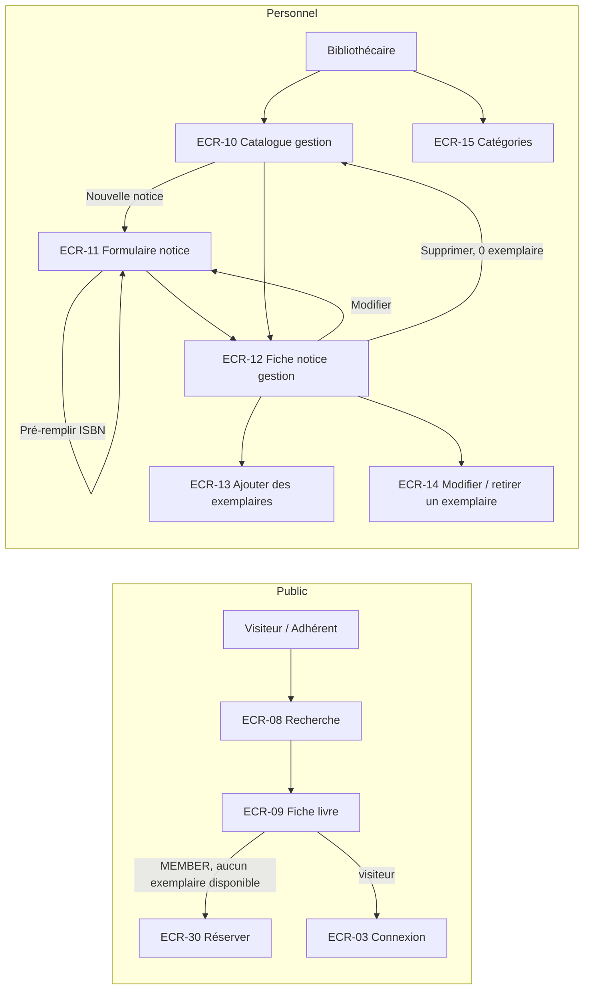

# UX — Catalogue et exemplaires

> Réutilise le socle [UX-socle.md](UX-socle.md). Les dialogues de circulation ouverts depuis ECR-12 sont spécifiés dans [UX-emprunts.md](UX-emprunts.md) (ECR-28, ECR-29) et [UX-reservations.md](UX-reservations.md) (ECR-30, ECR-31, ECR-32).

## 1. Parcours utilisateurs


## 2. Plan de navigation
| ECR | Route Angular | Rôles | Guard | US couvertes |
|---|---|---|---|---|
| ECR-08 | `/catalogue` (paramètres `q`, `categorie`, `disponible`, `langue`, `tri`, `page`, `taille`) | tous (y compris visiteur) | — | US-007 |
| ECR-09 | `/catalogue/:bookId` | tous | — | US-008, point d'entrée US-032 |
| ECR-10 | `/gestion/catalogue` (mêmes paramètres + `retirees`) | LIBRARIAN, ADMIN | `authGuard`, `passwordChangeGuard`, `roleGuard` | US-007 (AC-007-7), US-009 |
| ECR-11 | `/gestion/catalogue/nouvelle` · `/gestion/catalogue/:bookId/modifier` | LIBRARIAN, ADMIN | idem | US-009, US-010, US-015 |
| ECR-12 | `/gestion/catalogue/:bookId` | LIBRARIAN, ADMIN | idem | US-008 (AC-008-2), US-011, US-012, US-013 |
| ECR-13 | dialogue dans ECR-12 | LIBRARIAN, ADMIN | — | US-012 |
| ECR-14 | dialogue dans ECR-12 | LIBRARIAN, ADMIN | — | US-013 |
| ECR-15 | `/gestion/categories` | LIBRARIAN, ADMIN | idem | US-014 |

## 3. Écrans

### ECR-08 — Recherche dans le catalogue (public)
- **Route** : `/catalogue` · **Rôles** : tous · **US/AC** : US-007 (AC-007-1 → AC-007-7)
- **Wireframe** (mobile `sm` ; en `lg` les filtres passent dans une colonne de gauche) :
```
┌────────────────── Gabarit public ──────────────────┐
│ Rechercher un livre                                  │
│ [ titre, auteur ou ISBN ______________ ] [Rechercher]│
│ Filtres ▾  Catégorie [Toutes ▾] Langue [Toutes ▾]    │
│            [x] Disponibles uniquement                │
│ 23 résultats            Trier par [Pertinence ▾]     │
│ ┌──────────────────────────────────────────────────┐ │
│ │ Le Comte de Monte-Cristo                          │ │
│ │ Alexandre Dumas · 1844 · Roman                    │ │
│ │ [● 1 disponible sur 2]                            │ │
│ └──────────────────────────────────────────────────┘ │
│ ┌──────────────────────────────────────────────────┐ │
│ │ …                                                 │ │
│ └──────────────────────────────────────────────────┘ │
│ Page 1 sur 2                         ◀  ▶             │
└──────────────────────────────────────────────────────┘
```
- **Composants** : `app-catalog-search-page` (smart, synchronise les filtres avec l'URL) → `app-catalog-filters`, `app-book-result-list`, `app-book-result-card`, `app-availability-badge` (presentational) ; `app-search-input` (`minLength=2`), `app-pagination`.
- **Données lues** : résultats paginés (id notice, titre, sous-titre, auteurs, année, catégories, nb disponibles, nb total) ; liste des catégories et des langues pour les filtres. **Données écrites** : aucune.
- **États** :
  - initial (aucun mot-clé, aucun filtre) : texte d'aide « Saisissez un titre, un auteur ou un ISBN. » — aucune liste chargée ;
  - chargement : 5 cartes squelettes ;
  - vide : « Aucun livre ne correspond à votre recherche. » (AC-007-6) + lien « Effacer les filtres » si des filtres sont actifs ;
  - erreur : `app-error-state` ;
  - succès : nombre de résultats annoncé en `aria-live` (« 23 résultats »).
- **Actions** :
| Action | Déclencheur | Résultat | Feedback |
|---|---|---|---|
| Rechercher | `Entrée` / bouton | Résultats page 1 | Compteur de résultats |
| Filtrer catégorie / langue / disponibles | Changement de filtre | Résultats page 1, URL mise à jour | idem |
| Trier | Sélecteur : Pertinence (défaut si mot-clé), Titre A→Z, Année (récent d'abord) | Résultats triés | — |
| Ouvrir une notice | Clic/`Entrée` sur la carte (lien sur le titre) | ECR-09 | — |
- **Formulaire** :
| Champ | Type | Obligatoire | Validation [RG] | Message d'erreur exact |
|---|---|---|---|---|
| Mot-clé | search | Non (requis si aucun filtre) | ≥ 2 caractères [RG-11] ; tirets/espaces d'ISBN acceptés | « Saisissez au moins 2 caractères. » |
- **Badge de disponibilité** (`app-availability-badge`) : « N disponible(s) sur M » en `success` si N ≥ 1 ; « Aucun exemplaire disponible » en `info` si N = 0 [RG-11].
- **data-testid** : `catalog-search-input`, `catalog-search-submit`, `catalog-search-error`, `catalog-filter-category`, `catalog-filter-language`, `catalog-filter-available`, `catalog-sort`, `catalog-result-count`, `catalog-result-row` (+ `data-row-id` = id notice), `catalog-result-title`, `catalog-result-availability`, `catalog-help`, `catalog-loading`, `catalog-empty`, `catalog-clear-filters`, `catalog-error`, `catalog-error-retry`

### ECR-09 — Fiche d'un livre (public)
- **Route** : `/catalogue/:bookId` · **Rôles** : tous · **US/AC** : US-008 (AC-008-1, AC-008-3), US-032 (point d'entrée), AC-034-3
- **Wireframe** :
```
┌────────────────── Gabarit public ──────────────────┐
│ ◀ Retour aux résultats                               │
│ Le Comte de Monte-Cristo                             │
│ Alexandre Dumas                                      │
│ Éditeur Gallimard · 1844 · Français · 1 312 pages    │
│ Catégories : Roman, Classique · ISBN 978-2-07-…      │
│ Résumé ……………………………………………………                        │
│ ── Exemplaires ─────────────────────────────────     │
│ Cote      Statut                                     │
│ R DUM     [● Disponible]                             │
│ R DUM     [● Emprunté — retour prévu le 05/11/2026]  │
│ ── Réservation ─────────────────────────────────     │
│ (MEMBER, 0 disponible)       [ Réserver ce livre ]   │
│ (MEMBER, déjà réservé)  Vous êtes en position 2 sur 3│
│ (visiteur, 0 disponible) Connectez-vous pour réserver│
└──────────────────────────────────────────────────────┘
```
- **Composants** : `app-book-public-detail-page` (smart) → `app-book-summary` (presentational, réutilisé par ECR-12), `app-public-copy-list` ; `app-reservation-cta` (presentational, défini dans la feature `reservations`).
- **Données lues** : notice complète ; exemplaires hors `WITHDRAWN` (cote, statut, date de retour prévue si `ON_LOAN`) — **aucune donnée d'emprunteur** (AC-008-1) ; pour un adhérent connecté : possibilité de réserver et motif sinon, réservation active éventuelle (position, total, statut).
- **États** : chargement : squelette `detail` · vide N/A (une notice a toujours ses informations ; liste d'exemplaires vide impossible côté public, RG-11) · erreur 404 : « Ce livre est introuvable. » + lien « Retour au catalogue » (AC-008-3) · erreur autre : `app-error-state` · succès : fiche.
- **Actions** :
| Action | Déclencheur | Résultat | Feedback |
|---|---|---|---|
| Réserver ce livre | Bouton (MEMBER connecté, aucun exemplaire `AVAILABLE`) | Ouvre ECR-30 | — |
| Se connecter pour réserver | Lien (visiteur) | ECR-03 avec `retour=/catalogue/:bookId` | — |
| Retour aux résultats | Lien | ECR-08 avec les filtres précédents | — |
- **Règles d'affichage** : bouton « Réserver » absent si au moins 1 exemplaire disponible (texte « Un exemplaire est disponible en rayon. ») ; si l'adhérent a déjà une réservation active : « Vous êtes en position P sur T. » ou « Votre réservation est prête : à retirer avant le JJ/MM/AAAA. » (AC-034-3).
- **data-testid** : `book-detail-title`, `book-detail-authors`, `book-detail-isbn`, `book-detail-summary`, `book-copy-row` (+ `data-row-id` = cote + rang), `book-copy-status`, `book-copy-due-date`, `book-reserve-button`, `book-reserve-login-link`, `book-reserve-available-info`, `book-reservation-position`, `book-detail-loading`, `book-detail-not-found`, `book-detail-error`, `book-detail-error-retry`

### ECR-10 — Catalogue (gestion)
- **Route** : `/gestion/catalogue` · **Rôles** : LIBRARIAN, ADMIN · **US/AC** : US-007 (AC-007-7), US-009 (point d'entrée)
- **Wireframe** :
```
┌──────────────────────── Gabarit personnel ───────────────────────┐
│ Catalogue                                    [ + Nouvelle notice ] │
│ [titre, auteur ou ISBN ______] Catégorie [▾] [x] Inclure retirées  │
│ ┌────────────────────┬──────────────┬───────────┬──────┬─────────┐│
│ │ Titre ▲            │ Auteur(s)    │ ISBN      │ Année│Exemplair.││
│ ├────────────────────┼──────────────┼───────────┼──────┼─────────┤│
│ │ L'Étranger         │ Camus, A.    │ 978207036…│ 1942 │ 2 / 3   ││
│ │ Vieux traité       │ Anonyme      │ —         │ 1702 │[Retirée]││
│ │ Notice sans exempl.│ …            │ …         │ …    │ 0 / 0   ││
│ └────────────────────┴──────────────┴───────────┴──────┴─────────┘│
│ Page 1 sur 12                                      ◀  ▶  20 ▾      │
└────────────────────────────────────────────────────────────────────┘
```
- **Composants** : `app-catalog-admin-page` (smart) → `app-book-admin-table` (presentational) ; `app-data-table`, `app-search-input`, `app-pagination`.
- **Données lues** : notices paginées, y compris celles sans exemplaire et (si coché) entièrement retirées, avec disponibles/total et indicateur « retirée ». **Données écrites** : aucune.
- **États** : chargement squelette tableau · vide : « Aucune notice ne correspond à votre recherche. » · erreur standard · succès tableau. Sans mot-clé, la liste complète paginée est affichée (tri titre).
- **Actions** : Nouvelle notice → ECR-11 ; clic ligne → ECR-12 ; tri par titre, année, nombre d'exemplaires ; filtre catégorie ; « Inclure les notices retirées » (défaut non coché).
- **Formulaire** : mot-clé ≥ 2 caractères [RG-11], message « Saisissez au moins 2 caractères. »
- **data-testid** : `catalog-admin-new-button`, `catalog-admin-search-input`, `catalog-admin-category-filter`, `catalog-admin-include-withdrawn`, `catalog-admin-row` (+ `data-row-id`), `catalog-admin-withdrawn-badge`, `catalog-admin-loading`, `catalog-admin-empty`, `catalog-admin-error`, `catalog-admin-error-retry`

### ECR-11 — Formulaire de notice (création / modification)
- **Route** : `/gestion/catalogue/nouvelle` · `/gestion/catalogue/:bookId/modifier` · **Rôles** : LIBRARIAN, ADMIN · **US/AC** : US-009 (AC-009-1 → AC-009-8), US-010 (AC-010-1 → AC-010-4), US-015 (AC-015-1, AC-015-2)
- **Wireframe** :
```
┌──────────────────────── Gabarit personnel ───────────────────────┐
│ Nouvelle notice                                                    │
│ ISBN        [978-2-07-036002-4____] [ Pré-remplir ]                │
│ Titre *     [____________________________________]                 │
│ Sous-titre  [____________________________________]                 │
│ Auteur(s) * [Camus, Albert ×] [Ajouter un auteur… ▾]  ↑ ↓          │
│ Catégories *[Roman ×] [Classique ×] [Ajouter… ▾]                   │
│ Éditeur     [____________]  Année [____]  Langue * [Français ▾]    │
│ Pages       [____]                                                 │
│ Résumé      [                                          ] 0/4000    │
│ ┌────────────────────────────────────────────────────────────────┐ │
│ │ [x] Cet élément a été modifié entre-temps… [ Recharger ]        │ │
│ └────────────────────────────────────────────────────────────────┘ │
│                                   [ Annuler ] [ Enregistrer ]      │
└────────────────────────────────────────────────────────────────────┘
```
- **Composants** : `app-book-form-page` (smart, mode création/modification) → `app-book-form` (presentational), `app-author-picker` (presentational, s'appuie sur `app-autocomplete` avec option « Créer l'auteur “…” », ordre modifiable par boutons ↑ ↓), `app-category-picker` (multi-sélection `app-autocomplete`) ; `app-form-field`, `app-alert`.
- **Données lues** : (modification) notice + version courante ; suggestions d'auteurs (recherche par nom, ≥ 2 caractères, 10 résultats) ; catégories ; langues ; (pré-remplissage) informations bibliographiques pour un ISBN. **Données écrites** : notice complète ; nouveaux auteurs (nom, prénom).
- **États** : chargement (modification) squelette `detail` · vide N/A · erreur de lecture : `app-error-state` (404 → « Cette notice est introuvable. ») · formulaire : pristine → invalide → envoi → erreur serveur → succès : toast « Notice enregistrée. » puis navigation vers ECR-12.
- **Pré-remplissage (US-015, COULD)** : bouton actif seulement si l'ISBN est valide ; pendant l'appel, bouton `loading` ; en cas de succès, les champs vides sont remplis et les champs déjà saisis ne sont **pas** écrasés ; annonce `aria-live` « Informations pré-remplies : vérifiez-les avant d'enregistrer. »
- **Actions** :
| Action | Déclencheur | Résultat | Feedback |
|---|---|---|---|
| Pré-remplir | Bouton | Champs proposés | Annonce ci-dessus ou message d'échec |
| Ajouter un auteur existant / créer | `app-author-picker` | Auteur ajouté à la liste | — |
| Réordonner un auteur | ↑ ↓ (`aria-label` « Monter Camus, Albert ») | Ordre modifié | Annonce de la nouvelle position |
| Enregistrer | Bouton | Notice créée/modifiée | Toast + ECR-12 |
| Annuler | Bouton | Retour sans enregistrer ; si le formulaire est modifié, confirmation « Abandonner les modifications non enregistrées ? » | — |
| Recharger (conflit) | Bouton dans l'alerte | Recharge la dernière version | — |
- **Formulaire** :
| Champ | Type | Obligatoire | Validation [RG] | Message d'erreur exact |
|---|---|---|---|---|
| ISBN | texte (tirets/espaces tolérés) | Non | ISBN-10 ou ISBN-13 à clé valide [RG-07] | « ISBN invalide. » |
| ISBN (serveur) | — | — | Unicité [RG-07] | « Un livre avec cet ISBN existe déjà : « <titre> ». » + lien vers la notice (AC-009-5) |
| Titre | texte | Oui | 1-255 caractères [RG-08] | « Ce champ est obligatoire. » / « 255 caractères maximum. » |
| Sous-titre | texte | Non | ≤ 255 | « 255 caractères maximum. » |
| Auteur(s) | liste | Oui | ≥ 1 [RG-08] ; nouveau : nom 1-100, prénom ≤ 100 | « Ajoutez au moins un auteur. » |
| Catégories | liste | Oui | ≥ 1 [RG-08] | « Sélectionnez au moins une catégorie. » |
| Éditeur | texte | Non | ≤ 150 | « 150 caractères maximum. » |
| Année de publication | nombre | Non | 1450 ≤ année ≤ année en cours [RG-08] | « L'année doit être comprise entre 1450 et <année en cours>. » |
| Langue | liste | Oui | Défaut « Français » | « Ce champ est obligatoire. » |
| Nombre de pages | nombre | Non | Entier > 0 | « Saisissez un nombre entier positif. » |
| Résumé | zone de texte + compteur | Non | ≤ 4 000 | « 4 000 caractères maximum. » |
- **Messages pré-remplissage** : ISBN inconnu → « Aucune information trouvée pour cet ISBN. Vous pouvez saisir la notice manuellement. » ; source indisponible → « Le service de pré-remplissage est indisponible. Vous pouvez saisir la notice manuellement. » (AC-015-2).
- **Conflit (AC-010-3)** : message socle « Cet élément a été modifié entre-temps par un autre utilisateur. Rechargez la page pour voir la dernière version. » ; la saisie n'est pas perdue tant que l'utilisateur ne recharge pas.
- **data-testid** : `book-form-isbn-input`, `book-form-isbn-error`, `book-form-prefill-button`, `book-form-prefill-message`, `book-form-title-input`, `book-form-title-error`, `book-form-subtitle-input`, `book-form-authors-picker`, `book-form-author-chip`, `book-form-author-up`, `book-form-author-down`, `book-form-authors-error`, `book-form-categories-picker`, `book-form-categories-error`, `book-form-publisher-input`, `book-form-year-input`, `book-form-year-error`, `book-form-language-select`, `book-form-pages-input`, `book-form-summary-input`, `book-form-summary-counter`, `book-form-submit`, `book-form-cancel`, `book-form-server-error`, `book-form-conflict`, `book-form-conflict-reload`, `book-form-loading`, `book-form-error`

### ECR-12 — Fiche notice (gestion)
- **Route** : `/gestion/catalogue/:bookId` · **Rôles** : LIBRARIAN, ADMIN · **US/AC** : US-008 (AC-008-2), US-011 (AC-011-1 → AC-011-3), US-012 (point d'entrée), US-013 (point d'entrée) ; accès à US-030, US-031, US-032 (guichet), US-034
- **Wireframe** :
```
┌──────────────────────── Gabarit personnel ───────────────────────┐
│ Catalogue › L'Étranger                                             │
│ L'Étranger            [Modifier] [Supprimer] [Réserver pour un adh.]│
│ Albert Camus · Gallimard · 1942 · Roman · ISBN 978-2-07-036002-4   │
│ ── Exemplaires (3) ───────────────────────── [ + Ajouter ]         │
│ ┌─────────┬────────┬────────┬───────────┬─────────────────┬──────┐ │
│ │ N°      │ Cote   │ État   │ Acquis le │ Statut          │      │ │
│ ├─────────┼────────┼────────┼───────────┼─────────────────┼──────┤ │
│ │00001234 │ R CAM  │ Bon    │ 02/01/2024│[Disponible]     │ ⋮    │ │
│ │00001235 │ R CAM  │ Usé    │ 02/01/2024│[Emprunté]       │ ⋮    │ │
│ │00001236 │ R CAM  │ Abîmé  │ 02/01/2020│[Retiré] Désherb.│ ⋮    │ │
│ └─────────┴────────┴────────┴───────────┴─────────────────┴──────┘ │
│ ── File d'attente (ECR-32) ──────────────────────────────────────  │
└────────────────────────────────────────────────────────────────────┘
Menu ⋮ : Modifier | Retirer du fonds | Déclarer retrouvé (si Perdu) | Historique
```
- **Composants** : `app-book-admin-detail-page` (smart) → `app-book-summary` (réutilisé), `app-copy-admin-table` (presentational) ; ouvre ECR-13, ECR-14, ECR-28, ECR-29, ECR-31 ; inclut `app-reservation-queue-panel` (ECR-32).
- **Données lues** : notice ; tous les exemplaires (numéro, cote, état physique, date d'acquisition, statut, motif de retrait, date de retour prévue si emprunté) ; nombre d'exemplaires (pour la suppression). **Données écrites** : suppression de la notice.
- **États** : chargement squelette `detail` · vide (0 exemplaire) : « Aucun exemplaire pour cette notice. Elle n'est pas visible dans le catalogue public. » + bouton « Ajouter des exemplaires » · erreur 404 : « Cette notice est introuvable. » · erreur standard · succès.
- **Actions** :
| Action | Déclencheur | Résultat | Feedback |
|---|---|---|---|
| Modifier | Bouton | ECR-11 (modification) | — |
| Supprimer | Bouton, actif seulement si 0 exemplaire ; sinon désactivé avec le texte « Suppression impossible : la notice possède des exemplaires. » [RG-10] → `app-confirm-dialog` « Supprimer définitivement la notice « L'Étranger » ? » | Notice supprimée, retour ECR-10 | Toast « Notice supprimée. » |
| Ajouter des exemplaires | Bouton | ECR-13 | — |
| Modifier / Retirer un exemplaire | Menu ⋮ | ECR-14 | — |
| Déclarer retrouvé | Menu ⋮ (exemplaire `LOST`) | ECR-28 | — |
| Historique | Menu ⋮ | ECR-29 | — |
| Réserver pour un adhérent | Bouton (si aucun exemplaire `AVAILABLE`) | ECR-31 | — |
- **Message serveur** : notice avec exemplaires (AC-011-2) → « Suppression impossible : la notice possède des exemplaires. »
- **data-testid** : `book-admin-title`, `book-admin-edit-button`, `book-admin-delete-button`, `book-admin-delete-reason`, `book-admin-reserve-button`, `copy-admin-add-button`, `copy-admin-row` (+ `data-row-id` = numéro d'exemplaire), `copy-admin-row-menu`, `copy-admin-edit-action`, `copy-admin-withdraw-action`, `copy-admin-found-action`, `copy-admin-history-action`, `book-delete-dialog`, `book-delete-dialog-confirm`, `book-delete-dialog-cancel`, `book-admin-loading`, `book-admin-empty`, `book-admin-not-found`, `book-admin-error`, `book-admin-error-retry`

### ECR-13 — Dialogue « Ajouter des exemplaires »
- **Route** : dialogue dans ECR-12 · **Rôles** : LIBRARIAN, ADMIN · **US/AC** : US-012 (AC-012-1 → AC-012-5)
- **Wireframe** :
```
┌──────── Ajouter des exemplaires ────────┐
│ Notice : L'Étranger                      │
│ Nombre d'exemplaires * [ 3 ]             │
│ Cote *                 [R CAM______]     │
│ État physique *  (•) Bon ( ) Usé ( ) Abîmé│
│ Date d'acquisition *   [17/10/2026]      │
│ [i] Les numéros d'exemplaire sont        │
│     attribués automatiquement.           │
│             [ Annuler ] [ Ajouter ]      │
└──────────────────────────────────────────┘
```
- **Composants** : `app-add-copies-dialog` (presentational) ; `app-dialog`, `app-form-field`.
- **Données écrites** : notice, quantité, cote, état physique, date d'acquisition. **Données lues en retour** : numéros attribués et statut de chaque exemplaire créé (`AVAILABLE` ou `RESERVED` si attribué à une réservation, AC-012-2).
- **États** : formulaire ; succès : fermeture, rafraîchissement d'ECR-12, toast « 3 exemplaires ajoutés : 00001234, 00001235, 00001236. » ; si l'un est mis de côté : toast supplémentaire `warning` persistant « L'exemplaire 00001234 est mis de côté pour une réservation : placez-le sur l'étagère des réservations. » (AC-012-2).
- **Formulaire** :
| Champ | Type | Obligatoire | Validation [RG] | Message d'erreur exact |
|---|---|---|---|---|
| Nombre d'exemplaires | nombre | Oui | Entier 1-20 (Q-23) | « Saisissez un nombre entre 1 et 20. » |
| Cote | texte | Oui | 1-30 caractères | « Ce champ est obligatoire. » / « 30 caractères maximum. » |
| État physique | radio | Oui | Défaut `GOOD` | — |
| Date d'acquisition | date | Oui | ≤ date du jour ; défaut date du jour | « La date d'acquisition ne peut pas être dans le futur. » |
- **data-testid** : `add-copies-dialog`, `add-copies-quantity-input`, `add-copies-quantity-error`, `add-copies-shelfmark-input`, `add-copies-shelfmark-error`, `add-copies-condition-good`, `add-copies-condition-worn`, `add-copies-condition-damaged`, `add-copies-date-input`, `add-copies-date-error`, `add-copies-dialog-confirm`, `add-copies-dialog-cancel`, `add-copies-server-error`

### ECR-14 — Dialogue « Modifier / retirer un exemplaire »
- **Route** : dialogue dans ECR-12 · **Rôles** : LIBRARIAN, ADMIN · **US/AC** : US-013 (AC-013-1 → AC-013-6)
- **Wireframe** :
```
┌──────── Exemplaire 00001234 ─────────────┐
│ [ Modifier ] [ Retirer du fonds ]  (onglets)
│ ── Modifier ──                            │
│ Cote *          [R CAM 2_____]            │
│ État physique * (•) Bon ( ) Usé ( ) Abîmé │
│                 [ Annuler ] [ Enregistrer ]│
│ ── Retirer du fonds ──                    │
│ Motif *  [Choisir… ▾]                     │
│ [!] Le retrait est définitif. L'exemplaire│
│     restera dans l'historique.            │
│                 [ Annuler ] [ Retirer ]   │
└───────────────────────────────────────────┘
```
- **Composants** : `app-copy-edit-dialog` (presentational) ; `app-tabs`, `app-dialog`, `app-confirm-dialog`.
- **Données lues** : exemplaire (numéro, cote, état, statut, version). **Données écrites** : cote + état physique, ou retrait (motif).
- **Règles d'affichage** : exemplaire `WITHDRAWN` → dialogue en lecture seule « Cet exemplaire a été retiré du fonds et ne peut plus être modifié. » (AC-013-5) ; exemplaire `ON_LOAN` ou `RESERVED` → onglet « Retirer » désactivé avec « Retrait impossible : l'exemplaire est en circulation. » (AC-013-3) ; le numéro d'exemplaire n'est jamais modifiable [RG-09].
- **Retrait** : bouton « Retirer » ouvre `app-confirm-dialog` « Retirer définitivement l'exemplaire 00001234 (L'Étranger) du fonds ? » (action irréversible).
- **États** : formulaire ; succès : toast « Exemplaire modifié. » ou « Exemplaire retiré du fonds. », rafraîchissement d'ECR-12.
- **Formulaire** :
| Champ | Type | Obligatoire | Validation [RG] | Message d'erreur exact |
|---|---|---|---|---|
| Cote | texte | Oui | 1-30 | « Ce champ est obligatoire. » / « 30 caractères maximum. » |
| État physique | radio | Oui | `GOOD`/`WORN`/`DAMAGED` | — |
| Motif de retrait | liste (Abîmé, Perdu, Désherbage, Autre) | Oui (retrait) | [RG-10] | « Sélectionnez un motif de retrait. » |
- **Messages serveur** : en circulation → « Retrait impossible : l'exemplaire est en circulation. » ; retiré → « Cet exemplaire a été retiré du fonds et ne peut plus être modifié. »
- **data-testid** : `copy-edit-dialog`, `copy-edit-tab-edit`, `copy-edit-tab-withdraw`, `copy-edit-shelfmark-input`, `copy-edit-shelfmark-error`, `copy-edit-condition-good`, `copy-edit-condition-worn`, `copy-edit-condition-damaged`, `copy-edit-save`, `copy-withdraw-reason-select`, `copy-withdraw-reason-error`, `copy-withdraw-submit`, `copy-withdraw-blocked`, `copy-edit-readonly`, `copy-withdraw-confirm-dialog`, `copy-withdraw-confirm`, `copy-edit-server-error`

### ECR-15 — Catégories
- **Route** : `/gestion/categories` · **Rôles** : LIBRARIAN, ADMIN · **US/AC** : US-014 (AC-014-1 → AC-014-5)
- **Wireframe** :
```
┌──────────────────────── Gabarit personnel ───────────────────────┐
│ Catégories                                                         │
│ Nouvelle catégorie [______________] [ Ajouter ]                    │
│ ┌───────────────────────┬──────────────┬──────────────────────────┐│
│ │ Libellé ▲             │ Notices      │                          ││
│ ├───────────────────────┼──────────────┼──────────────────────────┤│
│ │ Histoire              │ 120          │ [Renommer] [Supprimer]░  ││
│ │ BD                    │ 0            │ [Renommer] [Supprimer]   ││
│ └───────────────────────┴──────────────┴──────────────────────────┘│
│ Page 1 sur 1                                                       │
└────────────────────────────────────────────────────────────────────┘
░ = désactivé, avec texte « Utilisée par 120 notices »
```
- **Composants** : `app-categories-page` (smart) → `app-category-table` (presentational, renommage en ligne : la cellule devient un champ, `Entrée` valide, `Échap` annule).
- **Données lues** : catégories paginées (libellé, nombre de notices). **Données écrites** : création, renommage, suppression.
- **États** : chargement squelette · vide : « Aucune catégorie. Créez la première ci-dessus. » · erreur standard · succès.
- **Actions** : Ajouter (toast « Catégorie créée. ») ; Renommer (toast « Catégorie renommée. ») ; Supprimer → `app-confirm-dialog` « Supprimer la catégorie « BD » ? » (toast « Catégorie supprimée. ») — désactivé si nombre de notices > 0 [RG-12].
- **Formulaire** :
| Champ | Type | Obligatoire | Validation [RG] | Message d'erreur exact |
|---|---|---|---|---|
| Libellé (création, renommage) | texte | Oui | 2-50 caractères [RG-12] ; unicité serveur insensible casse/accents | « Le libellé doit contenir entre 2 et 50 caractères. » / serveur : « Cette catégorie existe déjà. » |
- **Message serveur** : catégorie utilisée (AC-014-3) → « Suppression impossible : cette catégorie est utilisée par N notice(s). »
- **data-testid** : `categories-new-input`, `categories-new-error`, `categories-add-button`, `categories-row` (+ `data-row-id` = libellé), `categories-rename-action`, `categories-rename-input`, `categories-rename-error`, `categories-delete-action`, `categories-delete-blocked`, `categories-delete-dialog`, `categories-delete-confirm`, `categories-loading`, `categories-empty`, `categories-error`, `categories-error-retry`

## 4. Arborescence de composants
```
features/catalogue/
  catalogue.public.routes.ts           (/catalogue)
  catalogue.admin.routes.ts            (/gestion/catalogue, /gestion/categories)
  pages/
    catalog-search.page.ts             app-catalog-search-page        (ECR-08)
    book-public-detail.page.ts         app-book-public-detail-page    (ECR-09)
    catalog-admin.page.ts              app-catalog-admin-page         (ECR-10)
    book-form.page.ts                  app-book-form-page             (ECR-11)
    book-admin-detail.page.ts          app-book-admin-detail-page     (ECR-12)
    categories.page.ts                 app-categories-page            (ECR-15)
  components/
    catalog-filters.component.ts       app-catalog-filters
    book-result-list.component.ts      app-book-result-list
    book-result-card.component.ts      app-book-result-card
    availability-badge.component.ts    app-availability-badge
    book-summary.component.ts          app-book-summary
    public-copy-list.component.ts      app-public-copy-list
    book-admin-table.component.ts      app-book-admin-table
    book-form.component.ts             app-book-form
    author-picker.component.ts         app-author-picker
    category-picker.component.ts       app-category-picker
    copy-admin-table.component.ts      app-copy-admin-table
    add-copies-dialog.component.ts     app-add-copies-dialog          (ECR-13)
    copy-edit-dialog.component.ts      app-copy-edit-dialog           (ECR-14)
    category-table.component.ts        app-category-table
  data-access/
    catalog-search.service.ts          (recherche publique, fiche publique)
    book.service.ts                    (notices : lecture gestion, création, modification, suppression, pré-remplissage)
    author.service.ts                  (suggestions, création)
    category.service.ts                (liste, création, renommage, suppression)
    copy.service.ts                    (ajout, modification, retrait)
    catalog.models.ts                  (interfaces miroir des données §7)
    catalog-messages.ts                (codes de refus → messages exacts)
shared/validators/isbn.validator.ts    (RG-07 : clé ISBN-10/13, normalisation)
```
`app-reservation-cta` (ECR-09) et `app-reservation-queue-panel` (ECR-32) sont fournis par `features/reservations` ; les dialogues ECR-28/ECR-29 par `features/emprunts`.

## 5. Design tokens & composants partagés
| Token / Composant | Valeur / Rôle | Nouveau ou existant |
|---|---|---|
| Tokens | [UX-socle §5.1](UX-socle.md) | Existant |
| `app-availability-badge` | « N disponible(s) sur M » (`success`) / « Aucun exemplaire disponible » (`info`) | Nouveau (feature) |
| `app-book-summary` | Bloc d'informations de notice (public et gestion) | Nouveau (feature) |
| `app-autocomplete`, `app-tabs`, `app-search-input` | Socle | Existant |

## 6. Accessibilité
| Écran | Point de contrôle WCAG | Mise en œuvre |
|---|---|---|
| ECR-08 | 4.1.3 Messages d'état | Nombre de résultats annoncé (`aria-live="polite"`) après chaque recherche |
| ECR-08 | 2.4.4 Fonction du lien | Le lien de chaque carte est le titre du livre (pas « Voir plus ») |
| ECR-08, ECR-09 | 1.4.1 Couleur | Disponibilité exprimée en texte (« 1 disponible sur 2 ») |
| ECR-11 | 4.1.2 Nom, rôle, valeur | `app-author-picker` : `role=combobox`, liste `listbox`, boutons ↑ ↓ avec `aria-label` explicite |
| ECR-11 | 3.3.4 Prévention des erreurs | Confirmation avant abandon d'un formulaire modifié |
| ECR-12, ECR-14 | 3.3.4 | Confirmation explicite avant suppression de notice et retrait d'exemplaire |
| ECR-15 | 2.1.1 Clavier | Renommage en ligne : `Entrée` valide, `Échap` annule, focus rendu au bouton « Renommer » |

## 7. Besoins de données pour l'Architecte
| ECR | Opération | Données entrée | Données sortie | Pagination/Tri/Filtres |
|---|---|---|---|---|
| ECR-08 | Rechercher (public) | mot-clé (≥ 2, insensible casse/accents, ISBN avec ou sans tirets), catégorie, langue, disponibles uniquement | id, titre, sous-titre, auteurs (ordonnés), année, catégories, nb disponibles, nb total — notices visibles du public uniquement [RG-11] | Paginé 20 ; tri pertinence / titre / année |
| ECR-08, 10, 11 | Lister catégories | — | id, libellé | Liste complète triée (volume faible) — exception justifiée à la pagination pour les listes de choix |
| ECR-08, 11 | Lister langues | — | code, libellé | Liste fixe |
| ECR-09 | Lire une notice (public) | id notice ; session éventuelle | notice complète ; exemplaires hors `WITHDRAWN` : cote, statut, date de retour prévue ; si adhérent connecté : réservable (oui/non + motif), réservation active (statut, position, total, date limite) ; jamais l'identité d'un emprunteur | — |
| ECR-10 | Rechercher (gestion) | mot-clé, catégorie, inclure retirées | id, titre, auteurs, ISBN, année, nb disponibles, nb total, indicateur « retirée » | Paginé 20 ; tri titre / année / nb exemplaires |
| ECR-11 | Lire une notice pour modification | id | notice complète + version | — |
| ECR-11 | Créer / modifier une notice | ISBN, titre, sous-titre, auteurs (ids ordonnés), catégories (ids), éditeur, année, langue, pages, résumé, version (modification) | notice ; refus : ISBN invalide, ISBN existant (id + titre de la notice existante), champs obligatoires, année hors bornes, conflit de version | — |
| ECR-11 | Suggérer des auteurs | début du nom (≥ 2) | id, nom, prénom | 10 premiers, tri nom |
| ECR-11 | Créer un auteur | nom, prénom | id | — |
| ECR-11 | Pré-remplir par ISBN | ISBN | titre, sous-titre, auteurs (nom, prénom), éditeur, année, langue, pages ; refus : inconnu, source indisponible | — |
| ECR-12 | Lire une notice (gestion) | id | notice + tous les exemplaires (numéro, cote, état, date d'acquisition, statut, motif de retrait, date de retour prévue, version) | Exemplaires : liste complète (≤ quelques dizaines par notice) |
| ECR-12 | Supprimer une notice | id | — ; refus : notice avec exemplaires | — |
| ECR-13 | Ajouter des exemplaires | id notice, quantité, cote, état, date d'acquisition | liste des exemplaires créés (numéro, statut) | — |
| ECR-14 | Modifier un exemplaire | numéro, cote, état, version | exemplaire ; refus : retiré, conflit | — |
| ECR-14 | Retirer un exemplaire | numéro, motif | exemplaire ; refus : en circulation, retiré, motif absent | — |
| ECR-15 | Lister / créer / renommer / supprimer catégories | libellé | id, libellé, nb notices ; refus : doublon, longueur, catégorie utilisée (avec nb) | Paginé 20 ; tri libellé |

## 8. Questions ouvertes
| ID | Question | Hypothèse retenue | Impact |
|---|---|---|---|
| Q-22 | Liste des langues proposées (SPEC : « Langue, défaut français ») ? | Liste fermée : français, anglais, espagnol, allemand, italien, portugais, arabe, chinois, autre | Ajout de langues = donnée de référence |
| Q-23 | Nombre maximal d'exemplaires ajoutés en une fois ? | 20 par opération (limite d'ergonomie, sans impact métier) | Modification de la borne |
