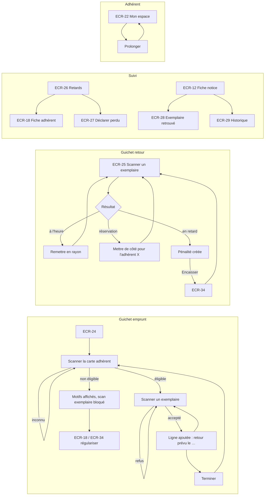

# UX — Emprunts, retours et prolongations

> Réutilise le socle [UX-socle.md](UX-socle.md). Objectif de conception : **emprunt ou retour en ≤ 30 s, entièrement au clavier et au lecteur de code-barres** (INDEX §1, NFR-03). Concevoir avec [UX-penalites.md](UX-penalites.md) (pénalité créée au retour).

## 1. Parcours utilisateurs


## 2. Plan de navigation
| ECR | Route Angular | Rôles | Guard | US couvertes |
|---|---|---|---|---|
| ECR-24 | `/gestion/guichet/emprunt` (`?adherent=A000123` optionnel) | LIBRARIAN, ADMIN | `authGuard`, `passwordChangeGuard`, `roleGuard` | US-025 |
| ECR-25 | `/gestion/guichet/retour` | LIBRARIAN, ADMIN | idem | US-026, US-037 |
| ECR-26 | `/gestion/retards` (`jours-min`, `page`, `taille`) | LIBRARIAN, ADMIN | idem | US-028 |
| ECR-27 | dialogue dans ECR-18 et ECR-26 | LIBRARIAN, ADMIN | — | US-029 |
| ECR-28 | dialogue dans ECR-12 | LIBRARIAN, ADMIN | — | US-030 |
| ECR-29 | panneau latéral dans ECR-12 | LIBRARIAN, ADMIN | — | US-031 |
| — | Action « Prolonger » (`app-renew-loan-action`) dans ECR-22 (MEMBER) et ECR-18 (personnel) | MEMBER, LIBRARIAN, ADMIN | — | US-027 |

## 3. Écrans

### ECR-24 — Guichet : emprunt
- **Route** : `/gestion/guichet/emprunt` · **Rôles** : LIBRARIAN, ADMIN · **US/AC** : US-025 (AC-025-1 → AC-025-11)
- **Wireframe** (`lg`, deux colonnes) :
```
┌──────────────────────── Gabarit personnel ───────────────────────────┐
│ Guichet — Emprunt                                    [ Terminer ]      │
│ ┌─ 1. Adhérent ───────────────────┐ ┌─ 2. Exemplaires ───────────────┐ │
│ │ Carte adhérent [A000123____] ⏎   │ │ N° d'exemplaire [00001234__] ⏎  │ │
│ │                                  │ │                                 │ │
│ │ MARTIN Jean · A000123 [Actif]    │ │ ✓ L'Étranger · 00001234         │ │
│ │ Adhésion jusqu'au 17/10/2027     │ │   À rendre le 07/11/2026        │ │
│ │ ┌──────────────────────────────┐ │ │ ✗ 00000999 — Exemplaire réservé │ │
│ │ │ ✓ Peut emprunter 2 document(s)│ │ │   pour un autre adhérent.       │ │
│ │ └──────────────────────────────┘ │ │ ✓ Nana · 00004567               │ │
│ │ Emprunts en cours : 3 / 5        │ │   À rendre le 07/11/2026        │ │
│ │ [ Voir la fiche ]                │ │   (réservation retirée)         │ │
│ └──────────────────────────────────┘ └─────────────────────────────────┘ │
└──────────────────────────────────────────────────────────────────────────┘
```
- **Composants** : `app-loan-desk-page` (smart ; état de la session de guichet en signals : adhérent courant, lignes de la session) → `app-desk-member-card` (presentational), `app-eligibility-panel` (feature adherents), `app-desk-loan-lines` (presentational) ; `app-scan-input` ×2.
- **Données lues** : adhérent par numéro (identité, statut, expiration, éligibilité + motifs, nb emprunts en cours / quota). **Données écrites** : emprunt (numéro d'adhérent, numéro d'exemplaire). **Données lues en retour** : titre, numéro d'exemplaire, date de retour prévue, réservation honorée (oui/non), nouvelle éligibilité (nb restant).
- **Déroulé clavier** :
  1. Focus automatique sur « Carte adhérent ». Scan/`Entrée` → carte de l'adhérent.
  2. Si éligible : focus automatique sur « N° d'exemplaire ». Chaque scan ajoute une ligne en tête de liste (succès ou refus), le champ se vide et garde le focus.
  3. Si non éligible : panneau `danger` avec tous les motifs (AC-025-5), champ exemplaire désactivé, bouton « Voir la fiche » focalisé.
  4. Quand le quota est atteint pendant la session, le panneau passe en `danger` « Nombre maximal d'emprunts atteint » et le champ exemplaire se désactive (AC-025-3).
  5. « Terminer » (ou `Échap` dans le champ exemplaire) vide la session et revient à l'étape 1 ; scanner une autre carte adhérent en étape 2 n'est pas possible tant que la session n'est pas terminée (évite les erreurs d'attribution).
- **États** : chargement : carte adhérent en squelette ; scan exemplaire : ligne « Enregistrement… » `aria-busy` · vide : « Aucun exemplaire scanné. » · erreur réseau : ligne d'erreur socle, la saisie est conservée dans le champ pour réessayer · succès : ligne ✓.
- **Actions** :
| Action | Déclencheur | Résultat | Feedback |
|---|---|---|---|
| Identifier l'adhérent | Scan / `Entrée` | Carte + éligibilité | Annonce « MARTIN Jean, peut emprunter 2 documents » ou « Emprunt impossible : … » |
| Enregistrer un emprunt | Scan / `Entrée` | Emprunt créé, exemplaire `ON_LOAN` | Ligne ✓ « <titre> · <n°> — À rendre le JJ/MM/AAAA » annoncée en `aria-live` |
| Voir la fiche | Bouton | ECR-18 | — |
| Terminer | Bouton / `Échap` | Session vidée | Focus carte adhérent |
- **Formulaire** :
| Champ | Type | Obligatoire | Validation [RG] | Message d'erreur exact |
|---|---|---|---|---|
| Carte adhérent | scan/texte | Oui | Format `A` + 6 chiffres [RG-13] | « Numéro d'adhérent invalide (format attendu : A000123). » |
| N° d'exemplaire | scan/texte | Oui | 8 chiffres [RG-09] | « Numéro d'exemplaire invalide (8 chiffres attendus). » |
- **Messages serveur (lignes de refus)** :
| Refus | Message exact |
|---|---|
| Adhérent inconnu | « Aucun adhérent ne porte le numéro A000999. » |
| Adhérent non éligible (AC-025-5, AC-025-7) | « Emprunt impossible : » + libellés de motifs (UX-adherents ECR-18) |
| Quota atteint (AC-025-3) [RG-22] | « Nombre maximal d'emprunts atteint. » |
| Exemplaire inconnu (AC-025-9) | « Exemplaire inconnu. » |
| Exemplaire `ON_LOAN` (AC-025-9, AC-025-10) | « Exemplaire déjà emprunté. » |
| Exemplaire `LOST` | « Exemplaire déclaré perdu : il ne peut pas être prêté. » |
| Exemplaire `WITHDRAWN` | « Exemplaire retiré du fonds : il ne peut pas être prêté. » |
| Exemplaire `RESERVED` pour un autre (AC-025-8) [RG-24] | « Exemplaire réservé pour un autre adhérent. » |
- **data-testid** : `loan-desk-member-input`, `loan-desk-member-error`, `loan-desk-member-card`, `loan-desk-member-name`, `loan-desk-loan-count`, `loan-desk-copy-input`, `loan-desk-copy-error`, `loan-desk-line` (+ `data-row-id` = numéro d'exemplaire, `data-result` = `success`/`error`), `loan-desk-line-due-date`, `loan-desk-line-message`, `loan-desk-line-reservation-fulfilled`, `loan-desk-view-member`, `loan-desk-finish`, `loan-desk-empty`, `loan-desk-member-loading`

### ECR-25 — Guichet : retour
- **Route** : `/gestion/guichet/retour` · **Rôles** : LIBRARIAN, ADMIN · **US/AC** : US-026 (AC-026-1 → AC-026-7), US-037 (AC-037-1, AC-037-4)
- **Wireframe** :
```
┌──────────────────────── Gabarit personnel ───────────────────────────┐
│ Guichet — Retour                                                       │
│ N° d'exemplaire [00001234____] ⏎                                       │
│ ┌────────────────────────────────────────────────────────────────────┐ │
│ │ ⚑ Nana · 00004567 — MARTINEZ Ana (A000456)                          │ │ warning, persistant
│ │   METTRE DE CÔTÉ pour BERNARD Luc (A000789), à retirer avant le     │ │
│ │   20/10/2026                                                        │ │
│ ├────────────────────────────────────────────────────────────────────┤ │
│ │ ! Germinal · 00000877 — MARTIN Jean (A000123)                       │ │ danger
│ │   Retour en retard de 5 jours. Pénalité créée : 1,00 €              │ │
│ │   Remettre en rayon : R ZOL                     [ Encaisser ]       │ │
│ ├────────────────────────────────────────────────────────────────────┤ │
│ │ ✓ L'Étranger · 00001234 — MARTIN Jean (A000123)                     │ │ success
│ │   Remettre en rayon : R CAM                                         │ │
│ ├────────────────────────────────────────────────────────────────────┤ │
│ │ ✗ 00007777 — Aucun emprunt en cours pour cet exemplaire.            │ │
│ └────────────────────────────────────────────────────────────────────┘ │
│ Retours de la session : 3                          [ Vider la liste ]  │
└────────────────────────────────────────────────────────────────────────┘
```
- **Composants** : `app-return-desk-page` (smart) → `app-desk-return-lines` (presentational) ; `app-scan-input` ; ouvre ECR-34 (Encaisser) pour l'adhérent de la ligne.
- **Données écrites** : retour (numéro d'exemplaire). **Données lues en retour** : titre, numéro, cote, adhérent (numéro, nom), jours de retard, pénalité créée (montant) le cas échéant, destination de l'exemplaire (`AVAILABLE` → rayon / `RESERVED` → bénéficiaire : numéro, nom, date limite de retrait).
- **Règles d'affichage** : l'instruction physique est en premier et en majuscules pour une mise de côté (« METTRE DE CÔTÉ pour … ») ; les lignes de mise de côté restent en haut de la liste jusqu'à ce que l'agent clique « Fait » (`app-button ghost`) ; aucune pénalité n'est affichée pour un retour le jour de l'échéance (AC-026-4).
- **États** : vide : « Scannez un exemplaire pour enregistrer son retour. » · ligne en cours « Enregistrement… » · erreur réseau socle (saisie conservée) · succès : ligne selon le cas ci-dessus.
- **Actions** :
| Action | Déclencheur | Résultat | Feedback |
|---|---|---|---|
| Enregistrer un retour | Scan / `Entrée` | Emprunt `RETURNED`, exemplaire `AVAILABLE` ou `RESERVED`, pénalité éventuelle | Ligne annoncée en `aria-live="assertive"` si mise de côté ou pénalité, sinon `polite` |
| Encaisser | Bouton sur une ligne avec pénalité | ECR-34 pré-filtré sur l'adhérent | — |
| Fait (mise de côté) | Bouton | Ligne repasse dans l'ordre chronologique | — |
| Vider la liste | Bouton | Liste de session vidée (les retours restent enregistrés) | — |
- **Formulaire** : N° d'exemplaire, 8 chiffres [RG-09], « Numéro d'exemplaire invalide (8 chiffres attendus). »
- **Messages serveur** : non emprunté (AC-026-6) → « Aucun emprunt en cours pour cet exemplaire. » ; exemplaire inconnu → « Exemplaire inconnu. »
- **Libellés de résultat** (exacts) : « Remettre en rayon : <cote> » ; « METTRE DE CÔTÉ pour <NOM Prénom> (<numéro>), à retirer avant le JJ/MM/AAAA » ; « Retour en retard de N jour(s). Pénalité créée : X,XX € ».
- **data-testid** : `return-desk-copy-input`, `return-desk-copy-error`, `return-desk-line` (+ `data-row-id`, `data-result` = `shelf`/`hold`/`late`/`error`), `return-desk-line-instruction`, `return-desk-line-hold-member`, `return-desk-line-late-days`, `return-desk-line-fine-amount`, `return-desk-line-collect`, `return-desk-line-done`, `return-desk-line-message`, `return-desk-count`, `return-desk-clear`, `return-desk-empty`

### ECR-26 — Emprunts en retard
- **Route** : `/gestion/retards` · **Rôles** : LIBRARIAN, ADMIN · **US/AC** : US-028 (AC-028-1 → AC-028-5)
- **Wireframe** :
```
┌──────────────────────── Gabarit personnel ───────────────────────────┐
│ Emprunts en retard (5)                                                 │
│ Au moins [ 7 ] jours de retard  [ Appliquer ]                          │
│ ┌──────────────┬─────────┬────────────────────────┬──────────┬──────┬──────────┬──┐
│ │ Titre        │ N° ex.  │ Adhérent / contact     │ À rendre │Retard▼│Pén. prov.│  │
│ ├──────────────┼─────────┼────────────────────────┼──────────┼──────┼──────────┼──┤
│ │ Germinal     │00000877 │ MARTIN Jean A000123    │22/09/2026│ 30 j │ 6,00 €   │⋮ │
│ │              │         │ 06 12 34 56 78 · j.m@… │          │      │          │  │
│ └──────────────┴─────────┴────────────────────────┴──────────┴──────┴──────────┴──┘
│ Page 1 sur 1                                                ◀  ▶ 20 ▾  │
└────────────────────────────────────────────────────────────────────────┘
Menu ⋮ : Voir la fiche adhérent | Déclarer perdu
```
- **Composants** : `app-overdue-loans-page` (smart) → `app-overdue-loans-table` (presentational) ; `app-data-table`, `app-pagination` ; ouvre ECR-27.
- **Données lues** : emprunts `OVERDUE` paginés : titre, numéro d'exemplaire, adhérent (numéro, nom, prénom, téléphone, e-mail), date de retour prévue, jours de retard [RG-27], montant provisoire [RG-36]. **Données écrites** : aucune.
- **États** : chargement squelette · vide : « Aucun emprunt en retard. » (AC-028-4) ; vide avec filtre : « Aucun emprunt avec au moins 7 jours de retard. » · erreur standard · succès.
- **Tri** : jours de retard décroissant (défaut, AC-028-1), date de retour prévue, nom d'adhérent. **Filtre** : retard minimal (entier ≥ 1, AC-028-2).
- **Formulaire** : « Au moins N jours », entier ≥ 1, message « Saisissez un nombre entier supérieur ou égal à 1. »
- **data-testid** : `overdue-min-days-input`, `overdue-min-days-error`, `overdue-apply-filter`, `overdue-count`, `overdue-row` (+ `data-row-id` = numéro d'exemplaire), `overdue-days`, `overdue-provisional-fine`, `overdue-member-link`, `overdue-row-menu`, `overdue-declare-lost-action`, `overdue-loading`, `overdue-empty`, `overdue-error`, `overdue-error-retry`

### ECR-27 — Dialogue « Déclarer un exemplaire perdu »
- **Route** : dialogue dans ECR-18 et ECR-26 · **Rôles** : LIBRARIAN, ADMIN · **US/AC** : US-029 (AC-029-1 → AC-029-3), US-037 (AC-037-5)
- **Wireframe** :
```
┌─────────── Déclarer perdu ───────────────┐
│ Germinal · 00000877                       │
│ Emprunté par MARTIN Jean (A000123)        │
│ À rendre le 13/10/2026 · 4 jours de retard│
│ Pénalités qui seront créées :             │
│   Retard (4 j) ............ 0,80 €        │
│   Perte (forfait) ........ 20,00 €        │
│   Total .................. 20,80 €        │
│ [!] L'emprunt sera clos et l'exemplaire   │
│ marqué « Perdu ».                         │
│          [ Annuler ] [ Déclarer perdu ]   │ (danger)
└───────────────────────────────────────────┘
```
- **Composants** : `app-declare-lost-dialog` (presentational, basé sur `app-confirm-dialog`).
- **Données lues** : emprunt + prévisualisation des pénalités [RG-36] [RG-37] (montants calculés par le serveur). **Données écrites** : déclaration de perte.
- **États** : chargement de la prévisualisation (spinner dans le dialogue) · erreur standard · succès : toast « Perte déclarée. Pénalités créées : 20,80 €. » et rafraîchissement de l'écran parent.
- **Message serveur** : emprunt déjà clos (AC-029-2) → « Cet emprunt n'est plus en cours. »
- **data-testid** : `declare-lost-dialog`, `declare-lost-late-fine`, `declare-lost-item-fine`, `declare-lost-total`, `declare-lost-confirm`, `declare-lost-cancel`, `declare-lost-loading`, `declare-lost-server-error`

### ECR-28 — Dialogue « Exemplaire retrouvé »
- **Route** : dialogue dans ECR-12 (exemplaire `LOST`) · **Rôles** : LIBRARIAN, ADMIN · **US/AC** : US-030 (AC-030-1 → AC-030-3)
- **Wireframe** :
```
┌──────── Exemplaire retrouvé ─────────────┐
│ Germinal · 00000877 · [Perdu]             │
│ L'exemplaire sera remis en circulation.   │
│ Les pénalités déjà créées restent dues ;  │
│ une remise peut être accordée par un      │
│ administrateur.                           │
│          [ Annuler ] [ Confirmer ]        │
└───────────────────────────────────────────┘
```
- **Composants** : `app-copy-found-dialog` (presentational).
- **Données écrites** : remise en circulation (numéro). **Données lues en retour** : nouveau statut (`AVAILABLE` ou `RESERVED` + bénéficiaire).
- **États** : succès : toast « Exemplaire remis en circulation : remettre en rayon (R ZOL). » ou toast persistant `warning` « Exemplaire mis de côté pour BERNARD Luc (A000789), à retirer avant le JJ/MM/AAAA. » (AC-030-2).
- **Message serveur** : exemplaire non perdu (AC-030-3) → « Cet exemplaire n'est pas déclaré perdu. »
- **data-testid** : `copy-found-dialog`, `copy-found-confirm`, `copy-found-cancel`, `copy-found-server-error`

### ECR-29 — Panneau « Historique de l'exemplaire »
- **Route** : panneau latéral (`app-drawer`) dans ECR-12 · **Rôles** : LIBRARIAN, ADMIN · **US/AC** : US-031 (AC-031-1 → AC-031-3)
- **Wireframe** :
```
┌──── Historique — 00001234 ────────────┐
│ 10/10/2026 → prévu 31/10/2026          │
│   [En cours] MARTIN Jean (A000123)     │
│ 02/05/2026 → prévu 23/05/2026          │
│   rendu le 20/05/2026 [Rendu]          │
│   Emprunteur : données effacées        │
│ …                                      │
│ Page 1 sur 3                 ◀  ▶      │
└────────────────────────────────────────┘
```
- **Composants** : `app-copy-history-drawer` (smart léger : charge à l'ouverture) → liste presentational.
- **Données lues** : emprunts de l'exemplaire paginés (dates d'emprunt, de retour prévue, effective, statut, emprunteur si non anonymisé [RG-19]).
- **États** : chargement · vide : « Cet exemplaire n'a jamais été emprunté. » · erreur standard · succès. Tri du plus récent au plus ancien (AC-031-1).
- **data-testid** : `copy-history-drawer`, `copy-history-row`, `copy-history-borrower`, `copy-history-anonymized`, `copy-history-loading`, `copy-history-empty`, `copy-history-error`

### Action transverse — Prolonger un emprunt (`app-renew-loan-action`)
- **Utilisé dans** : ECR-22 (adhérent, ses emprunts) et ECR-18 (personnel, menu ⋮ d'un emprunt) · **US/AC** : US-027 (AC-027-1 → AC-027-7)
- **Rendu** : si l'emprunt est prolongeable, bouton « Prolonger » ; sinon, à la place, le motif en texte `muted` : « Prolongation impossible : <motif> ».
- **Confirmation** : `app-confirm-dialog` « Prolonger l'emprunt de « L'Étranger » jusqu'au 28/11/2026 ? » (nouvelle date fournie par le serveur [RG-25]) → succès : toast « Emprunt prolongé jusqu'au 28/11/2026. » et mise à jour de la carte/ligne.
- **Motifs de refus** (exacts, affichés en amont et renvoyés par le serveur) :
| Refus | Message exact |
|---|---|
| Plafond atteint (AC-027-2) [RG-25] | « Prolongation impossible : nombre maximal de prolongations atteint. » |
| Réservé par un autre (AC-027-3) | « Prolongation impossible : document réservé par un autre adhérent. » |
| En retard (AC-027-4) | « Prolongation impossible : emprunt en retard. » |
| Adhérent non éligible (AC-027-5) | « Prolongation impossible : » + libellé de motif (« adhésion expirée », « adhérent suspendu », « pénalités impayées supérieures à 5,00 € », « emprunt en retard ») |
- **data-testid** : `renew-loan-button`, `renew-loan-blocked-reason`, `renew-loan-dialog`, `renew-loan-new-date`, `renew-loan-confirm`, `renew-loan-cancel`, `renew-loan-server-error`

## 4. Arborescence de composants
```
features/emprunts/
  emprunts.routes.ts                   (/gestion/guichet/**, /gestion/retards)
  pages/
    loan-desk.page.ts                  app-loan-desk-page            (ECR-24)
    return-desk.page.ts                app-return-desk-page          (ECR-25)
    overdue-loans.page.ts              app-overdue-loans-page        (ECR-26)
  components/
    desk-member-card.component.ts      app-desk-member-card
    desk-loan-lines.component.ts       app-desk-loan-lines
    desk-return-lines.component.ts     app-desk-return-lines
    overdue-loans-table.component.ts   app-overdue-loans-table
    declare-lost-dialog.component.ts   app-declare-lost-dialog       (ECR-27)
    copy-found-dialog.component.ts     app-copy-found-dialog         (ECR-28)
    copy-history-drawer.component.ts   app-copy-history-drawer       (ECR-29)
    renew-loan-action.component.ts     app-renew-loan-action         (exporté : adherents)
  data-access/
    loan.service.ts                    (emprunt, retour, prolongation, perte, retrouvé, retards, historique, prévisualisations)
    loan-desk.store.ts                 (état de session de guichet en signals : adhérent courant, lignes)
    loan.models.ts                     (interfaces miroir des données §7)
    loan-messages.ts                   (codes de refus → messages exacts)
```

## 5. Design tokens & composants partagés
| Token / Composant | Valeur / Rôle | Nouveau ou existant |
|---|---|---|
| Tokens | [UX-socle §5.1](UX-socle.md) | Existant |
| Lignes de guichet | `success-soft` (✓ succès / remise en rayon), `warning-soft` (⚑ mise de côté, persistante), `danger-soft` (! retard, ✗ refus) — icône + texte | Nouveau (règle d'affichage) |
| `app-scan-input` | Socle — focus automatique, vidage et refocalisation après traitement | Existant |
| `app-eligibility-panel` | Feature adherents | Existant |

## 6. Accessibilité
| Écran | Point de contrôle WCAG | Mise en œuvre |
|---|---|---|
| ECR-24, ECR-25 | 2.1.1 Clavier | Parcours complet sans souris : scan/`Entrée`, `Échap` pour terminer, raccourcis `Alt+E`/`Alt+R` (Q-20) |
| ECR-24, ECR-25 | 4.1.3 Messages d'état | Chaque résultat de scan annoncé (`polite` ; `assertive` pour mise de côté, pénalité et refus) |
| ECR-24, ECR-25 | 3.2.2 Changement de contexte | Le déplacement automatique du focus (carte → exemplaire) est annoncé et prévisible (libellés « 1. » / « 2. ») |
| ECR-25 | 1.4.1 Couleur | Type de ligne porté par une icône + verbe d'action (« Remettre en rayon », « METTRE DE CÔTÉ », « Retour en retard ») |
| ECR-27 | 3.3.4 | Prévisualisation des montants + bouton `danger` explicite avant action irréversible |

## 7. Besoins de données pour l'Architecte
| ECR | Opération | Données entrée | Données sortie | Pagination/Tri/Filtres |
|---|---|---|---|---|
| ECR-24 | Identifier un adhérent au guichet | numéro d'adhérent | identité, statut, expiration, éligible (oui/non), motifs, nb emprunts en cours, quota | — |
| ECR-24 | Enregistrer un emprunt | numéro d'adhérent, numéro d'exemplaire | titre, numéro d'exemplaire, date de retour prévue, réservation honorée (booléen), nb emprunts en cours, éligibilité mise à jour ; refus : adhérent inconnu/non éligible (motifs multiples), quota, exemplaire inconnu/emprunté/perdu/retiré/réservé pour un autre ; garantie d'unicité en cas de concurrence (AC-025-10) | — |
| ECR-25 | Enregistrer un retour | numéro d'exemplaire | titre, numéro, cote, adhérent (numéro, nom, prénom), jours de retard, pénalité créée (id, montant) ou aucune, destination (`AVAILABLE` / `RESERVED` + bénéficiaire : numéro, nom, prénom, date limite de retrait) ; refus : exemplaire inconnu, aucun emprunt en cours | — |
| ECR-26 | Lister les retards | retard minimal (jours) | titre, numéro d'exemplaire, numéro/nom/prénom/téléphone/e-mail de l'adhérent, date de retour prévue, jours de retard, montant provisoire | Paginé 20 ; tri jours de retard (défaut décroissant), date prévue, nom |
| ECR-27 | Prévisualiser une perte | id emprunt | jours de retard, pénalité de retard, forfait de perte, total | — |
| ECR-27 | Déclarer une perte | id emprunt | pénalités créées (montants) ; refus : emprunt non en cours | — |
| ECR-28 | Remettre en circulation un exemplaire retrouvé | numéro d'exemplaire | statut résultant, bénéficiaire éventuel (numéro, nom, date limite), cote ; refus : non perdu | — |
| ECR-29 | Historique d'un exemplaire | numéro d'exemplaire | emprunts : dates, statut, emprunteur (numéro, nom) ou indicateur « anonymisé » | Paginé 20 ; tri date d'emprunt décroissante |
| ECR-18, ECR-22 | Données de prolongation par emprunt | — | prolongeable (oui/non), motif, nouvelle date de retour si prolongé | Inclus dans les lectures d'emprunts en cours |
| ECR-18, ECR-22 | Prolonger | id emprunt | nouvelle date de retour prévue, nb prolongations ; refus : plafond, réservé, en retard, non éligible (motif), emprunt d'un autre adhérent | — |

## 8. Questions ouvertes
| ID | Question | Hypothèse retenue | Impact |
|---|---|---|---|
| Q-25 | Faut-il imprimer ou envoyer un ticket récapitulatif des emprunts au guichet ? (non prévu par la SPEC) | Non ; la date de retour est visible dans l'espace adhérent (US-023) | Ajout d'une US d'impression |
