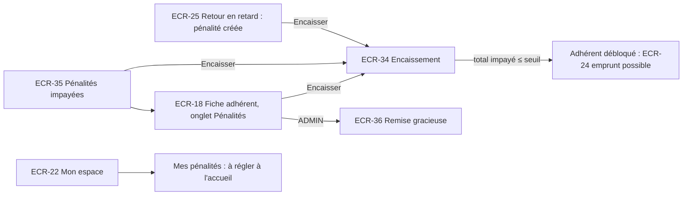

# UX — Pénalités

> Réutilise le socle [UX-socle.md](UX-socle.md). Le calcul automatique (US-037) n'a pas d'écran propre : son résultat est affiché au guichet retour (ECR-25), dans la déclaration de perte (ECR-27), en montant provisoire dans ECR-18, ECR-22 et ECR-26, et dans le blocage d'éligibilité (`app-eligibility-panel`).

## 1. Parcours utilisateurs


## 2. Plan de navigation
| ECR | Route Angular | Rôles | Guard | US couvertes |
|---|---|---|---|---|
| ECR-34 | dialogue dans ECR-18, ECR-25, ECR-35 | LIBRARIAN, ADMIN | — | US-038 |
| ECR-35 | `/gestion/penalites` (`page`, `taille`, `tri`) | LIBRARIAN, ADMIN | `authGuard`, `passwordChangeGuard`, `roleGuard` | US-040 |
| ECR-36 | dialogue dans ECR-18 (ligne de pénalité) | ADMIN | bouton absent pour LIBRARIAN | US-039 |
| — | Affichages du calcul : ECR-18, ECR-22, ECR-25, ECR-26, ECR-27 | — | — | US-037 |

## 3. Écrans

### ECR-34 — Dialogue « Encaisser des pénalités »
- **Route** : dialogue dans ECR-18, ECR-25, ECR-35 · **Rôles** : LIBRARIAN, ADMIN · **US/AC** : US-038 (AC-038-1 → AC-038-6)
- **Wireframe** :
```
┌────────── Encaisser — MARTIN Jean (A000123) ──────────┐
│ [x] Retard (5 j) · L'Étranger · 12/11/2026 ... 1,00 € │
│ [x] Perte · Germinal · 03/11/2026 ............ 20,00 €│
│ ─────────────────────────────────────────────────────  │
│ Total sélectionné ........................... 21,00 € │
│ Mode de paiement *  ( ) Espèces (•) Carte ( ) Chèque   │
│ Montant encaissé *  [ 21,00 ] €                        │
│                    [ Annuler ] [ Enregistrer 21,00 € ] │
└────────────────────────────────────────────────────────┘
```
- **Composants** : `app-collect-fines-dialog` (smart léger : charge les pénalités impayées de l'adhérent) → `app-fine-selection-list` (presentational, cases à cocher, toutes cochées par défaut).
- **Données lues** : pénalités `UNPAID` de l'adhérent (id, motif, jours, titre, date, montant, version) + total. **Données écrites** : ids sélectionnés, mode de paiement, montant encaissé. **Données lues en retour** : pénalités payées, nouveau total impayé, éligibilité mise à jour.
- **États** : chargement squelette liste · vide : « Aucune pénalité impayée. » (bouton Enregistrer masqué) · erreur standard · formulaire : pristine → invalide → envoi → erreur serveur → succès : toast « Paiement de 21,00 € enregistré (Carte bancaire). » ; si l'adhérent repasse sous le seuil [RG-35] et est éligible, second message « L'adhérent peut de nouveau emprunter. » ; rafraîchissement de l'écran parent.
- **Règles d'affichage** : le libellé du bouton reprend le total sélectionné ; le montant encaissé est pré-rempli avec ce total et recalculé à chaque (dé)sélection.
- **Formulaire** :
| Champ | Type | Obligatoire | Validation [RG] | Message d'erreur exact |
|---|---|---|---|---|
| Pénalités | cases à cocher | ≥ 1 | — | « Sélectionnez au moins une pénalité. » |
| Mode de paiement | radio (Espèces / Carte bancaire / Chèque) | Oui | `CASH`/`CARD`/`CHECK` [RG-38] | « Sélectionnez un mode de paiement. » |
| Montant encaissé | décimal (virgule acceptée), 2 décimales | Oui | = total sélectionné [RG-38] | inférieur : « Le paiement partiel n'est pas autorisé. » ; supérieur : « Le montant encaissé doit être égal au total sélectionné (21,00 €). » |
- **Messages serveur** : pénalité déjà réglée ou remise (AC-038-3, AC-038-5) → « Une ou plusieurs pénalités ont déjà été réglées. La liste a été actualisée. » (la liste est rechargée, rien n'est encaissé) ; paiement partiel → « Le paiement partiel n'est pas autorisé. »
- **data-testid** : `collect-dialog`, `collect-fine-row` (+ `data-row-id` = id pénalité), `collect-fine-checkbox`, `collect-selection-error`, `collect-total`, `collect-mode-cash`, `collect-mode-card`, `collect-mode-check`, `collect-mode-error`, `collect-amount-input`, `collect-amount-error`, `collect-confirm`, `collect-cancel`, `collect-server-error`, `collect-loading`, `collect-empty`, `collect-error`

### ECR-35 — Pénalités impayées
- **Route** : `/gestion/penalites` · **Rôles** : LIBRARIAN, ADMIN · **US/AC** : US-040 (AC-040-1 → AC-040-3)
- **Wireframe** :
```
┌──────────────────────── Gabarit personnel ───────────────────────────┐
│ Pénalités impayées · 3 adhérents · 27,20 €                             │
│ ┌─────────┬──────────────────┬────────────────────┬─────┬────────┬──────────┬────────┐
│ │ Numéro  │ Adhérent         │ Contact            │ Nb  │ Total ▼│ Situation│        │
│ ├─────────┼──────────────────┼────────────────────┼─────┼────────┼──────────┼────────┤
│ │ A000123 │ MARTIN Jean      │ 06… · j.martin@…   │ 2   │ 20,80 €│ [Bloqué] │[Encais.]│
│ │ A000456 │ MARTINEZ Ana     │ 07… · a.mz@…       │ 3   │  6,00 €│ [Bloqué] │[Encais.]│
│ │ A000789 │ BERNARD Luc      │ — · l.b@…          │ 1   │  0,40 €│          │[Encais.]│
│ └─────────┴──────────────────┴────────────────────┴─────┴────────┴──────────┴────────┘
│ Page 1 sur 1                                             ◀  ▶ 20 ▾     │
└────────────────────────────────────────────────────────────────────────┘
```
- **Composants** : `app-unpaid-fines-page` (smart) → `app-unpaid-fines-table` (presentational) ; ouvre ECR-34 ; le numéro mène à ECR-18.
- **Données lues** : adhérents ayant ≥ 1 pénalité `UNPAID` : numéro, nom, prénom, téléphone, e-mail, nombre de pénalités, total, bloqué (total > seuil [RG-35]) ; totaux globaux (nb adhérents, montant). **Données écrites** : via ECR-34.
- **États** : chargement squelette · vide : « Aucune pénalité impayée. » (AC-040-2) · erreur standard · succès. Tri par total décroissant (défaut, AC-040-1), nom, nombre.
- **Badge** « Bloqué » : `danger` + texte, uniquement si total > seuil.
- **data-testid** : `unpaid-summary`, `unpaid-row` (+ `data-row-id` = numéro), `unpaid-count`, `unpaid-total`, `unpaid-blocked-badge`, `unpaid-collect-action`, `unpaid-member-link`, `unpaid-loading`, `unpaid-empty`, `unpaid-error`, `unpaid-error-retry`

### ECR-36 — Dialogue « Accorder une remise gracieuse »
- **Route** : dialogue dans ECR-18 (onglet Pénalités, action sur une ligne `UNPAID`) · **Rôles** : ADMIN · **US/AC** : US-039 (AC-039-1 → AC-039-4)
- **Wireframe** :
```
┌──────── Accorder une remise ─────────┐
│ Perte · Germinal · 20,00 €            │
│ MARTIN Jean (A000123)                 │
│ Motif * [______________________]      │
│ [!] La remise est définitive.         │
│    [ Annuler ] [ Accorder la remise ] │
└───────────────────────────────────────┘
```
- **Composants** : `app-waive-fine-dialog` (presentational).
- **Données écrites** : id pénalité, motif. **Données lues en retour** : statut `WAIVED`, nouveau total impayé, éligibilité.
- **Règles d'affichage** : action « Accorder une remise » visible seulement pour `ADMIN` et seulement sur les pénalités `UNPAID` (AC-039-3, AC-039-4) ; refus serveur traité par le message 403 du socle.
- **États** : formulaire ; succès : toast « Remise accordée. » et rafraîchissement d'ECR-18.
- **Formulaire** :
| Champ | Type | Obligatoire | Validation [RG] | Message d'erreur exact |
|---|---|---|---|---|
| Motif | zone de texte | Oui | 3-255 caractères [RG-39] | « Le motif doit contenir entre 3 et 255 caractères. » |
- **Message serveur** : pénalité déjà réglée → « Cette pénalité a déjà été réglée ou remise. »
- **data-testid** : `waive-dialog`, `waive-fine-summary`, `waive-reason-input`, `waive-reason-error`, `waive-confirm`, `waive-cancel`, `waive-server-error`, `member-fine-waive-action` (sur la ligne de pénalité dans ECR-18)

### Affichage du calcul automatique (US-037)
| Où | Ce qui est affiché | AC |
|---|---|---|
| ECR-25 (retour) | « Retour en retard de N jour(s). Pénalité créée : X,XX € » + bouton Encaisser ; rien si retour le jour de l'échéance | AC-037-1 → AC-037-4 |
| ECR-27 (perte) | Prévisualisation retard + forfait + total avant confirmation | AC-037-5 |
| ECR-18, ECR-22, ECR-26 | « Pénalité provisoire : X,XX € » (libellé « provisoire » obligatoire) sur les emprunts en retard | AC-037-6 |
| `app-eligibility-panel`, refus d'emprunt/prolongation/réservation | « Pénalités impayées supérieures à 5,00 € » | AC-037-7 |
| ECR-22 (adhérent) | Liste des pénalités impayées, total, « À régler à l'accueil de la bibliothèque. » | US-023 |

## 4. Arborescence de composants
```
features/penalites/
  penalites.routes.ts                  (/gestion/penalites)
  pages/
    unpaid-fines.page.ts               app-unpaid-fines-page          (ECR-35)
  components/
    unpaid-fines-table.component.ts    app-unpaid-fines-table
    collect-fines-dialog.component.ts  app-collect-fines-dialog       (ECR-34, exporté : adherents, emprunts)
    fine-selection-list.component.ts   app-fine-selection-list
    waive-fine-dialog.component.ts     app-waive-fine-dialog          (ECR-36, exporté : adherents)
  data-access/
    fine.service.ts                    (impayées d'un adhérent, encaissement, remise, liste des débiteurs)
    fine.models.ts                     (interfaces miroir des données §7)
    fine-messages.ts                   (codes de refus → messages exacts)
shared/pipes/euro.pipe.ts              (format « 1,00 € », socle)
```

## 5. Design tokens & composants partagés
| Token / Composant | Valeur / Rôle | Nouveau ou existant |
|---|---|---|
| Tokens | [UX-socle §5.1](UX-socle.md) | Existant |
| Montants | `tabular-nums`, alignés à droite, pipe `euro` | Existant (socle) |
| Badge « Bloqué » | `danger` + texte | Nouveau (règle d'affichage) |
| Libellé « provisoire » | Texte `warning` après le montant | Nouveau (règle d'affichage) |

## 6. Accessibilité
| Écran | Point de contrôle WCAG | Mise en œuvre |
|---|---|---|
| ECR-34 | 1.3.1 | Pénalités dans un `fieldset` « Pénalités à encaisser » ; chaque case à cocher a pour libellé le motif, le titre et le montant |
| ECR-34 | 4.1.3 | Total sélectionné en `aria-live="polite"` à chaque (dé)sélection |
| ECR-34 | 3.3.4 | Le bouton reprend le montant (« Enregistrer 21,00 € ») pour éviter une erreur de saisie |
| ECR-35 | 1.4.1 | « Bloqué » en texte ; montants lisibles par lecteur d'écran (« 20 euros 80 ») via le format standard |
| ECR-36 | 3.3.4 | Avertissement « La remise est définitive. » avant validation |

## 7. Besoins de données pour l'Architecte
| ECR | Opération | Données entrée | Données sortie | Pagination/Tri/Filtres |
|---|---|---|---|---|
| ECR-34 | Lister les pénalités impayées d'un adhérent | numéro d'adhérent | id, motif, jours de retard, titre, date de création, montant, version ; total | Liste complète (volume faible) |
| ECR-34 | Encaisser | numéro d'adhérent, ids de pénalités, mode, montant encaissé | pénalités payées, total impayé restant, éligibilité ; refus : paiement partiel, montant différent, pénalité déjà réglée/remise (aucun encaissement partiel de la sélection), mode absent ; protection contre le double encaissement simultané (AC-038-5) | — |
| ECR-35 | Lister les débiteurs | — | numéro, nom, prénom, téléphone, e-mail, nb pénalités, total, bloqué ; totaux globaux | Paginé 20 ; tri total (défaut décroissant), nom, nb |
| ECR-36 | Accorder une remise | id pénalité, motif | statut `WAIVED`, total impayé restant, éligibilité ; refus : non `ADMIN`, motif invalide, déjà réglée | — |
| ECR-18, 22, 26 | Montant provisoire | — | montant provisoire par emprunt en retard [RG-36] | Inclus dans les lectures d'emprunts |

## 8. Questions ouvertes
N/A — aucune nouvelle question : les hypothèses Q-15 à Q-17 de la SPEC suffisent à concevoir les écrans.
