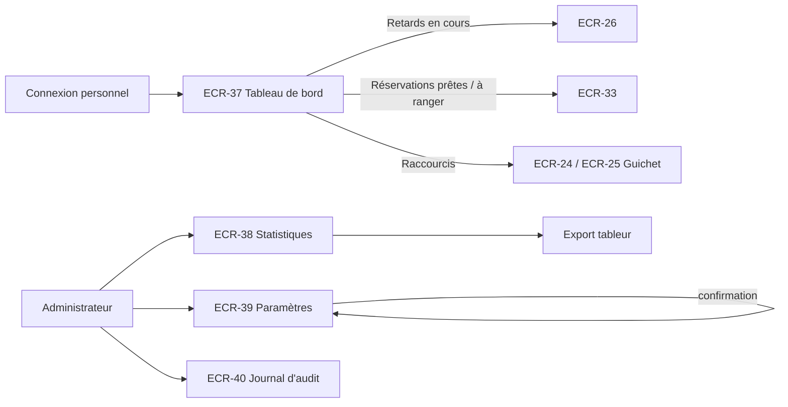

# UX — Pilotage : tableau de bord, statistiques, paramétrage et audit

> Réutilise le socle [UX-socle.md](UX-socle.md). Le tableau de bord ECR-37 est la page d'accueil du personnel (`/gestion`).

## 1. Parcours utilisateurs


## 2. Plan de navigation
| ECR | Route Angular | Rôles | Guard | US couvertes |
|---|---|---|---|---|
| ECR-37 | `/gestion` | LIBRARIAN, ADMIN | `authGuard`, `passwordChangeGuard`, `roleGuard(['LIBRARIAN','ADMIN'])` | US-041 |
| ECR-38 | `/gestion/statistiques` (`mois=AAAA-MM`) | ADMIN | `authGuard`, `passwordChangeGuard`, `roleGuard(['ADMIN'])` | US-042 |
| ECR-39 | `/gestion/parametres` | ADMIN | idem | US-043 |
| ECR-40 | `/gestion/audit` (`objet`, `auteur`, `action`, `du`, `au`, `page`, `taille`) | ADMIN | idem | US-044 |

## 3. Écrans

### ECR-37 — Tableau de bord du jour
- **Route** : `/gestion` · **Rôles** : LIBRARIAN, ADMIN · **US/AC** : US-041 (AC-041-1 → AC-041-3)
- **Wireframe** :
```
┌──────────────────────── Gabarit personnel ───────────────────────────┐
│ Tableau de bord — samedi 17 octobre 2026          [ Actualiser ]       │
│ [ Guichet — Emprunt (Alt+E) ]  [ Guichet — Retour (Alt+R) ]            │
│ ┌──────────────┐ ┌──────────────┐ ┌──────────────┐                     │
│ │ Emprunts du  │ │ Retours du   │ │ Retards en   │                     │
│ │ jour      12 │ │ jour       8 │ │ cours     5 ›│ → ECR-26            │
│ └──────────────┘ └──────────────┘ └──────────────┘                     │
│ ┌──────────────────────────┐ ┌───────────────────────────┐             │
│ │ Réservations prêtes   3 ›│ │ Exemplaires à remettre en │             │
│ │ dont 1 dernier jour      │ │ rayon                   2 ›│             │
│ └──────────────────────────┘ └───────────────────────────┘             │
│ Mis à jour à 14:32                                                      │
└──────────────────────────────────────────────────────────────────────────┘
```
- **Composants** : `app-dashboard-page` (smart) → `app-stat-card` ×5 (socle).
- **Données lues** : à la date du jour : nb emprunts, nb retours, nb emprunts `OVERDUE`, nb réservations `READY`, dont date limite = aujourd'hui, nb exemplaires à remettre en rayon (même périmètre qu'ECR-33, Q-26) ; heure de calcul. **Données écrites** : aucune.
- **États** : chargement : 5 cartes squelettes · vide : tous les indicateurs à « 0 » (AC-041-2), pas de message spécifique · erreur standard · succès. Pas de rafraîchissement automatique ; « Actualiser » relance la lecture.
- **Actions** : cartes « Retards en cours » → ECR-26 ; « Réservations prêtes » → ECR-33 onglet Prêtes ; « Exemplaires à remettre en rayon » → ECR-33 onglet À remettre en rayon ; « Emprunts du jour » et « Retours du jour » sont informatives (non cliquables : la SPEC ne prévoit pas de liste détaillée) ; raccourcis guichet.
- **data-testid** : `dashboard-date`, `dashboard-refresh`, `dashboard-desk-loan-link`, `dashboard-desk-return-link`, `dashboard-stat-loans-today`, `dashboard-stat-returns-today`, `dashboard-stat-overdue`, `dashboard-stat-ready`, `dashboard-stat-ready-last-day`, `dashboard-stat-to-shelve`, `dashboard-updated-at`, `dashboard-loading`, `dashboard-error`, `dashboard-error-retry`

### ECR-38 — Statistiques d'activité
- **Route** : `/gestion/statistiques` · **Rôles** : ADMIN · **US/AC** : US-042 (AC-042-1 → AC-042-5)
- **Wireframe** :
```
┌──────────────────────── Gabarit personnel ───────────────────────────┐
│ Statistiques          Mois [ octobre 2026 ▾ ]   [ Exporter (tableur) ] │
│ ┌──────────┐┌──────────┐┌──────────┐┌──────────┐┌──────────┐┌─────────┐│
│ │Emprunts  ││Retours   ││Prolong.  ││Réserv.   ││Nouveaux  ││Adhérents││
│ │ 1 284    ││ 1 190    ││ 210      ││ 156      ││adhérents ││emprunt. ││
│ │          ││          ││          ││          ││ 42       ││ 512     ││
│ └──────────┘└──────────┘└──────────┘└──────────┘└──────────┘└─────────┘│
│ Les 10 livres les plus empruntés     Rotation par catégorie            │
│ ┌───┬────────────────┬──────┐       ┌──────────────┬────────┬──────┐  │
│ │ 1 │ L'Étranger     │ 38   │       │ Catégorie    │Emprunts│ Taux │  │
│ │ 2 │ …              │ …    │       │ Roman        │ 640    │ 0,85 │  │
│ └───┴────────────────┴──────┘       └──────────────┴────────┴──────┘  │
│ Encaissements                                                          │
│ Espèces 120,40 € · Carte 310,00 € · Chèque 40,00 € · Remises 60,00 €   │
└────────────────────────────────────────────────────────────────────────┘
```
- **Composants** : `app-statistics-page` (smart) → `app-month-picker`, `app-stat-card` ×6, `app-top-books-table`, `app-rotation-table`, `app-collections-summary` (presentational). Les données sont présentées en **tableaux** (aucune bibliothèque de graphiques : non validée par ADR).
- **Données lues** : pour le mois choisi : nb emprunts, retours, prolongations, réservations, nouveaux adhérents, adhérents ayant emprunté ≥ 1 fois ; top 10 notices (titre, auteurs, nb emprunts) ; par catégorie : nb emprunts, nb exemplaires, taux de rotation [RG-41] ; encaissements par mode, total des remises. **Données écrites** : aucune. **Export** : fichier tableur des mêmes valeurs, sans donnée nominative (AC-042-3).
- **États** : chargement squelettes · vide (mois sans activité) : indicateurs à 0, tableaux « Aucun emprunt sur cette période. » · erreur standard · succès. Export : bouton `loading` puis téléchargement ; échec : toast « L'export a échoué. Réessayez. »
- **Formulaire** :
| Champ | Type | Obligatoire | Validation [RG] | Message d'erreur exact |
|---|---|---|---|---|
| Mois | sélecteur mois/année (défaut : mois en cours) | Oui | ≤ mois en cours (AC-042-4) [RG-41] | « Sélectionnez un mois passé ou le mois en cours. » |
- **data-testid** : `stats-month-picker`, `stats-month-error`, `stats-export-button`, `stats-card-loans`, `stats-card-returns`, `stats-card-renewals`, `stats-card-reservations`, `stats-card-new-members`, `stats-card-active-borrowers`, `stats-top-books-row`, `stats-rotation-row` (+ `data-row-id` = catégorie), `stats-collections-cash`, `stats-collections-card`, `stats-collections-check`, `stats-waived-total`, `stats-loading`, `stats-empty`, `stats-error`, `stats-error-retry`

### ECR-39 — Paramètres des règles de prêt
- **Route** : `/gestion/parametres` · **Rôles** : ADMIN · **US/AC** : US-043 (AC-043-1 → AC-043-5)
- **Wireframe** :
```
┌──────────────────────── Gabarit personnel ───────────────────────────┐
│ Paramètres                                                             │
│ [i] Une nouvelle valeur s'applique uniquement aux opérations           │
│     enregistrées après sa modification.                                │
│ ── Adhésion ─────────────────────────────────────────────────────      │
│ Durée de l'adhésion       [ 12 ] mois  (1 à 36)   modifié le 02/01/2026│
│                                                   par LEROY A. [Enregistrer]
│ Renouvellement anticipé   [ 30 ] jours (0 à 90)   …           [Enregistrer]
│ ── Emprunts ──                                                          │
│ Durée d'emprunt           [ 21 ] jours (1 à 90)               [Enregistrer]
│ Emprunts simultanés max   [  5 ]       (1 à 50)               [Enregistrer]
│ Prolongations max         [  1 ]       (0 à 5)                [Enregistrer]
│ Durée d'une prolongation  [ 21 ] jours (1 à 90)               [Enregistrer]
│ ── Réservations ──                                                      │
│ Réservations actives max  [  3 ]       (0 à 20)               [Enregistrer]
│ Délai de retrait          [  3 ] jours (1 à 15)               [Enregistrer]
│ ── Pénalités ──                                                         │
│ Seuil de blocage          [ 5,00 ] €   (0,00 à 100,00)        [Enregistrer]
│ Tarif journalier de retard[ 0,20 ] €   (0,00 à 5,00)          [Enregistrer]
│ Plafond par emprunt       [10,00 ] €   (0,00 à 100,00)        [Enregistrer]
│ Forfait de perte          [20,00 ] €   (0,00 à 500,00)        [Enregistrer]
└────────────────────────────────────────────────────────────────────────┘
```
- **Composants** : `app-settings-page` (smart) → `app-setting-group` (presentational, `fieldset` par groupe), `app-setting-row` (presentational : champ, unité, bornes, dernière modification, bouton propre à la ligne) ; `app-confirm-dialog`.
- **Données lues** : pour chaque paramètre de [RG-40] : code, libellé, valeur, unité, borne min, borne max, date et auteur de la dernière modification, version. **Données écrites** : code + nouvelle valeur + version.
- **Enregistrement** : une ligne à la fois ; bouton « Enregistrer » actif seulement si la valeur a changé et est valide ; confirmation `app-confirm-dialog` « Passer la durée d'emprunt de 21 à 28 jours ? Les emprunts déjà enregistrés ne sont pas modifiés. » (AC-043-1, AC-043-4).
- **États** : chargement squelette des groupes · vide N/A (les paramètres existent toujours) · erreur standard · ligne : envoi (`loading`) → succès : toast « Paramètre enregistré. », mise à jour de la date et de l'auteur · erreur serveur : message sous la ligne, valeur saisie conservée ; conflit : message socle de modification concurrente.
- **Formulaire** (chaque ligne) :
| Champ | Type | Obligatoire | Validation [RG] | Message d'erreur exact |
|---|---|---|---|---|
| Valeur entière (durées, quotas) | nombre entier | Oui | min ≤ valeur ≤ max [RG-40] | « La valeur doit être comprise entre <min> et <max>. » / « Saisissez un nombre entier. » |
| Valeur monétaire (seuil, tarif, plafond, forfait) | décimal 2 décimales, virgule | Oui | min ≤ valeur ≤ max [RG-40] | « La valeur doit être comprise entre <min> € et <max> €. » / « Saisissez un montant valide (ex. 0,20). » |
- **data-testid** : `settings-info`, `settings-group` (+ `data-group` = `membership`/`loans`/`reservations`/`fines`), `setting-row` (+ `data-row-id` = code du paramètre), `setting-input`, `setting-error`, `setting-bounds`, `setting-last-modified`, `setting-save`, `setting-confirm-dialog`, `setting-confirm`, `setting-cancel`, `settings-loading`, `settings-error`, `settings-error-retry`

### ECR-40 — Journal d'audit
- **Route** : `/gestion/audit` · **Rôles** : ADMIN · **US/AC** : US-044 (AC-044-1 → AC-044-4)
- **Wireframe** :
```
┌──────────────────────── Gabarit personnel ───────────────────────────┐
│ Journal d'audit                                                        │
│ Objet [A000123____] Auteur [________] Action [Toutes ▾]                │
│ Du [01/10/2026] Au [17/10/2026]                     [ Filtrer ]        │
│ ┌──────────────────┬────────────────┬──────────────┬──────────────┬──┐ │
│ │ Date-heure ▼     │ Auteur         │ Action       │ Objet        │  │ │
│ ├──────────────────┼────────────────┼──────────────┼──────────────┼──┤ │
│ │ 17/10/2026 14:02 │ DUPONT Marie   │ Modification │ Adhérent     │ ▸│ │
│ │                  │                │              │ A000123      │  │ │
│ │   Téléphone : 06 11 11 11 11 → 06 12 34 56 78                   │  │ │ (détail déplié)
│ │ 16/10/2026 00:00 │ Système        │ Changement   │ Emprunt …    │ ▸│ │
│ │                  │                │ d'état       │              │  │ │
│ └──────────────────┴────────────────┴──────────────┴──────────────┴──┘ │
│ Page 1 sur 8                                             ◀  ▶ 20 ▾     │
└────────────────────────────────────────────────────────────────────────┘
```
- **Composants** : `app-audit-log-page` (smart) → `app-audit-filters`, `app-audit-table` (presentational, ligne dépliable « Détail » : `button` `aria-expanded`).
- **Données lues** : entrées paginées : date-heure, auteur (nom ou « Système »), action, type et identifiant fonctionnel de l'objet, valeurs avant/après (jamais de mot de passe, AC-044-2). **Données écrites** : aucune — l'écran ne propose aucune action de modification ni de suppression (AC-044-3).
- **États** : chargement squelette · vide : « Aucune entrée ne correspond à ces critères. » · erreur standard · succès. Période par défaut : 7 derniers jours ; tri date décroissante (AC-044-1).
- **Formulaire** (filtres) :
| Champ | Type | Obligatoire | Validation [RG] | Message d'erreur exact |
|---|---|---|---|---|
| Objet | texte (numéro d'adhérent, numéro d'exemplaire, e-mail…) | Non | — | — |
| Auteur | `app-autocomplete` sur les comptes | Non | — | — |
| Action | liste (Création, Modification, Changement d'état, Suppression, Connexion, Échec de connexion) | Non | — | — |
| Du / Au | dates | Oui | Du ≤ Au ; période ≤ 12 mois en arrière (NFR-08) | « La date de début doit être antérieure ou égale à la date de fin. » / « Le journal est conservé 12 mois : choisissez une date plus récente. » |
- **data-testid** : `audit-filter-object`, `audit-filter-author`, `audit-filter-action`, `audit-filter-from`, `audit-filter-to`, `audit-filter-error`, `audit-filter-submit`, `audit-row`, `audit-row-toggle`, `audit-row-detail`, `audit-loading`, `audit-empty`, `audit-error`, `audit-error-retry`

## 4. Arborescence de composants
```
features/pilotage/
  pilotage.routes.ts                   (/gestion, /gestion/statistiques, /gestion/parametres, /gestion/audit)
  pages/
    dashboard.page.ts                  app-dashboard-page             (ECR-37)
    statistics.page.ts                 app-statistics-page            (ECR-38)
    settings.page.ts                   app-settings-page              (ECR-39)
    audit-log.page.ts                  app-audit-log-page             (ECR-40)
  components/
    month-picker.component.ts          app-month-picker
    top-books-table.component.ts       app-top-books-table
    rotation-table.component.ts        app-rotation-table
    collections-summary.component.ts   app-collections-summary
    setting-group.component.ts         app-setting-group
    setting-row.component.ts           app-setting-row
    audit-filters.component.ts         app-audit-filters
    audit-table.component.ts           app-audit-table
  data-access/
    dashboard.service.ts               (indicateurs du jour)
    statistics.service.ts              (statistiques mensuelles, export)
    settings.service.ts                (lecture, modification des paramètres)
    audit.service.ts                   (consultation du journal)
    pilotage.models.ts                 (interfaces miroir des données §7)
    pilotage-messages.ts               (codes de refus → messages exacts)
```

## 5. Design tokens & composants partagés
| Token / Composant | Valeur / Rôle | Nouveau ou existant |
|---|---|---|
| Tokens | [UX-socle §5.1](UX-socle.md) | Existant |
| `app-stat-card` | Indicateurs ECR-37 / ECR-38 ; cliquable seulement si `link` fourni | Existant (socle) |
| `app-month-picker` | Sélecteur mois/année accessible (deux listes déroulantes) | Nouveau (feature) |
| Visualisation | Tableaux uniquement ; aucune bibliothèque de graphiques sans ADR | Décision de conception |

## 6. Accessibilité
| Écran | Point de contrôle WCAG | Mise en œuvre |
|---|---|---|
| ECR-37 | 2.4.4 | Cartes cliquables = liens dont le nom inclut libellé + valeur (« Retards en cours : 5 ») ; cartes non cliquables sans rôle de lien |
| ECR-38 | 1.1.1 / 1.3.1 | Aucune information portée par un graphique : tableaux avec `caption` |
| ECR-39 | 1.3.1 | Un `fieldset`/`legend` par groupe ; bornes et unité reliées au champ par `aria-describedby` |
| ECR-39 | 3.3.4 | Confirmation avant chaque modification (impact sur les opérations futures) |
| ECR-40 | 4.1.2 | Lignes dépliables : `button` avec `aria-expanded` et `aria-controls` |

## 7. Besoins de données pour l'Architecte
| ECR | Opération | Données entrée | Données sortie | Pagination/Tri/Filtres |
|---|---|---|---|---|
| ECR-37 | Indicateurs du jour | — | nb emprunts du jour, nb retours du jour, nb retards en cours, nb réservations prêtes, dont dernier jour, nb exemplaires à remettre en rayon, horodatage | — |
| ECR-38 | Statistiques d'un mois | mois (AAAA-MM, ≤ mois en cours) | compteurs, top 10 notices (titre, auteurs, nb), rotation par catégorie (libellé, nb emprunts, nb exemplaires, taux arrondi à 2 décimales), encaissements par mode, total des remises ; refus : mois futur | — |
| ECR-38 | Exporter les statistiques | mois | fichier tableur (mêmes valeurs, sans donnée nominative) | — |
| ECR-39 | Lire les paramètres | — | pour chaque paramètre : code, groupe, valeur, unité, min, max, date et auteur de dernière modification, version | Liste complète (12 paramètres) |
| ECR-39 | Modifier un paramètre | code, valeur, version | paramètre mis à jour ; refus : hors bornes (min, max), non `ADMIN`, conflit | — |
| ECR-40 | Consulter le journal | objet, auteur, type d'action, période | date-heure, auteur, action, objet (type + identifiant fonctionnel), valeurs avant/après (sans secret) | Paginé 20 ; tri date décroissante ; filtres ci-contre |

## 8. Questions ouvertes
N/A — aucune nouvelle question : Q-18 (SPEC) et Q-26 (périmètre « à remettre en rayon ») couvrent les besoins de ces écrans.
