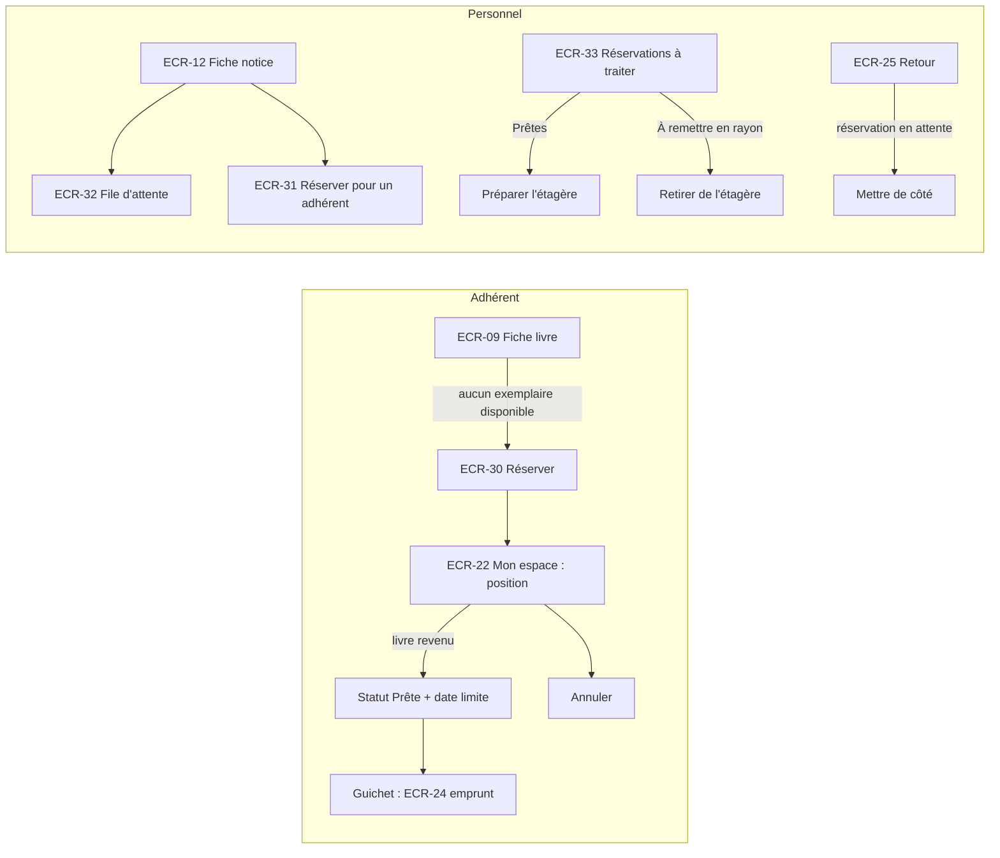

# UX — Réservations

> Réutilise le socle [UX-socle.md](UX-socle.md). Points d'entrée : fiche publique ECR-09, fiche notice gestion ECR-12, fiche adhérent ECR-18, espace adhérent ECR-22, guichet retour ECR-25 (mise de côté).

## 1. Parcours utilisateurs


## 2. Plan de navigation
| ECR | Route Angular | Rôles | Guard | US couvertes |
|---|---|---|---|---|
| ECR-30 | dialogue dans ECR-09 | MEMBER | — (bouton visible uniquement pour MEMBER) | US-032 |
| ECR-31 | dialogue dans ECR-12 | LIBRARIAN, ADMIN | — | US-032 (AC-032-8) |
| ECR-32 | panneau dans ECR-12 | LIBRARIAN, ADMIN | — | US-034, US-033 (annulation par le personnel) |
| ECR-33 | `/gestion/reservations` (`onglet=pretes|a-ranger`, `page`, `taille`) | LIBRARIAN, ADMIN | `authGuard`, `passwordChangeGuard`, `roleGuard` | US-035, US-036 (AC-036-2) |
| — | `app-reservation-cta` dans ECR-09 | tous | — | US-032, AC-034-3 |
| — | `app-cancel-reservation-action` dans ECR-22 (MEMBER) et ECR-18/ECR-32 (personnel) | MEMBER, LIBRARIAN, ADMIN | — | US-033 |

## 3. Écrans

### ECR-30 — Dialogue « Réserver ce livre » (adhérent)
- **Route** : dialogue dans ECR-09 · **Rôles** : MEMBER · **US/AC** : US-032 (AC-032-1 → AC-032-7)
- **Wireframe** (plein écran sous `sm`) :
```
┌──────────── Réserver ce livre ────────────┐
│ Bel-Ami — Guy de Maupassant                │
│ Tous les exemplaires sont empruntés.       │
│ 1 réservation avant vous : vous serez en   │
│ position 2.                                │
│ Quand un exemplaire reviendra, il sera mis │
│ de côté pour vous pendant 3 jours. Suivez  │
│ son statut dans « Mon espace ».            │
│ Réservations actives : 1 sur 3             │
│            [ Annuler ] [ Réserver ]        │
└────────────────────────────────────────────┘
```
- **Composants** : `app-reserve-dialog` (presentational) ouvert par `app-reservation-cta`.
- **Données lues** : réservabilité (oui/non + motifs), position prévisionnelle, nombre de réservations actives de l'adhérent / quota [RG-30], délai de retrait [RG-33]. **Données écrites** : réservation (id notice).
- **États** : chargement de la prévisualisation (spinner) · erreur standard · succès : fermeture, toast « Réservation enregistrée : vous êtes en position 2. », la fiche affiche la position (AC-032-1).
- **Si non réservable** : le dialogue affiche les motifs à la place du bouton « Réserver » (le bouton d'appel n'apparaît de toute façon pas si un exemplaire est disponible).
- **Messages serveur / motifs** (exacts) :
| Refus | Message exact |
|---|---|
| Exemplaire disponible (AC-032-2) [RG-29] | « Un exemplaire est disponible en rayon : vous pouvez l'emprunter directement. » |
| Aucun exemplaire en circulation (AC-032-3) | « Document indisponible : aucun exemplaire ne peut être réservé. » |
| Quota atteint (AC-032-4) [RG-30] | « Nombre maximal de réservations atteint (3). » (valeur fournie par le serveur) |
| Déjà réservé (AC-032-5) [RG-31] | « Vous avez déjà une réservation en cours pour ce livre. » |
| Déjà emprunté (AC-032-5) [RG-31] | « Vous avez déjà ce livre en cours d'emprunt. » |
| Non éligible (AC-032-6) [RG-23] | « Réservation impossible : » + libellés de motifs (UX-adherents ECR-18) |
- **data-testid** : `reserve-dialog`, `reserve-position-preview`, `reserve-quota`, `reserve-blocked-reason` (+ `data-reason`), `reserve-dialog-confirm`, `reserve-dialog-cancel`, `reserve-dialog-loading`, `reserve-server-error`

### ECR-31 — Dialogue « Réserver pour un adhérent » (personnel)
- **Route** : dialogue dans ECR-12 · **Rôles** : LIBRARIAN, ADMIN · **US/AC** : US-032 (AC-032-8 + mêmes règles AC-032-2 → AC-032-6)
- **Wireframe** :
```
┌──────── Réserver « Bel-Ami » pour un adhérent ────────┐
│ Carte adhérent [A000123____] ⏎                         │
│ MARTIN Jean · A000123 [Actif]                          │
│ ✓ Réservation possible · position prévue : 2           │
│ Réservations actives : 1 sur 3                         │
│                       [ Annuler ] [ Réserver ]         │
└────────────────────────────────────────────────────────┘
```
- **Composants** : `app-reserve-for-member-dialog` (smart léger) ; `app-scan-input`, `app-eligibility-panel` (variante réservation).
- **Données lues** : adhérent par numéro + réservabilité pour cette notice. **Données écrites** : réservation (id notice, numéro d'adhérent).
- **États** : chargement après scan · erreur (adhérent inconnu : « Aucun adhérent ne porte le numéro A000999. ») · succès : toast « Réservation enregistrée pour MARTIN Jean : position 2. », rafraîchissement d'ECR-32.
- **Formulaire** : carte adhérent, format `A` + 6 chiffres [RG-13], « Numéro d'adhérent invalide (format attendu : A000123). » ; motifs de refus identiques à ECR-30 avec « Cet adhérent a déjà… » au lieu de « Vous avez déjà… ».
- **data-testid** : `reserve-for-member-dialog`, `reserve-for-member-input`, `reserve-for-member-error`, `reserve-for-member-card`, `reserve-for-member-reason`, `reserve-for-member-confirm`, `reserve-for-member-cancel`

### ECR-32 — Panneau « File d'attente » (fiche notice gestion)
- **Route** : section de ECR-12 · **Rôles** : LIBRARIAN, ADMIN · **US/AC** : US-034 (AC-034-1, AC-034-2), US-033 (annulation par le personnel, [RG-34])
- **Wireframe** :
```
── File d'attente (4) ─────────────────────────────────────────────
┌────┬──────────────────────────┬─────────────┬──────────────────┬───────┐
│ #  │ Adhérent                 │ Réservé le  │ Statut           │       │
├────┼──────────────────────────┼─────────────┼──────────────────┼───────┤
│ —  │ BERNARD Luc (A000789)    │ 01/10/2026  │ [Prête] jusqu'au │[Annul.]│
│    │                          │             │ 20/10/2026 · ex. │       │
│    │                          │             │ 00004567         │       │
│ 1  │ MARTIN Jean (A000123)    │ 03/10/2026  │ [En attente]     │[Annul.]│
│ 2  │ PETIT Léa (A000078)      │ 05/10/2026  │ [En attente]     │[Annul.]│
└────┴──────────────────────────┴─────────────┴──────────────────┴───────┘
```
- **Composants** : `app-reservation-queue-panel` (smart léger, exporté vers catalogue) → tableau presentational ; `app-cancel-reservation-action`.
- **Données lues** : réservations actives de la notice : `READY` (adhérent, date limite, exemplaire) puis `PENDING` par position (adhérent, date-heure de réservation).
- **États** : chargement squelette 3 lignes · vide : « Aucune réservation en attente pour ce livre. » (AC-034-2) · erreur `app-error-state` local · succès.
- **data-testid** : `queue-panel`, `queue-row` (+ `data-row-id` = numéro d'adhérent, `data-status`), `queue-position`, `queue-ready-deadline`, `queue-cancel-action`, `queue-loading`, `queue-empty`, `queue-error`, `queue-error-retry`

### ECR-33 — Réservations à traiter
- **Route** : `/gestion/reservations` · **Rôles** : LIBRARIAN, ADMIN · **US/AC** : US-035 (AC-035-1 → AC-035-5), US-036 (AC-036-2)
- **Wireframe** :
```
┌──────────────────────── Gabarit personnel ───────────────────────────┐
│ Réservations à traiter                                                 │
│ [ Prêtes (3) ] [ À remettre en rayon (2) ]                             │
│ ── Prêtes ── (tri : date limite croissante)                            │
│ ┌──────────────┬─────────┬───────┬────────────────────┬──────────────┐ │
│ │ Titre        │ N° ex.  │ Cote  │ Adhérent           │ Retrait avant│ │
│ ├──────────────┼─────────┼───────┼────────────────────┼──────────────┤ │
│ │ Nana         │00004567 │ R ZOL │ BERNARD Luc A000789│ 17/10/2026 ⚠ │ │ (aujourd'hui)
│ │              │         │       │ ✉ E-mail non envoyé : appeler 06… │ │ (US-036)
│ │ Bel-Ami      │00003321 │ R MAU │ MARTIN Jean A000123│ 19/10/2026   │ │
│ └──────────────┴─────────┴───────┴────────────────────┴──────────────┘ │
│ ── À remettre en rayon ──                                              │
│ │ Germinal │00000877│R ZOL│ Expirée le 16/10 (PETIT Léa)│ → Remettre en rayon │
│ │ Nana     │00004568│R ZOL│ Expirée le 16/10 (DURAND P.)│ → Mettre de côté pour│
│ │          │        │     │                             │   BERNARD Luc A000789│
└────────────────────────────────────────────────────────────────────────┘
```
- **Composants** : `app-reservations-to-process-page` (smart) → `app-ready-reservations-table`, `app-released-copies-table` (presentational) ; `app-tabs`, `app-data-table`, `app-pagination`.
- **Données lues** : (Prêtes) réservations `READY` : titre, numéro d'exemplaire, cote, adhérent (numéro, nom, téléphone), date limite, échec d'envoi d'e-mail (US-036) ; (À remettre en rayon) réservations passées `EXPIRED` ou annulées depuis `READY` depuis la veille (Q-26) : titre, exemplaire, cote, ancien bénéficiaire, date, destination (rayon, ou nouveau bénéficiaire : numéro, nom, date limite). **Données écrites** : aucune (les expirations sont automatiques, [RG-33]).
- **États** : chargement squelette · vides : « Aucune réservation prête. » / « Aucun exemplaire à remettre en rayon. » · erreur standard · succès. Date limite = aujourd'hui → badge `warning` « Dernier jour » (texte, pas seulement couleur).
- **Libellés de destination** (exacts) : « Remettre en rayon : <cote> » ; « Mettre de côté pour <NOM Prénom> (<numéro>), à retirer avant le JJ/MM/AAAA » (AC-035-3).
- **data-testid** : `to-process-tab-ready`, `to-process-tab-released`, `ready-row` (+ `data-row-id` = numéro d'exemplaire), `ready-deadline`, `ready-last-day`, `ready-email-failed`, `released-row`, `released-destination` (+ `data-destination` = `shelf`/`hold`), `to-process-loading`, `ready-empty`, `released-empty`, `to-process-error`, `to-process-error-retry`

### Action transverse — Annuler une réservation (`app-cancel-reservation-action`)
- **Utilisé dans** : ECR-22 (adhérent, ses réservations), ECR-18 et ECR-32 (personnel) · **US/AC** : US-033 (AC-033-1 → AC-033-4)
- **Confirmation** : `app-confirm-dialog` « Annuler la réservation de « Bel-Ami » ? » ; pour une réservation `READY` : « L'exemplaire mis de côté sera proposé à l'adhérent suivant. »
- **Succès** : toast « Réservation annulée. » ; si annulée par le personnel alors qu'elle était `READY`, toast `warning` persistant avec la destination de l'exemplaire (même libellé qu'ECR-33).
- **Message serveur** : réservation close (AC-033-3) → « Cette réservation est déjà close. »
- **data-testid** : `cancel-reservation-button`, `cancel-reservation-dialog`, `cancel-reservation-confirm`, `cancel-reservation-cancel`, `cancel-reservation-server-error`

### Composant d'appel — `app-reservation-cta` (ECR-09)
Rendu selon la situation (données lues par ECR-09) :
| Situation | Rendu | data-testid |
|---|---|---|
| ≥ 1 exemplaire disponible | Texte « Un exemplaire est disponible en rayon. » | `book-reserve-available-info` |
| Visiteur, aucun disponible | Lien « Connectez-vous pour réserver » | `book-reserve-login-link` |
| MEMBER, réservable | Bouton « Réserver ce livre » → ECR-30 | `book-reserve-button` |
| MEMBER, réservation `PENDING` | « Vous êtes en position P sur T. » | `book-reservation-position` |
| MEMBER, réservation `READY` | « Votre réservation est prête : à retirer avant le JJ/MM/AAAA. » | `book-reservation-position` |
| Personnel connecté | Rien (réservation via ECR-31) | — |

### Notification par e-mail (US-036, COULD)
Pas d'écran : le contenu du message est défini ici pour l'Architecte. Objet : « Votre réservation est disponible — <titre> ». Corps : titre, auteur, « à retirer avant le JJ/MM/AAAA », horaires d'ouverture, lien vers « Mon espace ». En cas d'échec d'envoi, le marqueur `ready-email-failed` apparaît dans ECR-33 avec le téléphone de l'adhérent (AC-036-2).

## 4. Arborescence de composants
```
features/reservations/
  reservations.routes.ts               (/gestion/reservations)
  pages/
    reservations-to-process.page.ts    app-reservations-to-process-page (ECR-33)
  components/
    reservation-cta.component.ts       app-reservation-cta            (exporté : catalogue ECR-09)
    reserve-dialog.component.ts        app-reserve-dialog             (ECR-30)
    reserve-for-member-dialog.component.ts app-reserve-for-member-dialog (ECR-31)
    reservation-queue-panel.component.ts app-reservation-queue-panel  (ECR-32, exporté : catalogue ECR-12)
    cancel-reservation-action.component.ts app-cancel-reservation-action (exporté : adherents)
    ready-reservations-table.component.ts app-ready-reservations-table
    released-copies-table.component.ts app-released-copies-table
  data-access/
    reservation.service.ts             (prévisualisation, création, annulation, file d'une notice, à traiter)
    reservation.models.ts              (interfaces miroir des données §7)
    reservation-messages.ts            (codes de refus → messages exacts)
```

## 5. Design tokens & composants partagés
| Token / Composant | Valeur / Rôle | Nouveau ou existant |
|---|---|---|
| Tokens | [UX-socle §5.1](UX-socle.md) | Existant |
| Badge « Dernier jour » | `warning` + texte | Nouveau (règle d'affichage) |
| `app-tabs`, `app-confirm-dialog`, `app-scan-input`, `app-eligibility-panel` | Socle / adherents | Existant |

## 6. Accessibilité
| Écran | Point de contrôle WCAG | Mise en œuvre |
|---|---|---|
| ECR-30 | 1.4.10 Redistribution | Dialogue plein écran sous `sm` |
| ECR-30, ECR-31 | 3.3.1 | Motifs de refus listés en texte dans le dialogue, focus sur le premier motif |
| ECR-32 | 1.3.1 | Tableau avec `caption` « File d'attente de <titre> » ; la ligne `READY` est séparée visuellement et par son statut texte |
| ECR-33 | 2.4.6 | Onglets avec compteurs ; « Dernier jour » en texte |
| ECR-09 (AC-034-3) | Confidentialité | L'adhérent ne voit que sa position, jamais l'identité des autres (NFR-07) |

## 7. Besoins de données pour l'Architecte
| ECR | Opération | Données entrée | Données sortie | Pagination/Tri/Filtres |
|---|---|---|---|---|
| ECR-09 | Situation de réservation (adhérent connecté) | id notice | réservable (oui/non), motifs, réservation active éventuelle (statut, position, total, date limite) | Inclus dans la lecture de la fiche publique (UX-catalogue §7) |
| ECR-30, ECR-31 | Prévisualiser une réservation | id notice, (personnel) numéro d'adhérent | réservable, motifs, position prévisionnelle, nb réservations actives, quota, délai de retrait | — |
| ECR-30, ECR-31 | Créer une réservation | id notice, (personnel) numéro d'adhérent | id, statut `PENDING`, position ; refus : exemplaire disponible, aucun exemplaire en circulation, quota, doublon, déjà emprunté, non éligible (motifs) ; garantie en cas de concurrence (NFR-10) | — |
| ECR-22, ECR-18, ECR-32 | Annuler une réservation | id réservation | statut `CANCELLED`, destination de l'exemplaire si elle était `READY` ; refus : déjà close, réservation d'un autre adhérent (MEMBER) | — |
| ECR-32 | File d'attente d'une notice | id notice | réservations actives : statut, position, adhérent (numéro, nom, prénom), date-heure, date limite, exemplaire | Liste complète, tri `READY` puis position |
| ECR-33 | Réservations prêtes | — | titre, numéro d'exemplaire, cote, adhérent (numéro, nom, prénom, téléphone), date limite, échec d'envoi d'e-mail | Paginé 20 ; tri date limite croissante |
| ECR-33 | Exemplaires libérés à ranger | — | réservations `EXPIRED` ou annulées depuis `READY` depuis le début de la veille : titre, exemplaire, cote, ancien bénéficiaire, date, destination (rayon ou nouveau bénéficiaire + date limite) | Paginé 20 ; tri date décroissante |
| US-036 | Envoyer l'e-mail « réservation prête » | (événement passage `READY`) | statut d'envoi (envoyé / échec) consultable | — |

## 8. Questions ouvertes
| ID | Question | Hypothèse retenue | Impact |
|---|---|---|---|
| Q-26 | Quelle période couvre la liste « À remettre en rayon » (la SPEC ne prévoit pas d'action « traité ») ? | Réservations expirées ou annulées depuis le début de la veille ; pas d'acquittement enregistré | Ajout d'une action « Fait » persistante (donnée supplémentaire) |
