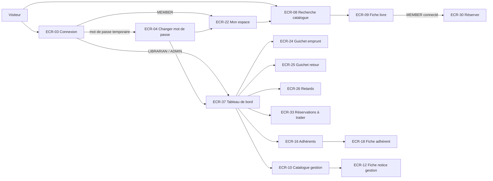

# UX — Socle transverse (design system, navigation, composants partagés)

> Document de référence pour toutes les UX par feature. Chaque `UX-<slug>.md` réutilise ce qui est défini ici sans le redéfinir.

## 0. Index des UX et des écrans
| Feature | Document | Écrans |
|---|---|---|
| socle | ce document | ECR-01, ECR-02 |
| authentification | [UX-authentification.md](UX-authentification.md) | ECR-03 → ECR-07 |
| catalogue | [UX-catalogue.md](UX-catalogue.md) | ECR-08 → ECR-15 |
| adherents | [UX-adherents.md](UX-adherents.md) | ECR-16 → ECR-23 |
| emprunts | [UX-emprunts.md](UX-emprunts.md) | ECR-24 → ECR-29 |
| reservations | [UX-reservations.md](UX-reservations.md) | ECR-30 → ECR-33 |
| penalites | [UX-penalites.md](UX-penalites.md) | ECR-34 → ECR-36 |
| pilotage | [UX-pilotage.md](UX-pilotage.md) | ECR-37 → ECR-40 |

Prochains identifiants libres : **ECR-41**, **Q-27**.

## 1. Parcours utilisateurs (vue globale)


## 2. Plan de navigation global
### 2.1 Gabarits (layouts)
| Gabarit | Composant | Utilisé par | Contenu |
|---|---|---|---|
| Public | `app-public-layout` | ECR-01, 02, 03, 08, 09 | En-tête : nom de la bibliothèque, champ de recherche catalogue, lien « Se connecter » ou menu utilisateur ; pied de page. Mobile-first (`sm`). |
| Adhérent | `app-member-layout` | ECR-04 (MEMBER), ECR-22, ECR-23 | En-tête public + onglets « Mon espace », « Catalogue », « Mes coordonnées » ; menu utilisateur (changer mot de passe, se déconnecter). Optimisé `sm`. |
| Personnel | `app-staff-layout` | Toutes les routes `/gestion/**`, ECR-04 (personnel) | Barre latérale fixe ≥ `lg` (repliée en menu tiroir < `lg`), en-tête avec nom + rôle de l'agent, raccourcis « Emprunt » et « Retour » toujours visibles. Optimisé `lg`. |

### 2.2 Menu latéral du personnel
| Entrée | Route | Rôles | Raccourci clavier |
|---|---|---|---|
| Tableau de bord | `/gestion` | LIBRARIAN, ADMIN | — |
| Guichet — Emprunt | `/gestion/guichet/emprunt` | LIBRARIAN, ADMIN | `Alt+E` |
| Guichet — Retour | `/gestion/guichet/retour` | LIBRARIAN, ADMIN | `Alt+R` |
| Adhérents | `/gestion/adherents` | LIBRARIAN, ADMIN | `Alt+A` |
| Catalogue | `/gestion/catalogue` | LIBRARIAN, ADMIN | `Alt+C` |
| Retards | `/gestion/retards` | LIBRARIAN, ADMIN | — |
| Réservations à traiter | `/gestion/reservations` | LIBRARIAN, ADMIN | — |
| Pénalités impayées | `/gestion/penalites` | LIBRARIAN, ADMIN | — |
| Catégories | `/gestion/categories` | LIBRARIAN, ADMIN | — |
| *Administration* (titre de groupe) | — | ADMIN | — |
| Comptes du personnel | `/gestion/comptes` | ADMIN | — |
| Statistiques | `/gestion/statistiques` | ADMIN | — |
| Paramètres | `/gestion/parametres` | ADMIN | — |
| Journal d'audit | `/gestion/audit` | ADMIN | — |

Le groupe *Administration* n'est pas affiché pour `LIBRARIAN` (et les routes restent protégées côté serveur, NFR-06).

### 2.3 Guards (fonctions `CanActivateFn`, dans `core/auth/`)
| Guard | Rôle | Comportement en cas d'échec |
|---|---|---|
| `authGuard` | Exige un utilisateur connecté | Redirige vers `/connexion?retour=<url demandée>` |
| `roleGuard(roles[])` | Exige l'un des rôles (`data.roles` de la route) | Redirige vers ECR-02 `/acces-refuse` |
| `passwordChangeGuard` | Si mot de passe temporaire [RG-05], interdit toute route sauf ECR-04 | Redirige vers `/compte/mot-de-passe?obligatoire=1` (AC-001-7) |
| `guestGuard` | Sur `/connexion` : utilisateur déjà connecté | Redirige vers l'accueil de son rôle |

Accueil par rôle après connexion : `MEMBER` → `/mon-espace` ; `LIBRARIAN`, `ADMIN` → `/gestion` ; sauf paramètre `retour` valide et autorisé pour le rôle.

## 3. Écrans du socle

### ECR-01 — Page introuvable
- **Route** : `**` · **Rôles** : tous · **US/AC** : AC-008-3, AC-018-4 (cas « introuvable »)
- **Wireframe** :
```
┌──────────────────────────────────────────┐
│  Page introuvable                         │
│  La page demandée n'existe pas ou a été   │
│  déplacée.                                │
│  [ Retour à l'accueil ]                   │
└──────────────────────────────────────────┘
```
- **Composants** : `app-not-found-page` (core/errors).
- **Données** : aucune. **États** : N/A — page statique.
- **Actions** : « Retour à l'accueil » → accueil du rôle (ou `/catalogue` si visiteur).
- **data-testid** : `not-found-title`, `not-found-home-link`

### ECR-02 — Accès refusé
- **Route** : `/acces-refuse` · **Rôles** : tous · **US/AC** : AC-002-2 et tous les AC « droits » (refus côté interface)
- **Wireframe** :
```
┌──────────────────────────────────────────┐
│  Accès refusé                             │
│  Vous n'avez pas les droits nécessaires   │
│  pour accéder à cette page.               │
│  [ Retour à l'accueil ]                   │
└──────────────────────────────────────────┘
```
- **Composants** : `app-forbidden-page` (core/errors).
- **Données** : aucune. **États** : N/A — page statique.
- **data-testid** : `forbidden-title`, `forbidden-home-link`

## 4. Arborescence Angular globale
```
frontend/src/app/
  app.config.ts / app.routes.ts      (routes racines, lazy loading par feature)
  core/
    auth/
      auth.service.ts                (signal currentUser, login, logout, changePassword)
      session-idle.service.ts        (inactivité RG-03 + avertissement)
      auth.guard.ts  role.guard.ts  password-change.guard.ts  guest.guard.ts
    http/
      auth.interceptor.ts            (ajoute l'authentification aux appels)
      problem-detail.interceptor.ts  (erreur serveur → message utilisateur, 401 → connexion)
    layout/
      public-layout/  member-layout/  staff-layout/
      app-header/  app-staff-sidebar/  app-user-menu/
    errors/
      not-found.page.ts  forbidden.page.ts
    notifications/
      toast.service.ts               (file de messages, aria-live)
  shared/
    ui/          (composants presentational listés §5.3)
    pipes/       date-fr.pipe.ts, euro.pipe.ts, status-label.pipe.ts
    models/      page.model.ts (page, taille, total), problem.model.ts, statuses.ts (énumérations §5.2)
    validators/  isbn.validator.ts, password-policy.validator.ts, postal-code.validator.ts, date-not-future.validator.ts
  features/
    authentification/  catalogue/  adherents/  emprunts/  reservations/  penalites/  pilotage/
      pages/  components/  data-access/
```
Chaque feature est chargée à la demande (`loadChildren`/`loadComponent`). Les pages (`*.page.ts`, sélecteur `app-…-page`) sont les seuls composants qui injectent des services ; les composants de `components/` et `shared/ui/` ne communiquent que par `input()`/`output()`.

## 5. Design tokens & composants partagés

### 5.1 Tokens Tailwind (`tailwind.config`)
Les tokens sont des alias de la palette Tailwind par défaut : **aucune valeur de couleur n'est écrite dans les templates**, seuls les noms de tokens sont utilisés.
| Token | Alias palette Tailwind | Usage | Contraste vérifié |
|---|---|---|---|
| `primary` / `primary-hover` / `primary-soft` | `blue-700` / `blue-800` / `blue-50` | Actions principales, liens, focus | `blue-700` sur blanc : 6,7:1 |
| `success` / `success-soft` | `green-700` / `green-50` | Statuts positifs (disponible, payé) | 5,0:1 sur blanc ; ≥ 4,6:1 sur `success-soft` |
| `warning` / `warning-soft` | `amber-800` / `amber-50` | Échéance proche, réservé, provisoire | 6,3:1 sur blanc |
| `danger` / `danger-soft` | `red-700` / `red-50` | Erreurs, retards, blocages, actions destructrices | 6,5:1 sur blanc |
| `info` / `info-soft` | `cyan-800` / `cyan-50` | Informations neutres (emprunté, en attente) | 7,4:1 sur blanc |
| `surface` / `surface-alt` | `white` / `gray-50` | Fonds de page, cartes, lignes alternées | — |
| `border` | `gray-300` | Bordures de champs et cartes | 3:1 avec `surface` (composant non textuel) |
| `muted` | `gray-600` | Texte secondaire | 7,5:1 sur blanc |
| `ink` | `gray-900` | Texte principal | 17:1 sur blanc |
| `focus` | `blue-600` | Anneau de focus `ring-2 ring-offset-2` | 5,2:1 |

**Typographie** : police système (`font-sans`) ; corps `text-base` (16 px) ; libellés `text-sm font-medium` ; titres de page `text-2xl font-semibold` ; chiffres de tableau `tabular-nums`.
**Espacements** : grille de 4 px ; gouttière de page `px-4` (mobile) / `px-8` (`lg`) ; cartes `p-4`/`p-6` ; `gap-4` entre blocs.
**Rayons et ombres** : `rounded-md` (champs, boutons), `rounded-lg` + `shadow-sm` (cartes), `shadow-xl` (dialogues).
**Mouvement** : transitions ≤ 150 ms ; toutes désactivées sous `motion-reduce:`.

### 5.2 Statuts : libellé FR et badge
Le badge affiche **toujours un libellé texte** (jamais la couleur seule) et une icône décorative `aria-hidden`.
| Énumération | Valeur | Libellé FR | Token |
|---|---|---|---|
| Compte | `ACTIVE` / `LOCKED` / `DISABLED` | Actif / Verrouillé / Désactivé | success / warning / muted |
| Exemplaire | `AVAILABLE` | Disponible | success |
| | `ON_LOAN` | Emprunté | info |
| | `RESERVED` | Mis de côté | warning |
| | `LOST` | Perdu | danger |
| | `WITHDRAWN` | Retiré | muted |
| État physique | `GOOD` / `WORN` / `DAMAGED` | Bon / Usé / Abîmé | success / warning / danger |
| Motif de retrait | `DAMAGED` / `LOST` / `WEEDED` / `OTHER` | Abîmé / Perdu / Désherbage / Autre | — |
| Adhérent | `ACTIVE` / `EXPIRED` / `SUSPENDED` / `ARCHIVED` | Actif / Expiré / Suspendu / Archivé | success / warning / danger / muted |
| Emprunt | `ACTIVE` / `OVERDUE` / `RETURNED` / `LOST` | En cours / En retard / Rendu / Perdu | info / danger / muted / danger |
| Réservation | `PENDING` / `READY` / `FULFILLED` / `EXPIRED` / `CANCELLED` | En attente / Prête / Retirée / Expirée / Annulée | info / success / muted / warning / muted |
| Pénalité | `UNPAID` / `PAID` / `WAIVED` | Impayée / Payée / Remise accordée | danger / success / muted |
| Motif de pénalité | `LATE_RETURN` / `LOST_ITEM` | Retard / Perte | — |
| Mode de paiement | `CASH` / `CARD` / `CHECK` | Espèces / Carte bancaire / Chèque | — |
| Rôle | `MEMBER` / `LIBRARIAN` / `ADMIN` | Adhérent / Bibliothécaire / Administrateur | — |

Source unique : `shared/models/statuses.ts` + `status-label.pipe.ts`.

### 5.3 Composants partagés (`shared/ui/`)
| Composant | Rôle | Entrées / sorties principales |
|---|---|---|
| `app-button` | Bouton (variantes `primary`, `secondary`, `danger`, `ghost`), état `loading` (spinner + `aria-busy`, désactivé) | `variant`, `loading`, `type` · `pressed` |
| `app-status-badge` | Badge de statut §5.2 | `kind` (énumération), `value` |
| `app-form-field` | Libellé + champ projeté + aide + message d'erreur (`aria-describedby`, `aria-invalid`) ; astérisque « obligatoire » | `label`, `hint`, `errors` (map erreur → message) |
| `app-data-table` | Tableau accessible (`<table>`, `<caption>`, en-têtes `scope`), tri par colonne (`aria-sort`), ligne cliquable optionnelle | `columns`, `rows`, `sort` · `sortChange`, `rowSelect` |
| `app-pagination` | Pagination serveur (taille par défaut **20**), « Page x sur y », précédente/suivante, choix 20/50/100 | `page`, `size`, `total` · `pageChange` |
| `app-loading-state` | Squelettes (lignes de tableau ou carte) + texte masqué « Chargement… » `role=status` | `variant` (`table`, `card`, `detail`), `rows` |
| `app-empty-state` | Illustration neutre, message, action optionnelle | `message`, `actionLabel` · `action` |
| `app-error-state` | Message d'erreur + bouton « Réessayer » ; `role=alert` | `message` · `retry` |
| `app-dialog` | Boîte de dialogue modale (`role=dialog`, `aria-modal`, piège du focus, `Échap` ferme, focus rendu à l'élément déclencheur) | `title`, `open` · `closed` |
| `app-confirm-dialog` | Confirmation d'action destructrice/irréversible : rappelle l'objet concerné ; bouton de confirmation `danger` ; option « saisir le mot de confirmation » pour l'irréversible | `title`, `message`, `confirmLabel`, `requireTyping` · `confirmed`, `cancelled` |
| `app-toast-outlet` | Affiche les messages du `ToastService` dans une région `aria-live="polite"` (succès) ou `assertive` (erreur) ; disparaissent après 6 s, sauf erreurs (fermeture manuelle) | — |
| `app-page-header` | Titre `h1`, fil d'Ariane, zone d'actions | `title`, `breadcrumbs` |
| `app-search-input` | Champ de recherche avec bouton, déclenchement sur `Entrée` ou après 300 ms d'inactivité, longueur minimale configurable | `minLength`, `placeholder` · `search` |
| `app-scan-input` | Champ optimisé lecteur de code-barres : focus automatique, validation sur `Entrée`, vidé et refocalisé après traitement, retour sonore optionnel désactivé par défaut | `label`, `pattern` · `scanned` |
| `app-autocomplete` | Saisie avec suggestions (`role=combobox`, `aria-expanded`, navigation flèches) ; option « Créer “…” » | `options`, `allowCreate` · `query`, `selected`, `create` |
| `app-tabs` | Onglets accessibles (`role=tablist`, flèches gauche/droite) | `tabs`, `active` · `activeChange` |
| `app-drawer` | Panneau latéral (mêmes règles d'accessibilité que `app-dialog`) | `title`, `open` · `closed` |
| `app-stat-card` | Indicateur chiffré cliquable (libellé + valeur `tabular-nums`) | `label`, `value`, `tone`, `link` |
| `app-description-list` | Liste libellé/valeur (`<dl>`) pour les fiches | `items` |
| `app-alert` | Bandeau d'information persistant (info, warning, danger) | `tone`, `title` |

### 5.4 Pipes et formats (NFR-05, NFR-11)
| Pipe | Exemple | Règle |
|---|---|---|
| `dateFr` | `07/11/2026` ; `17/10/2026 14:32` | Fuseau Europe/Paris |
| `euro` | `1,00 €` ; `20,80 €` | 2 décimales, virgule, espace insécable avant € |
| `statusLabel` | `ON_LOAN` → « Emprunté » | Table §5.2 |

### 5.5 Services transverses (`core/`)
| Service | Responsabilité |
|---|---|
| `AuthService` | État de session en signal (`currentUser` : identité, rôle, mot de passe temporaire, adhérent rattaché) ; connexion, déconnexion, changement de mot de passe ; rechargement de session au démarrage. |
| `SessionIdleService` | Surveille l'activité ; avertit 2 minutes avant la déconnexion d'inactivité [RG-03] par un dialogue « Votre session va expirer » avec « Rester connecté » ; à expiration, déconnecte et redirige vers ECR-03 avec le message de session expirée. |
| `ToastService` | Pousse les messages de succès/erreur vers `app-toast-outlet`. |
| `problemDetailInterceptor` | Traduit les erreurs serveur en messages (§5.6) ; 401 → déconnexion + ECR-03 ; 403 → message « droits » ; ne journalise jamais de donnée personnelle. |

### 5.6 Messages transverses (exacts)
| Situation | Message |
|---|---|
| Serveur injoignable / erreur réseau | « Le service est momentanément indisponible. Vérifiez votre connexion puis réessayez. » |
| Erreur inattendue (500) | « Une erreur inattendue est survenue. Réessayez ; si le problème persiste, contactez l'administrateur. » |
| Droits insuffisants (403) | « Vous n'avez pas les droits nécessaires pour effectuer cette action. » |
| Session expirée (401 ou inactivité) | « Votre session a expiré. Veuillez vous reconnecter. » |
| Modification concurrente (AC-010-3) | « Cet élément a été modifié entre-temps par un autre utilisateur. Rechargez la page pour voir la dernière version. » |
| Élément introuvable (404) | « L'élément demandé est introuvable. » |
| Champ obligatoire vide | « Ce champ est obligatoire. » |
| Enregistrement réussi (générique) | « Modifications enregistrées. » |

Les refus métier (quota, éligibilité…) ont des messages spécifiques définis dans chaque UX de feature. Le serveur renvoie un code de refus stable que le frontend traduit via une table de correspondance par feature (`data-access/<feature>-messages.ts`) ; si un code est inconnu, le texte fourni par le serveur est affiché.

### 5.7 Modèle des 4 états (appliqué à chaque vue de données)
| État | Rendu standard |
|---|---|
| Chargement | `app-loading-state` à la place exacte du contenu (pas de saut de mise en page) ; boutons d'action désactivés. |
| Vide | `app-empty-state` avec le message spécifique de l'écran. |
| Erreur | `app-error-state` avec le message §5.6 et « Réessayer » qui relance la même lecture. |
| Succès | Contenu ; les mises à jour asynchrones sont annoncées par `aria-live`. |

**États de formulaire** : *pristine* (bouton d'envoi actif, aucune erreur affichée) → *invalide* (erreurs affichées après sortie du champ ou tentative d'envoi ; focus déplacé sur le premier champ en erreur ; résumé d'erreurs `role=alert` en haut du formulaire si ≥ 2 erreurs) → *envoi* (bouton `loading`, champs en lecture seule) → *erreur serveur* (message dans un `app-alert danger` au-dessus du bouton, champs concernés marqués si le serveur les désigne, saisie conservée) → *succès* (toast + navigation ou fermeture du dialogue).

## 6. Accessibilité (règles transverses — NFR-03)
| Point de contrôle WCAG 2.1 | Mise en œuvre |
|---|---|
| 1.3.1 Information et relations | Titres hiérarchisés (un seul `h1` par page), tableaux avec `caption`/`th scope`, listes `dl` pour les fiches, `fieldset`/`legend` pour les groupes de champs. |
| 1.4.1 Utilisation de la couleur | Tous les statuts ont un libellé texte (§5.2) ; les erreurs ont une icône + texte. |
| 1.4.3 Contraste | Tokens §5.1 vérifiés ≥ 4,5:1. |
| 1.4.10 Redistribution | Aucune barre de défilement horizontale à 320 px, sauf tableaux (défilement horizontal limité au tableau, avec en-tête visible). |
| 2.1.1 Clavier | Toutes les actions accessibles au clavier ; raccourcis §2.2 annoncés dans les infobulles et désactivables. |
| 2.2.1 Réglage du délai | Avertissement d'inactivité 2 min avant [RG-03] avec prolongation possible (Q-19). |
| 2.4.1 Contourner des blocs | Lien « Aller au contenu » en premier élément focalisable. |
| 2.4.3 Parcours du focus | Ordre logique ; dialogues avec piège du focus et retour du focus. |
| 2.4.7 Focus visible | Anneau `focus-visible:ring-2 ring-focus ring-offset-2` sur tous les éléments interactifs. |
| 3.3.1 / 3.3.3 Identification et suggestion d'erreur | Messages exacts sous le champ, reliés par `aria-describedby`. |
| 4.1.3 Messages d'état | Toasts et résultats de scan dans des régions `aria-live`. |

## 7. Conventions `data-testid` (pour le QA)
- Forme : `<ecran>-<element>[-<action>]`, kebab-case, en anglais (ex. `loan-desk-copy-input`, `member-detail-renew-button`).
- Lignes de liste : `<liste>-row` + attribut `data-row-id` portant l'identifiant fonctionnel (numéro d'adhérent, numéro d'exemplaire…).
- États : `<ecran>-loading`, `<ecran>-empty`, `<ecran>-error`, `<ecran>-error-retry`.
- Champs : `<formulaire>-<champ>-input` ; message d'erreur : `<formulaire>-<champ>-error`.
- Badges : `status-badge` + `data-status="<VALEUR>"`.
- Dialogues : `<dialogue>-dialog`, `<dialogue>-confirm`, `<dialogue>-cancel`.
- Toasts : `toast-success`, `toast-error`.

## 8. Besoins de données transverses pour l'Architecte
| ECR | Opération | Données entrée | Données sortie | Pagination/Tri/Filtres |
|---|---|---|---|---|
| Tous | Session courante | — | Identité (nom, prénom, e-mail), rôle, indicateur « mot de passe temporaire », numéro d'adhérent rattaché si `MEMBER` | — |
| Tous | Format d'erreur | — | Code de refus stable, message lisible, liste éventuelle de champs en erreur avec motif, liste de motifs multiples (AC-025-5) | — |
| Toutes les listes | Pagination | page (à partir de 0), taille (20 par défaut, max 100), tri `champ,sens` | éléments, page, taille, total d'éléments, total de pages | — |

## 9. Questions ouvertes
| ID | Question | Hypothèse retenue | Impact |
|---|---|---|---|
| Q-19 | WCAG 2.2.1 impose de prévenir avant la déconnexion d'inactivité [RG-03] : la SPEC ne le mentionne pas. | Avertissement 2 minutes avant, avec « Rester connecté » (relève de NFR-03) | Si refusé : non-conformité WCAG AA |
| Q-20 | Les raccourcis clavier du guichet (`Alt+E`, `Alt+R`, `Alt+A`, `Alt+C`) sont-ils souhaités ? | Oui, pour l'objectif « emprunt en ≤ 30 s » (INDEX §1) et NFR-03 ; désactivables | Retrait des raccourcis uniquement |
